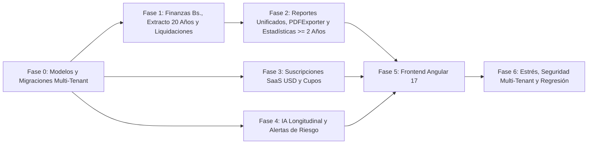

# Plan de Implementación por Fases — Sprint 4 (SIGEPSI)

Este plan cubre de extremo a extremo las **8 Historias de Usuario (`HU-49` a `HU-56`)** definidas en [sprint4.md](./sprint4.md), incorporando explícitamente:

1. **Dashboard gerencial integral** con acceso a **todos los reportes y consultas** del sistema (clínicos, operativos, IA, financieros y SaaS) exportables a **PDF, Excel y CSV**.
2. **Extracto histórico de pagos tipo bancario (hasta 20 años)** con saldo acumulado línea por línea (*running balance*), subtotales mensuales/anuales, paginación en servidor, PDF multipágina y Excel en streaming (`write_only`).
3. **Base de datos y estadísticas mínimas de 2 años (24+ meses)** con series longitudinales, comparativa interanual (YoY) y comando de población histórica realista.

---

## Arquitectura y Secuencia de Fases

---

## Fase 0 — Base de Datos, App `finanzas` y Migraciones Multi-Tenant

**Objetivo:** Dejar definidos y migrados todos los esquemas (`public` y `tenant`) sin romper la operación de Sprints 1–3.

### Cambios en Backend
1. **Crear nueva app `prototipo/backend/finanzas/`** y registrarla en:
   - `prototipo/backend/sigepsi/settings.py` (`TENANT_APPS` y `SHARED_APPS` siguiendo la convención actual).
   - `prototipo/backend/sigepsi/urls_tenant.py` y `prototipo/backend/sigepsi/urls_public.py` bajo `api/finanzas/` y `api/v1/finanzas/`.
2. **Modelos en `prototipo/backend/finanzas/models.py`** (esquema tenant):
   - `CuentaPaciente`: FK `Paciente`, `total_cargado`, `total_pagado`, `saldo_pendiente` (`DecimalField`, `BOB`), `ultima_actualizacion`.
   - `MovimientoFinanciero`: FK `CuentaPaciente`, FK opcional `Cita`, `tipo` (`CARGO`, `ABONO`, `AJUSTE`), `concepto`, `monto`, `fecha_movimiento`, índices en `(cuenta, fecha_movimiento)` y `(fecha_movimiento)` para soportar rangos de 20 años.
   - `PagoConsulta`: FK `CuentaPaciente`, FK opcional `Cita`, `monto`, `metodo_pago` (`EFECTIVO`, `QR_BANCARIO`, `TRANSFERENCIA`, `TARJETA_STRIPE`), `numero_recibo` correlativo único por tenant, `codigo_verificacion`, `registrado_por`, `fecha_pago`.
   - `LiquidacionHonorario` y `DetalleLiquidacionCita`: FK `Psicologo`, `fecha_inicio`, `fecha_fin`, `monto_bruto`, `porcentaje_comision_centro`, `comision_centro`, `monto_neto_psicologo`, `estado` (`GENERADA`, `PAGADA`, `ANULADA`), `referencia_bancaria`, `fecha_pago`, con restricción para impedir que una `Cita` se liquide dos veces en liquidaciones activas.
3. **Modelos en `prototipo/backend/clinica/models.py`** (esquema tenant):
   - `ResumenClinicoIA`: FK `Paciente`, FK `HistoriaClinica`, `estado` (`BORRADOR_IA`, `APROBADO_HITL`), `fuente` (`HF`, `FALLBACK`), `contenido_json`, `texto_resumen`, `hash_sha256`, `generado_por`, `aprobado_por`, `fecha_aprobacion`.
   - `AlertaRiesgoIA`: FK `Paciente`, `tipo` (`RIESGO_VITAL`, `RETROCESO_AGUDO`, `RIESGO_ABANDONO`, `CAIDA_ADHERENCIA`), `score_riesgo` (0–100), `severidad` (`BAJO`, `MEDIO`, `ALTO`, `CRITICO`), `factores_json`, `explicacion`, `estado` (`ABIERTA`, `EN_ATENCION`, `RESUELTA`, `DESCARTADA`), `nota_intervencion`, `atendido_por`, `fecha_resolucion`.
4. **Modelo en `prototipo/backend/subscriptions/models.py`** (esquema `public`):
   - `FacturaSaaS`: FK `Suscripcion`, FK `Tenant`, `stripe_session_id` / `stripe_invoice_id` (`unique=True` para idempotencia), `plan`, `monto_usd`, `moneda='usd'`, `estado`, `fecha_emision`, `fecha_renovacion`.

### Verificación de Fase 0
- Ejecutar `python manage.py makemigrations finanzas clinica subscriptions` y `python manage.py migrate_schemas`.

---

## Fase 1 — Finanzas Clínicas en Bs., Extracto Tipo Banco (20 Años) y Liquidaciones (`HU-52`, `HU-54`)

**Objetivo:** Implementar toda la operación de caja, el extracto masivo multi-anual y la liquidación de honorarios.

### Entregables Backend (`prototipo/backend/finanzas/`)
1. **`finanzas/services.py`:**
   - `registrar_cargo_cita(cita)` y `registrar_pago(...)` bajo `transaction.atomic()` + `select_for_update()` sobre `CuentaPaciente`. Valida montos `> 0`, no superar saldo sin permiso de abono (`400 Bad Request`), genera correlativo `REC-YYYY-NNNNNN` y registra evento en `audit/services.py`.
   - `obtener_extracto_bancario(paciente_id=None, fecha_desde, fecha_hasta, page, page_size)`:
     - Soporta rangos de hasta **20 años** (`7305 días`).
     - Calcula **saldo inicial anterior al rango**, **Debe (Cargo)**, **Haber (Abono)** y **Saldo Acumulado (*running balance*)** cronológico usando agregación SQL + `Window(Sum(...))` en PostgreSQL para máximo rendimiento.
     - Devuelve resumen anual/mensual (subtotales por año y mes) y listado paginado para la web.
   - `generar_liquidacion(psicologo_id, fecha_inicio, fecha_fin, porcentaje_comision)` y `marcar_liquidacion_pagada(liquidacion_id, referencia_bancaria)`: excluye sesiones ya liquidadas en liquidaciones no anuladas.
2. **`finanzas/pdf_utils.py` (con `reportlab`, ya en `requirements.txt`):**
   - `generar_recibo_pago_pdf(pago)` (`HU-52`): comprobante oficial en `Bs.` con código de verificación.
   - `generar_extracto_bancario_pdf(movimientos_qs, filtros, tenant_name)` (`HU-52`): PDF multipágina con `SimpleDocTemplate` + `Table(..., repeatRows=1)`, encabezado/pie con numeración `Página X de Y`, saldo inicial, líneas de movimiento, subtotales anuales y resumen final.
   - `generar_boleta_liquidacion_pdf(liquidacion)` (`HU-54`): detalle de sesiones, monto bruto, retención del centro y neto a pagar.
   - Exportador **Excel en streaming (`openpyxl.Workbook(write_only=True)`)** para extractos de miles de filas.
3. **`finanzas/views.py`, `serializers.py`, `urls.py`:**
   - `GET /api/finanzas/cuentas/`, `GET /api/finanzas/cuentas/<paciente_id>/`
   - `POST /api/finanzas/pagos/`, `GET /api/finanzas/pagos/<id>/recibo-pdf/`
   - `GET /api/finanzas/extracto/` (JSON paginado + `?formato=pdf|excel|csv`, `fecha_desde`, `fecha_hasta`, `paciente_id`, `metodo_pago`)
   - `GET/POST /api/finanzas/liquidaciones/`, `PATCH /api/finanzas/liquidaciones/<id>/pagar/`, `GET /api/finanzas/liquidaciones/<id>/boleta-pdf/`

---

## Fase 2 — Dashboard Gerencial Integral, Reportes Totales, `PDFExporter` y Datos Históricos $\ge 2$ Años (`HU-53`)

**Objetivo:** Unificar todos los reportes y consultas del sistema, habilitar exportación PDF oficial para cualquier reporte y garantizar datos estadísticos de mínimo 2 años.

### Entregables Backend
1. **Ampliar `prototipo/backend/reportes/services.py`:**
   - Añadir las nuevas fuentes del Sprint 4 a `FUENTES_DISPONIBLES`:
     - `pagos` (cobros en Bs. por método, paciente, psicólogo, recibo)
     - `cuentas_pacientes` (saldos pendientes y morosidad)
     - `extracto_pagos` (movimientos históricos multi-anuales)
     - `liquidaciones` (honorarios devengados y pagados por psicólogo)
     - `alertas_riesgo_ia` (alertas longitudinales e intervenciones)
     - `resumenes_ia` (auditoría de resúmenes HITL)
     - `facturas_saas` (solo SuperAdmin)
   - Incorporar **paginación opcional** (`page`, `page_size`) en `ReportEngine.generar()` para consultas web grandes sin saturar memoria.
2. **Agregar `PDFExporter` real en `prototipo/backend/reportes/exporters.py`:**
   - Implementar `PDFExporter.generar(resultado, nombre, tenant_name)` con `reportlab` (orientación horizontal automática si hay >6 columnas, encabezados repetidos por página y bloque de totales/resumen).
   - Optimizar `ExcelExporter` con modo `write_only=True` cuando `total > 2000` filas.
3. **Endpoints de Dashboard Gerencial Multi-Año (`finanzas/views.py`):**
   - `GET /api/finanzas/dashboard/`:
     - Soporta presets (`6m`, `12m`, `24m`, `2y`, `all`) y rango libre (`fecha_desde`, `fecha_hasta`), filtro por `psicologo_id` y `especialidad_id`.
     - Retorna:
       - **4 KPIs principales en Bs.**: Ingreso Bruto, Honorarios Profesionales, Margen Neto Real del Centro, Cartera por Cobrar + Índice de Morosidad (%).
       - **Serie mensual longitudinal ($\ge 24$ meses)**: `mes`, `ingreso_bruto`, `honorarios`, `margen_neto`, `citas_realizadas`, `tasa_ausentismo`.
       - **Comparativa interanual (YoY)**: Año actual vs. Año anterior (% de crecimiento/variación).
       - **Distribución por método de pago** y **por especialidad/psicólogo**.
       - **Catálogo de reportes/consultas disponibles** para lanzar cualquier consulta directamente desde el dashboard.
   - RBAC estricto: `403 Forbidden` para `Paciente` y `Psicólogo` sin permiso gerencial.
4. **Seeder histórico de $\ge 2$ años (`finanzas/management/commands/seed_historico_sprint4.py`):**
   - Genera **mínimo 24 meses (2 años completos)** de historial realista por tenant: citas (`REALIZADA`, `CANCELADA`, `INASISTENCIA`), cargos en `CuentaPaciente`, `PagoConsulta` por distintos métodos, `LiquidacionHonorario` mensuales, `NotaSesion`, `RegistroAnimo` y `AlertaRiesgoIA`.
   - Incluye opción `--anios-extracto 20` para poblar un paciente/centro de demostración con movimientos distribuidos a lo largo de **20 años** y validar el extracto bancario masivo.

---

## Fase 3 — Suscripciones SaaS, Stripe Idempotente y Cupos por Plan (`HU-55`)

**Objetivo:** Completar el gobierno comercial SaaS en USD sobre esquema `public`.

### Entregables Backend (`prototipo/backend/subscriptions/`)
1. **`subscriptions/views.py` y `urls.py`:**
   - Actualizar `VerifySessionView` y crear `StripeWebhookView` (`POST /api/subscriptions/webhook/`) con manejo idempotente de `stripe_session_id` / `stripe_invoice_id` para emitir `FacturaSaaS` sin duplicados.
   - Endpoints `SuperAdmin`:
     - `GET /api/subscriptions/admin/dashboard/`: MRR total en USD, distribución de planes, listado de tenants con estado (`ACTIVA`, `PENDIENTE`, `CANCELADA`), fecha de renovación e historial de `FacturaSaaS`.
     - `PATCH /api/subscriptions/admin/<id>/`: cambio de plan (`basico`, `profesional`, `empresarial`) y suspensión/reactivación.
2. **`subscriptions/quotas.py`:**
   - Funciones `validar_cupo_psicologos(tenant)` y `validar_cupo_pacientes(tenant)` leyendo los límites de `subscriptions/plans.py` (`basico`: 3 psicólogos / 50 pacientes; `profesional`: 10 / 200; `empresarial`: ilimitado).
   - Conectar validación en la creación de `Psicologo` y `Paciente` en `clinica/views.py` retornando error estructurado con sugerencia de upgrade.

---

## Fase 4 — IA Longitudinal y Consola de Alertas Prioritarias (`HU-49`, `HU-50`, `HU-51`)

**Objetivo:** Implementar resumen clínico longitudinal HITL y motor de detección/gestión de riesgo clínico.

### Entregables Backend (`prototipo/backend/clinica/`)
1. **`clinica/ia_resumen_service.py` (`HU-49`):**
   - Verifica mínimo 2 notas SOAP o evoluciones del paciente en el tenant.
   - Recolecta motivo inicial, notas SOAP, evoluciones, tendencia de `RegistroAnimo` y adherencia de `TareaTerapeutica`.
   - Aplica `PreconsultaRulesEngine.sanitizar_pii()` antes de invocar Hugging Face (`antidino-iacupficct.hf.space`, `timeout=15s`).
   - Si HF falla o excede 15s, ejecuta fallback extractivo determinístico local en Django.
   - Calcula `hash_sha256`, crea `ResumenClinicoIA` en `BORRADOR_IA` con etiqueta obligatoria `"Borrador IA — Requiere Revisión Profesional"`, y nunca escribe `DiagnosticoCIE` automáticamente.
   - Flujo HITL: edición y aprobación (`APROBADO_HITL`) registrando `aprobado_por`, fecha y auditoría.
   - RBAC: si un psicólogo no asignado intenta leer/generar, retorna `403 Forbidden` y registra en `CE_AuditLog`.
2. **`clinica/ia_riesgo_service.py` (`HU-50`):**
   - Evalúa 4 señales por paciente:
     1. Léxico de riesgo vital en notas SOAP / check-ins (reutilizando patrones de crisis de `chatbot_service.py` / `ia_rules_engine.py`).
     2. $\ge 3$ registros consecutivos de `RegistroAnimo` con nivel $\le 2/5$.
     3. $\ge 2$ citas `INASISTENCIA` consecutivas o $>21$ días sin cita.
     4. Caída de adherencia en `TareaTerapeutica` (tareas vencidas/incumplidas).
   - Calcula `score_riesgo` (0–100), severidad (`BAJO`, `MEDIO`, `ALTO`, `CRITICO`), factores explicables y evita duplicados actualizando la alerta abierta existente del mismo tipo/paciente.
3. **Endpoints en `clinica/views.py` y `clinica/urls.py` (`HU-49`, `HU-50`, `HU-51`):**
   - Resúmenes IA: `GET/POST /api/clinica/pacientes/<id>/resumenes-ia/`, `PATCH /api/clinica/resumenes-ia/<id>/aprobar/`, `GET /api/clinica/resumenes-ia/<id>/pdf/`.
   - Alertas Riesgo IA: `POST /api/clinica/alertas-riesgo/evaluar/`, `GET /api/clinica/alertas-riesgo/` (orden `CRITICO` → `ALTO` → `MEDIO` → `BAJO` y score desc), `PATCH /api/clinica/alertas-riesgo/<id>/transicion/` (bloqueando `RESUELTA`/`DESCARTADA` sin `nota_intervencion` y auditando en `CE_AuditLog`).

---

## Fase 5 — Frontend Angular 17 (Web)

**Objetivo:** Construir todas las interfaces del Sprint 4 integradas al layout y guards existentes.

### Servicios y Modelos (`prototipo/web/src/app/core/`)
- `models/finanzas.model.ts` y `services/finanzas.service.ts` (cobros, extracto 20 años, dashboard 24+ meses, liquidaciones, descargas Blob PDF/Excel).
- `services/ia-longitudinal.service.ts` (resúmenes HITL y consola de alertas de riesgo).
- Extender `services/subscription.service.ts` y `services/report.service.ts` (soporte descarga PDF).

### Componentes Nuevos y Actualizaciones (`prototipo/web/src/app/modules/`)
1. **`modules/finanzas/caja-clinica.component.ts` (`HU-52`):**
   - Tarjetas de estado de cuenta (`Total Cargado`, `Total Pagado`, `Saldo Pendiente` en `Bs.`).
   - Modal de registro de pago con pills de método (`Efectivo`, `QR Bancario`, `Transferencia`, `Tarjeta`) y descarga de recibo PDF.
   - Pestaña **Extracto Histórico Tipo Banco (hasta 20 años)**: selector de rango amplio, tabla paginada (`Fecha`, `Recibo`, `Concepto`, `Debe`, `Haber`, `Saldo Acumulado`), resumen por año y botones **Descargar PDF Multipágina** / **Exportar Excel**.
2. **`modules/finanzas/dashboard-financiero.component.ts` (`HU-53`):**
   - 4 KPIs gerenciales en `Bs.` + selector de horizonte (`12 meses`, `24 meses / 2 años`, `Rango libre`) + toggle de comparativa interanual (YoY).
   - Gráficas de tendencia multi-año (Ingreso Bruto vs. Honorarios vs. Margen Neto) y distribución por método/especialidad.
   - **Sección Centro Integral de Reportes y Consultas**: acceso directo a todas las fuentes del sistema (clínicas, agenda, IA, caja, extracto, liquidaciones, auditoría) con vista rápida y exportación PDF/Excel/CSV.
3. **`modules/finanzas/liquidaciones-honorarios.component.ts` (`HU-54`):**
   - Selector de periodo y psicólogo, indicador de reparto (`70% Psicólogo / 30% Centro`), desglose de sesiones, botón emitir/marcar pagada y descarga de boleta PDF.
4. **`modules/suscripciones/saas-admin-dashboard.component.ts` (`HU-55`):**
   - Consola SuperAdmin con MRR en `USD`, conteo de tenants activos, chips de planes, tabla de suscripciones, cambio/suspensión de plan y drawer de `FacturaSaaS`.
5. **Drawer Resumen IA en `modules/historias-clinicas/historia-clinica-detalle.component.ts` (`HU-49`):**
   - Banner ámbar `"Borrador IA — Requiere Revisión Profesional"`, secciones estructuradas, botón `"Editar y Aprobar (HITL)"` y `"Exportar PDF"`.
6. **`modules/alertas-riesgo/consola-alertas-riesgo.component.ts` (`HU-50`, `HU-51`):**
   - Tabs por estado/severidad, indicador de score 0–100, chips de factores explicables, modal de intervención obligatoria y conexión con `layout/alertas-crisis-badge.component.ts`.
7. **Navegación y Guards:**
   - Registrar rutas en `prototipo/web/src/app/app.routes.ts` y entradas en `prototipo/web/src/app/layout/main-layout.component.ts` respetando roles (`SuperAdmin`, `Admin Centro`, `Recepcionista`, `Psicólogo`).

---

## Fase 6 — Certificación Final: Estrés, Multi-Tenant y Regresión (`HU-56`)

**Objetivo:** Verificar calidad productiva, concurrencia, aislamiento y rendimiento de reportes grandes antes del congelamiento.

### Suites y Verificaciones (`prototipo/backend/tests/`)
1. `test_sprint4_finanzas.py`: atomicidad de pagos, rechazos `400`, recibo PDF, **extracto de 20 años** (running balance, subtotales, PDF multipágina y Excel streaming), KPIs gerenciales de **24 meses**, anti-doble liquidación y boleta PDF.
2. `test_sprint4_saas.py`: idempotencia de Stripe webhook/verify, MRR USD, `FacturaSaaS` y bloqueo por cupos (`max_psicologos`, `max_pacientes`).
3. `test_sprint4_ia_longitudinal.py`: sanitización PII, timeout/fallback determinístico, SHA-256, flujo HITL, `403` cross-psicólogo + auditoría, motor de 4 señales de riesgo, deduplicación y nota obligatoria al resolver/descartar.
4. `test_sprint4_estres_multitenant.py`:
   - 30+ peticiones concurrentes (`ThreadPoolExecutor`) sobre citas (`SELECT FOR UPDATE`), cobros (`transaction.atomic()`) e inferencia IA con `0%` errores `5xx` y sin deadlocks.
   - Aislamiento estricto multi-tenant: JWT de `centro_esperanza` rechazado en `mentesana` en expedientes, pagos, extractos y resúmenes IA.
   - Prueba de rendimiento del extracto de 20 años y estadísticas de 24 meses.
5. **Script consolidador `prototipo/backend/verify_sprint4.py`** + regresión completa de suites S1–S4 y compilación de producción Angular (`npm run build` en `prototipo/web`).
