# CAPÍTULO 7 – DESARROLLO SPRINT 3 (SIGEPSI)

> **Periodo oficial de desarrollo:** 09 de octubre al 02 de noviembre de 2026  
> **Entrega formal del incremento:** 02 de noviembre de 2026  
> **Fecha oficial de presentación y defensa docente:** 03 y 05 de noviembre de 2026 *(Conforme a las secciones 1.2.8 y 3.11 de la memoria general del proyecto)*  
> **Asignatura:** Sistemas de Información II (SI2 – Semestre 2-2026) – Grupo 9  
> **Proyecto:** SIGEPSI – Plataforma Web y Móvil de Gestión Integral de Centros de Salud Mental  
> **Casos de uso incorporados en el Sprint 3:** `CU12` (Gestionar recordatorios y notificaciones automáticas), `CU21` (Clasificar motivo de consulta mediante Inteligencia Artificial) y `CU22` (Sugerir asignación de paciente a psicólogo mediante Inteligencia Artificial).  
> **Alcance técnico central:** Despliegue de la Experiencia Móvil de Pacientes en Flutter 3.x (tareas `SP3-68` a `SP3-76`), Servicio de Notificaciones Push FCM (`CU12`), Motor Asistivo de Clasificación de Motivos de Consulta por IA (`CU21`), y Algoritmo Multivariable de Sugerencia y Emparejamiento de Psicólogos (`CU22`) con Consola Web de Triaje y Validación Humana para el Coordinador Clínico.

---

## Resumen Ejecutivo del Incremento del Sprint 3

El presente documento formaliza la planificación, arquitectura, desarrollo de software, modelado analítico, pruebas y ceremonias ágiles correspondientes al **Sprint 3** del proyecto **SIGEPSI** (Plataforma Web y Móvil de Gestión Integral de Centros de Salud Mental).

Tras sentar las bases de la infraestructura multi-tenant en el Sprint 0, los módulos de agenda y teleconsulta web en el Sprint 1, y el núcleo clínico médico-legal (HCE, notas SOAP, consentimientos SHA-256, reportes QBE y backup en la nube) en el Sprint 2, el **Sprint 3** representa la convergencia ubicua y asistiva de la plataforma:
1. **Canal Móvil de Pacientes (Flutter 3.x):** Entrega de la aplicación cliente para smartphones Android e iOS que empodera al paciente con autenticación persistente JWT cifrada, visualización de agenda personalizada, políticas de cancelación de citas ($>24$h), sala nativa de teleconsulta WebRTC (Jitsi Meet), autorreporte reflexivo de tareas terapéuticas inter-sesiones y registro diario del estado de ánimo (*Mood Tracker*).
2. **Servicio de Notificaciones Push en Tiempo Real (CU12):** Integración con Firebase Cloud Messaging (FCM) y cron jobs en segundo plano para despachar recordatorios preventivos de citas (24 horas y 1 hora antes) y alertas de nuevas tareas asignadas por el terapeuta.
3. **Módulo de Inteligencia Artificial para Triaje y Clasificación de Motivos (CU21):** Pipeline de procesamiento lingüístico y heurístico que ingesta las respuestas de preconsulta (intake), ejecuta sanitización estricta de datos personales sensibles (PII), categoriza el motivo en áreas temáticas (ansiedad, depresión, pareja, infanto-juvenil, duelo) y determina el nivel de severidad y banderas de crisis autolítica.
4. **Algoritmo Multivariable de Emparejamiento y Sugerencia de Psicólogos (CU22):** Motor matemático de matching que calcula la idoneidad clínica de los terapeutas según especialidad requerida (40%), disponibilidad horaria (30%), balanceo de carga para evitar saturación profesional (20%) y modalidad de atención (10%), desplegando el resultado en una consola web en Angular 17 con **supervisión humana obligatoria (*Human-in-the-Loop*)** para el Coordinador Clínico.

### Contextualización del Modelo de Negocio (Sede Física vs. Clínica Virtual SaaS)

En estricta correspondencia con los requerimientos operativos de la salud mental contemporánea y el marco metodológico de la asignatura, SIGEPSI responde a la dualidad funcional de los centros psicológicos:
1. **Sede Física (Consultorios y Gabinetes Presenciales):** Comprende la recepción física de pacientes, atención en consultorios médicos, validación de documentación de identidad en ventanilla, levantamiento de notas clínicas en estaciones de trabajo de escritorio y firma de consentimientos informados en terminales o tabletas de recepción.
2. **Clínica Virtual y Telepsicología (Canal Digital Ubicuo):** Permite la atención remota y continua a través del portal web (Angular 17) y la aplicación móvil del paciente (Flutter 3.x), integrando salas de teleconsulta seguras punto a punto mediante WebRTC (Jitsi Meet), llenado móvil del cuestionario de intake previo a la sesión, seguimiento asíncrono de tareas terapéuticas inter-sesiones, formalización de consentimientos con sellado criptográfico SHA-256 desde cualquier dispositivo y orientación interactiva continua mediante el chatbot institucional en Web y Móvil.

Bajo la arquitectura **SaaS Multi-Tenant**, múltiples organizaciones médicas (centros privados, gabinetes universitarios y redes de salud) operan de forma simultánea e independiente sobre la misma infraestructura en la nube, garantizando el aislamiento absoluto de los datos clínicos de sus pacientes por esquema de base de datos en PostgreSQL 16.

### Trazabilidad con Sprints Anteriores y Alcance Exclusivo del Sprint 3

Para mantener la estricta coherencia metodológica con el **Product Backlog** (sección 3.6 de `documentacion/intento.md`) y la **Planificación de Casos de Uso por Sprint** (secciones 3.9 y 3.11 de `documentacion/intento.md`), se clarifica el estado de los casos de uso:

* **Casos de uso ya implementados y concluidos en Sprints anteriores:**
  * **Sprint 0:** `CU1` (Gestión de centros y multi-tenant), `CU2` (Inicio de sesión y autenticación), `CU3` (Gestión de usuarios), `CU4` (Roles y permisos RBAC) y `CU27` (Recuperación de contraseña).
  * **Sprint 1:** `CU6` (Gestión de psicólogos), `CU7` (Gestión de pacientes), `CU8` (Disponibilidad horaria), `CU9` (Dashboard administrativo), `CU10` (Alertas tempranas), `CU11` (Gestión de citas y agenda) y `CU13` (Teleconsultas y videoconferencias).
  * **Sprint 2:** `CU5` (Bitácora confidencial cifrada con llave única), `CU14` (Formulario previo e intake digital), `CU15` (Historia clínica CIE-10/11), `CU16` (Notas SOAP inmutables), `CU17` (Evolución y tareas terapéuticas), `CU18` (Consentimientos informados SHA-256), `CU19` (Cierre y derivación psiquiátrica), `CU20` (Chatbot de orientación), `CU25` (Reportes QBE multiformato con comandos de voz) y `CU28` (Backup y restore en la nube).
* **Alcance Exclusivo del Sprint 3:**
  1. **Nuevos Casos de Uso del Product Backlog:**
     * **`CU12`:** Gestionar recordatorios y notificaciones automáticas (Push Notifications en tiempo real mediante Firebase Cloud Messaging - FCM).
     * **`CU21`:** Clasificar motivo de consulta mediante Inteligencia Artificial (análisis de intake, detección de áreas temáticas y cálculo de severidad con salvaguardas éticas).
     * **`CU22`:** Sugerir asignación de paciente a psicólogo mediante Inteligencia Artificial (matching multivariable considerando especialidad, disponibilidad horaria, modalidad y balanceo de carga, con validación humana obligatoria en consola web).
  2. **Implementación de la Aplicación Móvil de Pacientes en Flutter 3.x (Tareas `SP3-68` a `SP3-76`):**
     * Despliegue del cliente móvil nativo en Flutter para que el paciente acceda desde su smartphone a: autenticación segura con JWT persistente (`CU2` Móvil), consulta interactiva de su agenda de citas (`CU11` Móvil), cancelación con política de anticipación ($>24$h), sala de teleconsulta WebRTC nativa (`CU13` Móvil), módulo de entrega de tareas terapéuticas con autorreflexión (`CU17` Móvil) y registro diario de estado de ánimo (*Mood Tracker*).

> [!IMPORTANT]
> **Reasignación Cíclica de Roles y Tarea de Implementación de Mujica:**  
> En conformidad con la directriz metodológica del Sprint 3, se aplicó la rotación formal de roles SCRUM entre los 6 integrantes:  
> • **Mujica Vallejos Andy Mauricio:** Product Owner *(con desarrollo técnico activo del motor de IA y matching `SP3-77`)*  
> • **Larrazabal Rojas Julio Cesar:** Scrum Master *(con desarrollo de prototipos UI/UX en Flutter `SP3-71, SP3-74` y consola de triaje)*  
> • **Condori Diaz Marilyn Esther:** Development Team *(Rotada formalmente a desarrollo móvil Flutter: Citas y FCM Push `SP3-72`)*  
> • **Romero Saavedra Maria Ilse:** Development Team *(Rotada formalmente a desarrollo móvil Flutter: Tareas, Mood Tracker y Teleconsulta `SP3-75`)*  
> • **Delgado Rojas Alberto Caleb:** Development Team *(Arquitectura Flutter, Auth JWT móvil y soporte FCM `SP3-68, SP3-69`)*  
> • **Velasco Soliz Rolando:** Development Team *(QA Lead y testing integral de caja negra en móviles e IA `SP3-70, 73, 76, 78`)*  

---

## SECCIÓN ESPECIAL: Correcciones Metodológicas Dictadas por la Cátedra (Audio Sprint 3)

En estricta observancia de las observaciones, retroalimentaciones y lineamientos directos formulados por la docente evaluadora para el Sprint 3 (`datos/Sprint3.txt`), el equipo ha incorporado las siguientes correcciones estructurales:

### 1. Corrección Metodológica en el Análisis y Diseño de Clases (Patrón VOPC / BCE)

* **Diagnóstico del Error Común Señalado por la Docente:**  
  La docente constató que en diagramas de clases previos, varios grupos cometieron el error de reproducir mecánicamente el trazado de un diagrama de comunicación dentro del diagrama de clases. En dicho error, las clases que representan entidades secundarias, detalles o catálogos (por ejemplo: teléfono de la persona, profesión o historial de citas) eran conectadas **directamente al controlador** como si el controlador interactuara con cada tabla de forma plana.
* **Directriz Metodológica Oficial Dictada:**
  1. **Interfaz de Usuario (Boundary / Vista):** Representa la interacción con el usuario (formulario, panel, app móvil o pantalla de consulta). Posee atributos propios de la interfaz gráfica y métodos orientados a eventos (`crear()`, `editar()`, `mostrar()`, `enviar()`, etc.).
  2. **Clase Control (Controller / Gestor de Negocio):** Ubicada en la capa lógica/backend. Implementa los métodos que gobiernan las transacciones del negocio (`registrar()`, `modificar()`, `actualizar()`, `validar()`, `consultar()`). Esta clase **no inventa atributos ajenos**, sino que orquesta las operaciones utilizando el modelo del dominio.
  3. **Conexión Exclusiva a la Entidad Principal:** El Controlador se comunica **únicamente con la clase entidad principal (raíz del agregado o entidad principal del caso de uso)**.
  4. **Estructura Jerárquica y Multiplicidad de Entidades:** La entidad principal es la que se asocia con sus entidades secundarias o dependientes mediante relaciones de agregación/asociación con multiplicidades explícitas (por ejemplo: una `Persona` tiene $1 \dots *$ teléfonos; una `Cita` tiene $0 \dots *$ notificaciones push; una `ClasificacionIA` tiene $1 \dots *$ criterios de severidad evaluados).
  5. **Regla de Oro:** **Ninguna entidad secundaria o detalle debe conectarse directamente a la clase control.** Toda interacción se canaliza a través de la entidad principal, respetando la arquitectura en tres capas (Presentación $\to$ Lógica de Negocio $\to$ Entidad Principal $\to$ Entidades de Detalle).

```
   [ENFOQUE INCORRECTO - OBSERVADO POR LA DOCENTE]
   Interfaz (UI)  --->  Controlador  --->  Entidad Principal (Persona)
                             |--------->  Entidad Detalle 1 (Telefono)    <-- ERROR: Conexión directa
                             |--------->  Entidad Detalle 2 (Profesion)   <-- ERROR: Conexión directa

   [ENFOQUE CORRECTO - APLICADO EN SPRINT 3]
   Interfaz (UI)  --->  Controlador  --->  Entidad Principal (Persona)
                                                    |
                                                    +--- (1..*) ---> Entidad Detalle 1 (Telefono)
                                                    +--- (1..*) ---> Entidad Detalle 2 (Profesion)
```

### 2. Finalización y Detalle Exhaustivo del Modelo C4 de Arquitectura

La docente remarcó que para el Sprint 3 debe entregarse la versión final y definitiva de la arquitectura lógica y física bajo el **Modelo C4**. Específicamente, se subsana la falta de detalle en los módulos y paquetes de software, presentando el contenido minucioso de cada uno de los 6 paquetes del sistema más el paquete móvil cliente, detallando sus controladores, servicios de lógica de negocio, pasarelas de integración e interfaces.

### 3. Rotación de Roles y Desarrollo Móvil Obligatorio

En cumplimiento directo de la sugerencia docente: *"los que han hecho web hasta este momento les toca hacer móvil, ya no seamos cómodos y quedemos web con todo el semestre... cambie de rol, no se conforme con decir yo soy Scrum Master y se acabó"*:
* **Rotación de Liderazgo:**
  * **Product Owner:** Asume **Mujica Vallejos Andy Mauricio**, quien además de velar por el Product Backlog y los criterios de aceptación clínicos, **desarrolla tareas técnicas clave** en la implementación del motor de IA para clasificación de consultas y emparejamiento de terapeutas (`SP3-77`).
  * **Scrum Master:** Asume **Larrazabal Rojas Julio Cesar**, quien conduce las ceremonias, gestiona los impedimentos técnicos de emuladores y dependencias móviles y desarrolla interfaces UI/UX en Flutter (`SP3-71`, `SP3-74`).
* **Transición Web $\to$ Móvil (Flutter):**
  * **Condori Diaz Marilyn Esther** y **Romero Saavedra Maria Ilse**, quienes en sprints anteriores desarrollaron principalmente componentes backend y frontend web, asumen en este Sprint 3 la programación activa en **Flutter 3.x** (módulos de notificaciones push, gestión móvil de citas, teleconsulta WebRTC y seguimiento terapéutico).
  * **Delgado Rojas Alberto Caleb** lidera la integración de la arquitectura móvil, autenticación JWT en Flutter y servicios FCM.
  * **Velasco Soliz Rolando** asume la responsabilidad transversal de Aseguramiento de Calidad (QA), ejecutando la suite completa de pruebas de caja negra sobre la app móvil y el motor de IA.

---

## 7.1 SPRINT PLANNING

### 7.1.1 Objetivos del Sprint 3

El Sprint 3 tiene como propósito consolidar la interacción ubicua del paciente mediante la aplicación móvil nativa (Flutter 3.x) y desplegar las capacidades de inteligencia artificial aplicada al triaje clínico institucional. Al concluir este Sprint, el equipo entrega un incremento de software utilizable y potencialmente desplegable que comprende:

1. **Gestión de Recordatorios y Notificaciones Automáticas (CU12):** Implementar la infraestructura de notificaciones push en tiempo real mediante Firebase Cloud Messaging (FCM), configurando recordatorios preventivos de citas (24 horas y 1 hora de anticipación) y avisos de nuevas tareas terapéuticas asignadas.
2. **Clasificación Asistida del Motivo de Consulta por IA (CU21):** Construir el pipeline de procesamiento lingüístico y heurístico que analiza las respuestas del formulario de preconsulta (intake), sanitizando datos personales (PII), categorizando el motivo en áreas temáticas (ansiedad, depresión, pareja, infanto-juvenil, duelo) y determinando el nivel de severidad y banderas de riesgo.
3. **Sugerencia y Emparejamiento de Psicólogos por IA (CU22):** Implementar el algoritmo de matching multivariable que calcula la idoneidad clínica de los terapeutas según especialidad requerida, disponibilidad horaria, modalidad (presencial/virtual) y balanceo de carga de pacientes activos.
4. **Consola Web de Triaje con Validación Humana (CU22):** Proveer al Coordinador Clínico un panel interactivo en Angular 17 para revisar las sugerencias de la IA, auditar las justificaciones y confirmar o reasignar manualmente al profesional, garantizando el principio de supervisión médica obligatoria (*Human-in-the-Loop*).
5. **Autenticación y Experiencia Móvil de Pacientes en Flutter (SP3-68 a SP3-70):** Construir el acceso móvil seguro de pacientes mediante tokens JWT persistentes en almacenamiento cifrado seguro (`flutter_secure_storage`).
6. **Agenda y Consulta de Citas Móviles con Políticas de Cancelación (SP3-71 a SP3-73):** Permitir al paciente visualizar sus citas programadas, historial de sesiones y solicitar cancelación o reprogramación sujeta a la política institucional de 24 horas de anticipación.
7. **Teleconsulta Móvil WebRTC y Seguimiento de Tareas (SP3-74 a SP3-76):** Permitir el ingreso directo a salas virtuales seguras de Jitsi Meet embebidas en Flutter, la visualización de tareas prescritas con autorreflexión y el registro diario de estado de ánimo (*Mood Tracker*).

#### Casos de Uso Contemplados en el Sprint 3

|  ID CU   | Descripción del Caso de Uso | Estado | Móvil | Web | Sprint | Requisitos Funcionales Asociados |
| :------: | :-------------------------- | :----: | :---: | :-: | :----: | :------------------------------- |
| **CU12** | Gestionar recordatorios y notificaciones automáticas (Push FCM) | Implementado |   X   |  X  |  SP3   | RF-18, RNF-18 |
| **CU21** | Clasificar motivo de consulta mediante Inteligencia Artificial | Implementado |   X   |  X  |  SP3   | RF-10, RNF-19 |
| **CU22** | Sugerir asignación de paciente a psicólogo mediante Inteligencia Artificial | Implementado |       |  X  |  SP3   | RF-11, RNF-19 |
| *(Móvil)*| Despliegue de Interfaces Cliente Móvil de Pacientes en Flutter 3.x (`CU2`, `CU11`, `CU13`, `CU17`) | Implementado |   X   |     |  SP3   | RF-01, RF-14, RF-15, RF-16, RF-19, RF-24, RF-25 |

#### Cronograma Oficial de Hitos y Actividades del Sprint 3

| Hito / Actividad | Fecha de Inicio | Fecha de Fin | Duración | Estado |
| :--------------- | :-------------: | :----------: | :------: | :----: |
| Planificación y Refinamiento del Sprint 3 (Sprint Planning) | 09 de octubre de 2026 | 10 de octubre de 2026 | 2 días | **Concluido** |
| Diseño UI/UX Móvil (Figma) y Configuración Base Flutter | 10 de octubre de 2026 | 13 de octubre de 2026 | 4 días | **Concluido** |
| Desarrollo Backend (Endpoints IA, Matching, FCM Push y Citas) | 13 de octubre de 2026 | 22 de octubre de 2026 | 10 días | **Concluido** |
| Desarrollo App Móvil Flutter (Auth, Citas, Teleconsulta y Tareas) | 16 de octubre de 2026 | 27 de octubre de 2026 | 12 días | **Concluido** |
| Integración y Pruebas QA (Caja Negra Móvil, BDD, IA y Firebase) | 28 de octubre de 2026 | 01 de noviembre de 2026 | 5 días | **Concluido** |
| Revisión del Sprint (Sprint Review) & Aceptación del Product Owner | 02 de noviembre de 2026 | 02 de noviembre de 2026 | 1 día | **Concluido** |
| Retrospectiva del Sprint (Sprint Retrospective) | 02 de noviembre de 2026 | 02 de noviembre de 2026 | 1 día | **Concluido** |
| Entrega Documental Formal y Congelamiento del Incremento | 02 de noviembre de 2026 | 02 de noviembre de 2026 | 1 día | **Concluido** |
| Presentación y Defensa Oficial del Sprint 3 ante el Docente | **03 de noviembre de 2026** | **05 de noviembre de 2026** | 2 días | **Programado** |

---

### 7.1.2 Historias de Usuario del Sprint 3

La estimación de esfuerzo se realizó mediante **Planning Poker** aplicando la secuencia de Fibonacci ($1, 2, 3, 5, 8, 13$). Se definieron **9 Historias de Usuario** bajo el estándar de las **3C** (Card, Conversation, Confirmation BDD), con un total de **51 PHU**, perfectamente alineadas con las 11 tareas técnicas del Product Backlog (`SP3-68` a `SP3-78`):

#### Resumen de Historias de Usuario del Sprint 3

|    ID     | Título de la Historia de Usuario | Casos de Uso / Tareas Backlog | Prioridad | PHU | Responsables de Implementación | Prototipo Asociado (Figma) |
| :-------: | :------------------------------- | :---------------------------: | :-------: | :-: | :----------------------------- | :------------------------- |
| **HU-40** | Autenticación y sesión persistente de pacientes en App Móvil con JWT | `CU2` (Móvil) / `SP3-68, SP3-69, SP3-70` | Alta | 5 PHU | Delgado Rojas Alberto Caleb | Pantalla Login Móvil Flutter |
| **HU-41** | Consulta y navegación interactiva de citas desde la App Móvil | `CU11` (Móvil) / `SP3-71, SP3-72, SP3-73` | Alta | 5 PHU | Condori Diaz Marilyn Esther | Pantalla Mis Citas Móvil |
| **HU-42** | Cancelación y solicitud de reprogramación de citas con validación de política ($>24$h) | `CU11` (Móvil) / `SP3-71, SP3-72, SP3-73` | Media | 3 PHU | Condori Diaz Marilyn Esther | Diálogo Modal Cancelación Móvil |
| **HU-43** | Recepción de recordatorios automáticos de citas y notificaciones push (FCM) | **`CU12`** / `SP3-71, SP3-72, SP3-73` | Alta | 5 PHU | Condori Diaz Marilyn / Delgado Caleb | Centro de Notificaciones Móvil |
| **HU-44** | Sala nativa de teleconsulta psicológica WebRTC (Jitsi Meet) en App Móvil | `CU13` (Móvil) / `SP3-74, SP3-75, SP3-76` | Alta | 8 PHU | Romero Saavedra Maria / Larrazabal Julio | Sala Teleconsulta Embebida Flutter |
| **HU-45** | Módulo móvil de seguimiento de tareas inter-sesión y entrega reflexiva | `CU17` (Móvil) / `SP3-74, SP3-75, SP3-76` | Alta | 5 PHU | Romero Saavedra Maria Ilse | Pantalla Tareas y Evidencias Flutter |
| **HU-46** | Registro diario de estado de ánimo (*Mood Tracker*) con factores contextuales | `CU17` (Móvil) / `SP3-74, SP3-75, SP3-76` | Media | 4 PHU | Romero Saavedra Maria Ilse | Widget Mood Tracker Móvil |
| **HU-47** | Clasificación asistida de motivo de consulta mediante IA y detección de crisis | **`CU21`** / `SP3-77, SP3-78` | Alta | 8 PHU | Mujica Vallejos Andy Mauricio (PO) | Consola Triage y Clasificación IA |
| **HU-48** | Algoritmo multivariable de emparejamiento de psicólogos con validación humana | **`CU22`** / `SP3-77, SP3-78` | Alta | 8 PHU | Mujica Vallejos Andy Mauricio (PO) | Consola de Asignación y Triaje Web |
| **TOTAL** | **Esfuerzo Planificado y Consolidado Sprint 3 (9 Historias de Usuario)** | — | — | **51 PHU** | **Equipo SCRUM (6 integrantes)** | — |

---

### Detalle de Historias de Usuario (Tarjetas 3C en Formato Oficial)

#### Historia de Usuario HU-40

| Campo | Detalle de la Especificación Oficial |
| :--- | :----------------------------------- |
| **ID y Título:** | **HU-40: Autenticación y sesión persistente de pacientes en App Móvil con JWT** *(CU2 Móvil / RF-01, RNF-18)* |
| **Descripción (Card):** | Como Paciente, quiero iniciar sesión en la aplicación móvil con mi correo y contraseña, para acceder de forma rápida y segura a mis citas y actividades sin tener que autenticarme repetidamente. |
| **Prioridad / Estimación:** | Prioridad: **Alta** &nbsp;\|&nbsp; Estimación Planning Poker: **5 PHU** |
| **Conversación:** | La app móvil en Flutter debe almacenar el token de refresco en el almacenamiento seguro nativo (`flutter_secure_storage` con Keystore en Android y Keychain en iOS). El inicio de sesión debe validar el rol de paciente. |
| **Criterios de Aceptación (BDD Confirmation):** | • **a)** Dado que el paciente ingresa credenciales correctas, cuando presiona 'Iniciar Sesión', el sistema autentica contra el backend `/api/auth/login/`, guarda el JWT cifrado y redirige al Dashboard principal.<br>• **b)** Dado que las credenciales son incorrectas, cuando presiona 'Iniciar Sesión', el sistema muestra un mensaje claro de error sin revelar si falló el correo o la clave.<br>• **c)** Dado que el token expira, cuando la app realiza una petición, el interceptor HTTP renueva automáticamente el Access Token mediante el Refresh Token sin cerrar la sesión del usuario. |
| **Desarrollador a Cargo:** | Delgado Rojas Alberto Caleb &nbsp;&nbsp;\|&nbsp;&nbsp; **Prototipo:** Pantalla Login Móvil Flutter (Figma)<br>**Prompt para IA (Generación UI):** *"Modern clean mobile login screen for patient mental health app SIGEPSI in Flutter 3. Soft teal #0D9488 accent, calm background, email and password inputs with icon prefixes, biometric face/fingerprint shortcut button, 'Iniciar Sesión' primary rounded button, Figma UI 4k."* |

---

#### Historia de Usuario HU-41

| Campo | Detalle de la Especificación Oficial |
| :--- | :----------------------------------- |
| **ID y Título:** | **HU-41: Consulta y navegación interactiva de citas desde la App Móvil** *(CU11 Móvil / RF-14, RF-15)* |
| **Descripción (Card):** | Como Paciente, quiero consultar la lista de mis citas programadas y mi historial de sesiones pasadas en la app móvil, para conocer fecha, hora, modalidad y nombre de mi terapeuta. |
| **Prioridad / Estimación:** | Prioridad: **Alta** &nbsp;\|&nbsp; Estimación Planning Poker: **5 PHU** |
| **Conversación:** | La interfaz debe dividir visualmente las citas en dos pestañas: 'Próximas' e 'Historial'. Cada tarjeta debe incluir tags de estado (`CONFIRMADA`, `PENDIENTE`, `CANCELADA`) y badges de modalidad (`PRESENCIAL`, `VIRTUAL`). |
| **Criterios de Aceptación (BDD Confirmation):** | • **a)** Dado que el paciente tiene citas programadas, cuando accede a la sección 'Mis Citas', la app lista las sesiones ordenadas cronológicamente mostrando foto del terapeuta, fecha, hora y consultorio o enlace virtual.<br>• **b)** Dado que no existen citas próximas, cuando el paciente abre la pantalla, la app muestra una ilustración amigable con un botón de acción rápida para solicitar o agendar cita.<br>• **c)** Dado que la cita es virtual y está próxima a iniciar (menos de 10 min), la app resalta la tarjeta y habilita el botón 'Entrar a Teleconsulta'. |
| **Desarrollador a Cargo:** | Condori Diaz Marilyn Esther *(Rotada a Móvil)* &nbsp;&nbsp;\|&nbsp;&nbsp; **Prototipo:** Pantalla Mis Citas Móvil (Figma)<br>**Prompt para IA (Generación UI):** *"Mobile screen for psychological appointments list in Flutter 3. Dual tabs 'Próximas' and 'Historial'. Clean cards with psychologist avatar, specialty tag, calendar date badge, modality indicator (Video call vs Clinic Office), and teal action buttons. Figma mobile UI 4k."* |

---

#### Historia de Usuario HU-42

| Campo | Detalle de la Especificación Oficial |
| :--- | :----------------------------------- |
| **ID y Título:** | **HU-42: Cancelación y solicitud de reprogramación de citas con validación de política ($>24$h)** *(CU11 Móvil / RF-16)* |
| **Descripción (Card):** | Como Paciente, quiero cancelar o solicitar reprogramación de una cita desde la app móvil, para liberar el horario del profesional cuando no pueda asistir por un imprevisto. |
| **Prioridad / Estimación:** | Prioridad: **Media** &nbsp;\|&nbsp; Estimación Planning Poker: **3 PHU** |
| **Conversación:** | La cancelación debe respetar la política institucional: solo permitida con más de 24 horas de anticipación. Si faltan menos de 24 horas, el sistema bloquea la acción y sugiere comunicarse con recepción. |
| **Criterios de Aceptación (BDD Confirmation):** | • **a)** Dado que faltan más de 24 horas para la cita, cuando el paciente selecciona 'Cancelar Cita' e ingresa un motivo, el sistema actualiza el estado a `CANCELADA`, libera el bloque del psicólogo y notifica por FCM.<br>• **b)** Dado que faltan menos de 24 horas para la sesión, cuando el paciente intenta cancelar, la app deshabilita el botón y muestra un cuadro de diálogo informando la política y ofreciendo el botón 'Contactar por WhatsApp a Recepción'.<br>• **c)** El backend valida la regla temporal de forma estricta independientemente de la hora del dispositivo cliente. |
| **Desarrollador a Cargo:** | Condori Diaz Marilyn Esther *(Rotada a Móvil)* &nbsp;&nbsp;\|&nbsp;&nbsp; **Prototipo:** Diálogo Modal Cancelación Móvil (Figma)<br>**Prompt para IA (Generación UI):** *"Mobile confirmation dialog popup for cancelling a therapy appointment in Flutter. Warning badge, clear text explaining 24h anticipation policy, optional dropdown reason selector, 'Confirmar Cancelación' red bordered button and 'Volver' neutral button. Figma UI 4k."* |

---

#### Historia de Usuario HU-43

| Campo | Detalle de la Especificación Oficial |
| :--- | :----------------------------------- |
| **ID y Título:** | **HU-43: Recepción de recordatorios automáticos de citas y notificaciones push (FCM)** *(CU12 / RF-18, RNF-18)* |
| **Descripción (Card):** | Como Paciente, quiero recibir notificaciones push en mi teléfono móvil antes de mis sesiones y cuando me asignen nuevas tareas, para no olvidar mis compromisos terapéuticos. |
| **Prioridad / Estimación:** | Prioridad: **Alta** &nbsp;\|&nbsp; Estimación Planning Poker: **5 PHU** |
| **Conversación:** | El backend ejecutará tareas programadas (Celery / Cron) para identificar citas a 24 horas y 1 hora de su inicio, despachando la notificación mediante Firebase Cloud Messaging al token del dispositivo del paciente. |
| **Criterios de Aceptación (BDD Confirmation):** | • **a)** Al iniciar sesión en la app móvil, el token FCM del dispositivo se registra automáticamente en la tabla `comunicacion_tokenfcm` asociado al paciente.<br>• **b)** 24 horas antes de una cita confirmada, el sistema despacha una notificación push con título 'Recordatorio de Consulta' indicando psicólogo, hora y modalidad.<br>• **c)** Al presionar la notificación push en el teléfono, la app se abre automáticamente navegando a la pantalla de detalle de la cita o teleconsulta correspondiente. |
| **Desarrollador a Cargo:** | Condori Diaz Marilyn Esther / Delgado Rojas Alberto Caleb &nbsp;&nbsp;\|&nbsp;&nbsp; **Prototipo:** Centro de Notificaciones Móvil (Figma)<br>**Prompt para IA (Generación UI):** *"Mobile push notification tray and in-app notifications center for SIGEPSI Flutter app. Timestamped cards with icons: green bell for appointment reminder, blue book for new therapy task, amber clock for 1h alert. Figma 4k mockup."* |

---

#### Historia de Usuario HU-44

| Campo | Detalle de la Especificación Oficial |
| :--- | :----------------------------------- |
| **ID y Título:** | **HU-44: Sala nativa de teleconsulta psicológica WebRTC (Jitsi Meet) en App Móvil** *(CU13 Móvil / RF-19)* |
| **Descripción (Card):** | Como Paciente con cita virtual, quiero ingresar a la sala de teleconsulta directamente desde la aplicación móvil sin instalar programas externos, para realizar mi sesión psicológica con audio y video fluido. |
| **Prioridad / Estimación:** | Prioridad: **Alta** &nbsp;\|&nbsp; Estimación Planning Poker: **8 PHU** |
| **Conversación:** | Integración mediante el SDK móvil de Jitsi Meet embebido en Flutter. La sala se genera con un token criptográfico único asociado a la cita. Se deben solicitar permisos de cámara y micrófono de forma transparente. |
| **Criterios de Aceptación (BDD Confirmation):** | • **a)** El botón 'Entrar a Sala Virtual' se habilita 10 minutos antes de la hora fijada y hasta 45 minutos después del inicio de la cita.<br>• **b)** Al presionar 'Entrar', la app solicita permisos de cámara/micrófono y conecta a la sala WebRTC cifrada de punto a punto, mostrando controles de silenciar, cámara frontal/trasera y colgar.<br>• **c)** Al finalizar la videollamada, la app retorna a la pantalla de detalle de cita mostrando un mensaje de agradecimiento e invitando a registrar su estado de ánimo del día. |
| **Desarrollador a Cargo:** | Romero Saavedra Maria Ilse *(Rotada a Móvil)* / Larrazabal Julio &nbsp;&nbsp;\|&nbsp;&nbsp; **Prototipo:** Sala Teleconsulta Embebida Flutter (Figma)<br>**Prompt para IA (Generación UI):** *"Mobile in-app WebRTC video call interface embedded in Flutter for SIGEPSI. Dark overlay mode, full screen video feed of therapist, picture-in-picture of patient, floating bottom bar with mute audio, toggle camera, chat, and red end-call button. 4k Figma UI."* |

---

#### Historia de Usuario HU-45

| Campo | Detalle de la Especificación Oficial |
| :--- | :----------------------------------- |
| **ID y Título:** | **HU-45: Módulo móvil de seguimiento de tareas inter-sesión y entrega reflexiva** *(CU17 Móvil / RF-24, RF-25)* |
| **Descripción (Card):** | Como Paciente, quiero ver las tareas y ejercicios asignados por mi psicólogo y enviar mis conclusiones reflexivas desde la app móvil, para mantener la continuidad de mi tratamiento entre sesiones. |
| **Prioridad / Estimación:** | Prioridad: **Alta** &nbsp;\|&nbsp; Estimación Planning Poker: **5 PHU** |
| **Conversación:** | Las tareas terapéuticas (registros de pensamientos, ejercicios de respiración, lecturas) deben mostrar instrucciones claras, fecha límite, y un formulario de autorreporte donde el paciente describa su experiencia y dificultad (1-5). |
| **Criterios de Aceptación (BDD Confirmation):** | • **a)** Dado que el terapeuta asignó una tarea, cuando el paciente ingresa al módulo 'Mis Tareas', la tarea aparece con etiqueta 'Pendiente' y fecha límite visible.<br>• **b)** Al presionar 'Completar Tarea', se abre un formulario con campo de texto libre para reflexiones y una escala de dificultad del 1 al 5.<br>• **c)** Al enviar la entrega, el estado cambia a 'Entregada', se bloquea la edición y el psicólogo recibe el reporte en su expediente web de historia clínica. |
| **Desarrollador a Cargo:** | Romero Saavedra Maria Ilse *(Rotada a Móvil)* &nbsp;&nbsp;\|&nbsp;&nbsp; **Prototipo:** Pantalla Tareas y Evidencias Flutter (Figma)<br>**Prompt para IA (Generación UI):** *"Mobile screen for psychological therapeutic homework tasks in Flutter 3. Clean cards with checkbox status, task title, clinical description, due date pill. Detail sheet with difficulty rating stars (1-5), reflection textarea, and submit button. Figma 4k."* |

---

#### Historia de Usuario HU-46

| Campo | Detalle de la Especificación Oficial |
| :--- | :----------------------------------- |
| **ID y Título:** | **HU-46: Registro diario de estado de ánimo (*Mood Tracker*) con factores contextuales** *(CU17 Móvil / RF-25)* |
| **Descripción (Card):** | Como Paciente, quiero registrar diariamente mi estado de ánimo mediante una escala visual de emojis y etiquetas contextuales en la app móvil, para que mi terapeuta observe mi evolución emocional a lo largo del tiempo. |
| **Prioridad / Estimación:** | Prioridad: **Media** &nbsp;\|&nbsp; Estimación Planning Poker: **4 PHU** |
| **Conversación:** | Widget interactivo en la pantalla principal de la app con 5 niveles (Muy Mal, Mal, Neutral, Bien, Excelente), selector de factores (sueño, trabajo, familia, salud) y gráfica de tendencia semanal. |
| **Criterios de Aceptación (BDD Confirmation):** | • **a)** El paciente puede registrar su estado de ánimo una vez al día seleccionando un emoji y hasta 3 factores detonantes.<br>• **b)** La app grafica la curva emocional de los últimos 7 y 30 días, permitiendo al paciente ver su propia estabilidad.<br>• **c)** Los registros se sincronizan con la base de datos de la clínica para que el psicólogo los visualice en la sección de evolución de la Historia Clínica (CU15/CU17). |
| **Desarrollador a Cargo:** | Romero Saavedra Maria Ilse *(Rotada a Móvil)* &nbsp;&nbsp;\|&nbsp;&nbsp; **Prototipo:** Widget Mood Tracker Móvil (Figma)<br>**Prompt para IA (Generación UI):** *"Mobile home screen widget for daily mood tracking in Flutter 3. Horizontal row of 5 stylized expressive emoji faces (Very Sad to Very Happy). Context chips: 'Buen sueño', 'Estrés laboral', 'Familia', 'Ejercicio'. Weekly smooth spline curve chart below. Figma UI 4k."* |

---

#### Historia de Usuario HU-47

| Campo | Detalle de la Especificación Oficial |
| :--- | :----------------------------------- |
| **ID y Título:** | **HU-47: Clasificación asistida de motivo de consulta mediante IA y detección de crisis** *(CU21 / RF-10, RNF-19)* |
| **Descripción (Card):** | Como Coordinador Clínico, quiero que el sistema analice automáticamente el texto del formulario de preconsulta (intake) mediante IA, para clasificar el motivo en áreas temáticas y alertar de inmediato si existen factores de riesgo o crisis. |
| **Prioridad / Estimación:** | Prioridad: **Alta** &nbsp;\|&nbsp; Estimación Planning Poker: **8 PHU** |
| **Conversación:** | El servicio debe recibir el motivo y síntomas, anonimizar cualquier dato de identificación personal (nombres, teléfonos, carnets) antes de procesar, categorizar en áreas (ansiedad, depresión, pareja, infanto-juvenil, duelo), asignar un puntaje de severidad (1-5) y activar una bandera de `ALERTA_CRISIS` si detecta ideación autolítica o violencia. |
| **Criterios de Aceptación (BDD Confirmation):** | • **a)** El endpoint de IA recibe el texto de preconsulta y elimina patrones de teléfono, carnet o email antes del análisis semántico.<br>• **b)** El modelo retorna la categoría principal sugerida con porcentaje de confianza y nivel de severidad (`BAJA`, `MODERADA`, `ALTA`, `CRITICA`).<br>• **c)** Si el texto contiene términos o patrones de riesgo autolítico, el sistema marca `ALERTA_CRISIS = TRUE`, resalta el caso en rojo en la consola del coordinador y genera una notificación prioritaria inmediata. |
| **Desarrollador a Cargo:** | Mujica Vallejos Andy Mauricio *(Product Owner)* &nbsp;&nbsp;\|&nbsp;&nbsp; **Prototipo:** Consola Triage y Clasificación IA (Figma)<br>**Prompt para IA (Generación UI):** *"Clinical triage card interface showing AI assistant analysis in Angular 17. Patient code badge, extracted symptoms tags, Category Pill 'Trastorno de Ansiedad Generalizada (88% confianza)', severity meter gauge in high alert amber/red, and safety crisis flag banner with human review mandate. 4k Figma UI."* |

---

#### Historia de Usuario HU-48

| Campo | Detalle de la Especificación Oficial |
| :--- | :----------------------------------- |
| **ID y Título:** | **HU-48: Algoritmo multivariable de emparejamiento de psicólogos con validación humana** *(CU22 / RF-11, RNF-19)* |
| **Descripción (Card):** | Como Coordinador Clínico, quiero que la plataforma sugiera automáticamente los psicólogos más idóneos para atender un caso según especialidad, disponibilidad y carga horaria, permitiéndome revisar, validar o cambiar la asignación en la consola web antes de confirmarla. |
| **Prioridad / Estimación:** | Prioridad: **Alta** &nbsp;\|&nbsp; Estimación Planning Poker: **8 PHU** |
| **Conversación:** | El algoritmo calculará una puntuación de compatibilidad con fórmula transparente: $Score = 0.4 \times Afinidad + 0.3 \times Disponibilidad + 0.2 \times BalanceCarga + 0.1 \times Modalidad$. Ningún paciente será asignado sin confirmación humana explícita del coordinador. |
| **Criterios de Aceptación (BDD Confirmation):** | • **a)** El endpoint `/api/v1/ia/sugerir-psicologo/{paciente_id}/` retorna el Top 3 de profesionales ordenados por compatibilidad con el desglose de factores.<br>• **b)** Los profesionales con cupo completo de pacientes activos son penalizados en el cálculo para evitar sobrecargas de trabajo.<br>• **c)** En la consola web de triaje, el coordinador puede aprobar al terapeuta sugerido o seleccionar a otro profesional manualmente; la decisión queda registrada de forma auditada en la bitácora del sistema. |
| **Desarrollador a Cargo:** | Mujica Vallejos Andy Mauricio *(Product Owner)* / Larrazabal Julio &nbsp;&nbsp;\|&nbsp;&nbsp; **Prototipo:** Consola de Asignación y Triaje Web (Figma)<br>**Prompt para IA (Generación UI):** *"Desktop coordinator dashboard for clinical triage and human-in-the-loop patient assignment in SIGEPSI, Angular 17. Left pane: list of incoming intake cases with severity color dots (Red: Crítico, Amber: Alto, Blue: Moderado). Right pane: full case evaluation, AI suggestion breakdown, and single-click confirmation button 'Aprobar Asignación Sugerida' with auditor log preview. 4k Figma UI."* |

---

### 7.1.3 Contexto del Sistema

El subsistema desarrollado en el Sprint 3 consolida la experiencia ubicua del paciente en dispositivos móviles y la inteligencia asistiva en la nube. A continuación se presentan los modelos analíticos que delimitan el alcance del incremento, guiados por el estándar riguroso establecido en el Sprint 2:

```
 +----------------------------------------------------------------------------------------------------+
 |                                          SISTEMA SIGEPSI                                           |
 |                                                                                                    |
 |   +--------------------+     HTTPS / JWT      +------------------------------------------------+   |
 |   |  PACIENTE (Móvil)  | ===================> |          APLICACIÓN MÓVIL FLUTTER 3.x          |   |
 |   | (Smartphone iOS /  |                      | - Onboarding y Login Seguro (JWT)              |   |
 |   |      Android)      | <=================== | - Agenda Móvil y Gestión de Citas              |   |
 |   +--------------------+     Notificaciones   | - Teleconsulta WebRTC (Jitsi Meet Nativo)      |   |
 |                                   Push FCM     | - Módulo de Tareas y Mood Tracker              |   |
 |                                               +------------------------------------------------+   |
 |                                                                        ||                          |
 |                                                                        || REST API (TLS 1.3)       |
 |                                                                        \/                          |
 |   +--------------------+     HTTPS / TLS 1.3  +------------------------------------------------+   |
 |   | PERSONAL CLÍNICO Y | ===================> |            BACKEND DJANGO REST FRAMEWORK       |   |
 |   | COORDINADOR (Web)  |                      | - Middleware Multi-Tenant (django-tenants)     |   |
 |   +--------------------+                      | - Motor Heurístico de IA (Clasificación CU21)  |   |
 |                                               | - Algoritmo de Matching de Terapeutas (CU22)   |   |
 |                                               | - Despacho de Push Notifications (FCM Admin)   |   |
 |                                               +------------------------------------------------+   |
 |                                                                  ||            ||                  |
 |                                             Persistencia Tenant  ||            || Integración      |
 |                                                                  \/            \/                  |
 |                                               +---------------------+  +-----------------------+   |
 |                                               |    POSTGRESQL 16    |  |  FIREBASE CLOUD MSG   |   |
 |                                               | Esquemas Aislados   |  | Push Notifications    |   |
 |                                               | por Clínica SaaS    |  +-----------------------+   |
 |                                               +---------------------+                              |
 +----------------------------------------------------------------------------------------------------+
```

#### Diagrama de Casos de Uso del Sprint 3 (Modelo Incremental Acumulado)

El siguiente diagrama formaliza la integración acumulativa de la plataforma a través de los cuatro periodos de desarrollo. Se diferencian los casos de uso consolidados en los Sprints 0, 1 y 2 de las **nuevas funcionalidades incorporadas en el Sprint 3** (`CU12`, `CU21` y `CU22`) y la **interfaz cliente móvil nativa** (`CU2`, `CU11`, `CU13` y `CU17` en Flutter 3.x para Pacientes). Se resalta que casos como `CU7` (Gestión de pacientes) fueron cerrados en el Sprint 1 como herramientas del personal administrativo y **no son parte del incremento de desarrollo del Sprint 3**:

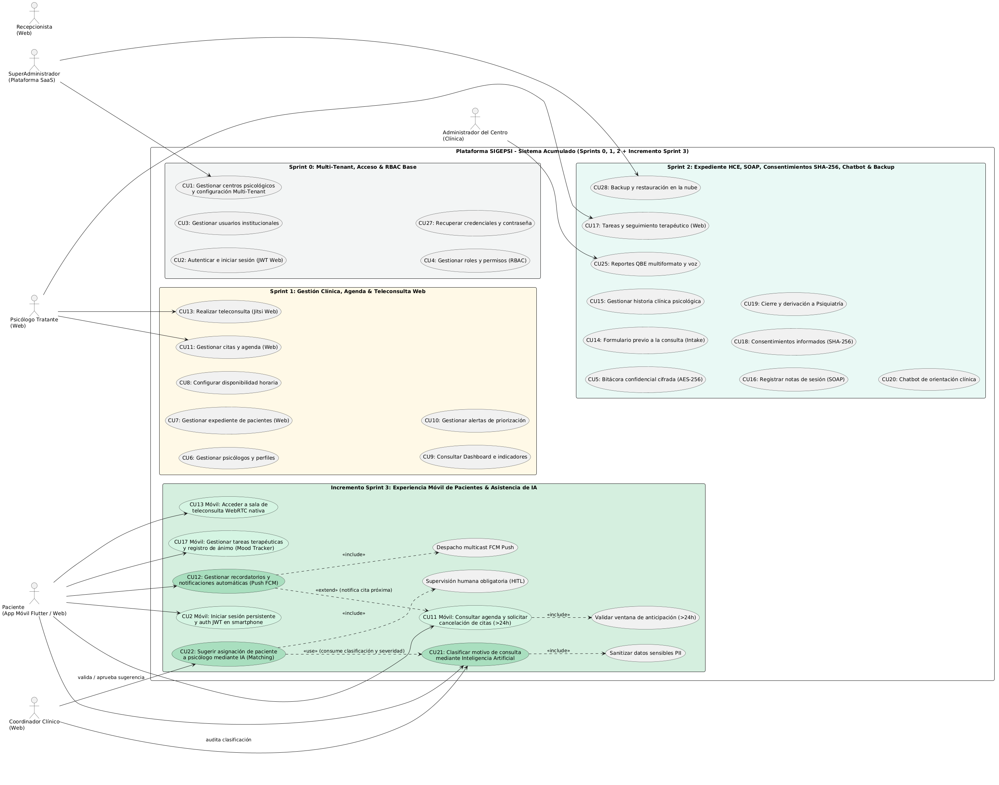

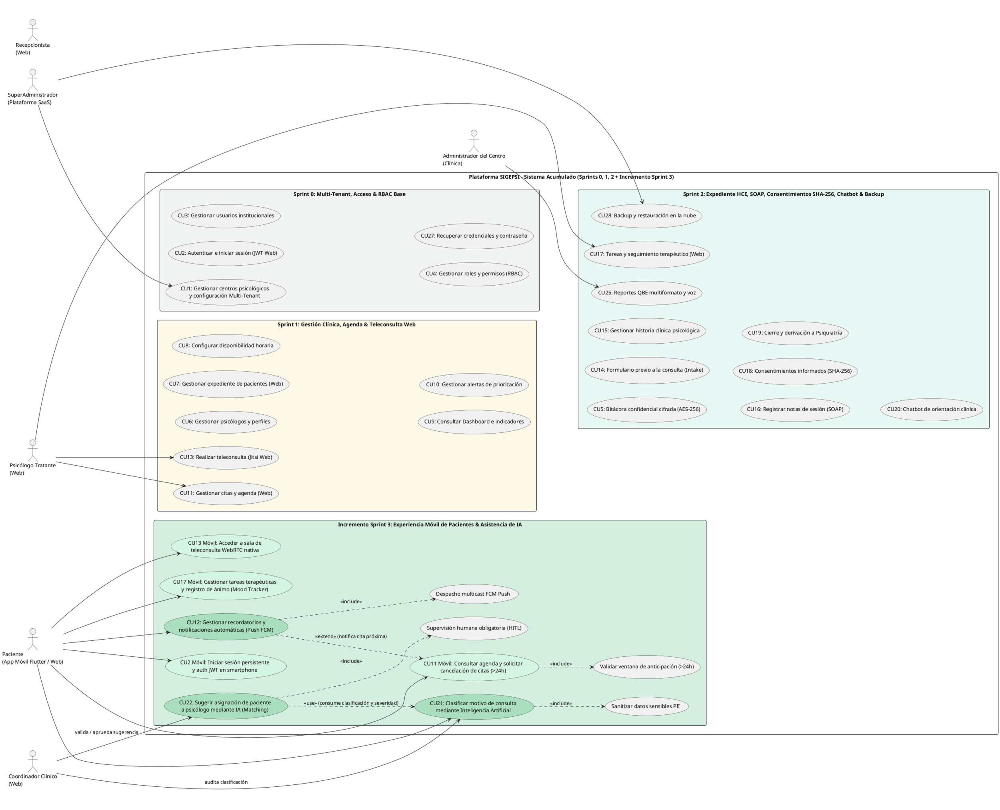

#### Diagrama de Clases del Dominio Clínico (Modelo Incremental Tenant Sprint 3)

El siguiente modelo de datos formaliza la integración de las nuevas entidades del **Sprint 3** (`TokenFCM`, `NotificacionCita`, `RegistroAnimo`, `ClasificacionIA` y `SugerenciaMatching`) con el esquema de base de datos relacional multi-inquilino en PostgreSQL 16:

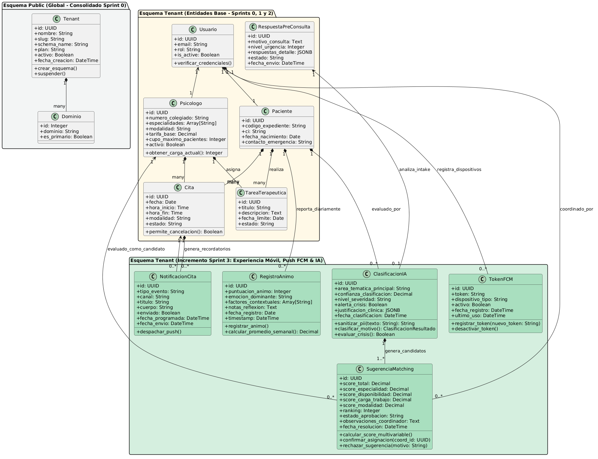

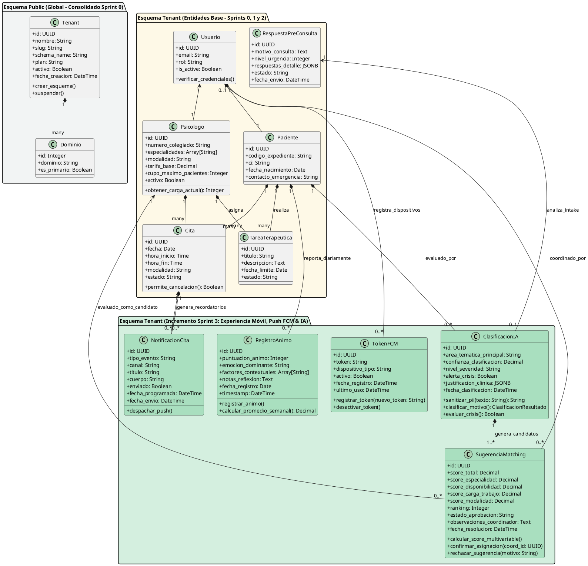

#### Diagramas de Actividad de Flujos Críticos del Sprint 3

En congruencia con el nivel de rigor formal del Sprint 2, se modelan los 5 flujos operativos y analíticos más críticos del Sprint 3 mediante diagramas de actividad UML con carriles de responsabilidad (*swimlanes*):

##### 1. Flujo de Despacho y Recepción de Recordatorios Push FCM (`CU12`)

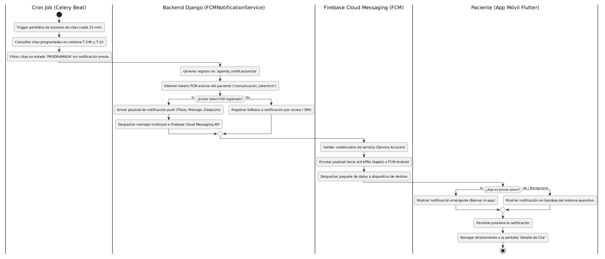

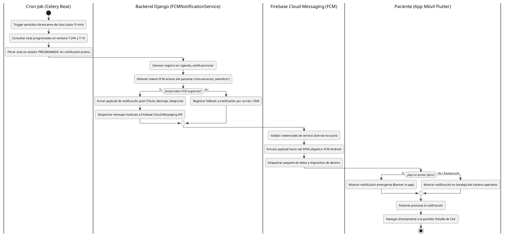

##### 2. Flujo de Clasificación Asistida de Motivo por IA y Detección de Crisis (`CU21`)


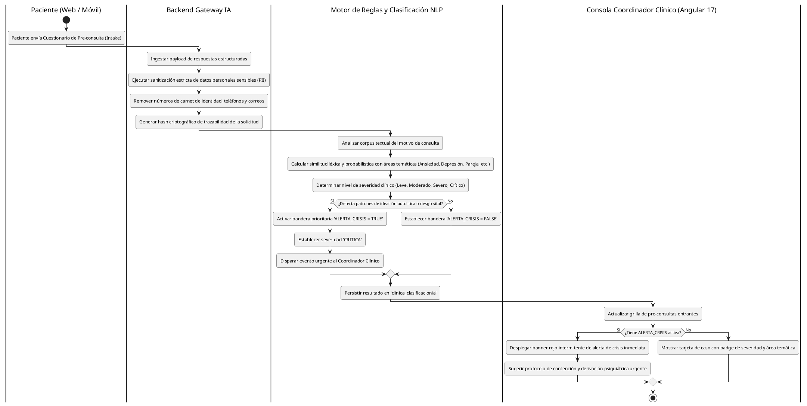

##### 3. Flujo del Algoritmo Multivariable de Matching y Supervisión Humana (*Human-in-the-Loop*) (`CU22`)

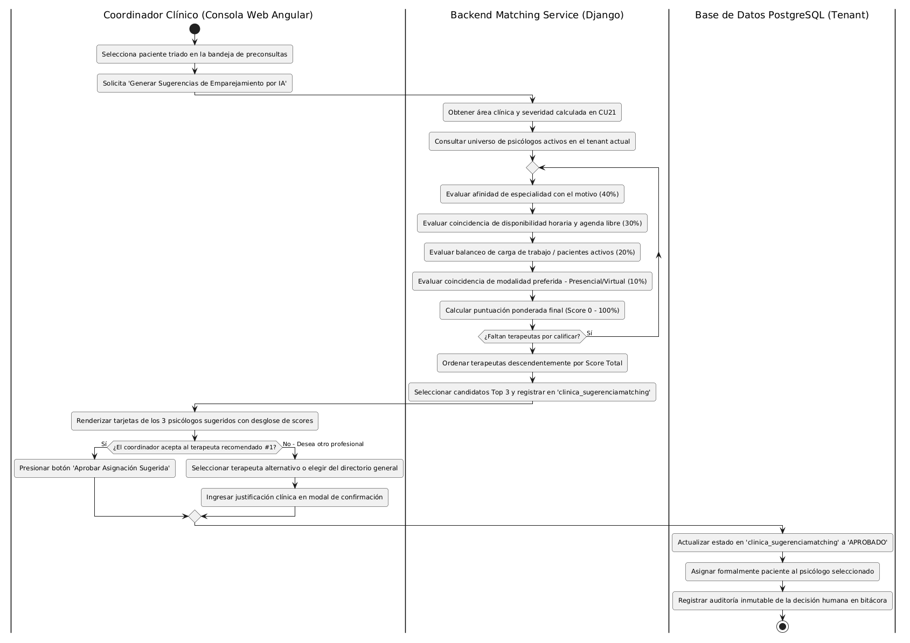

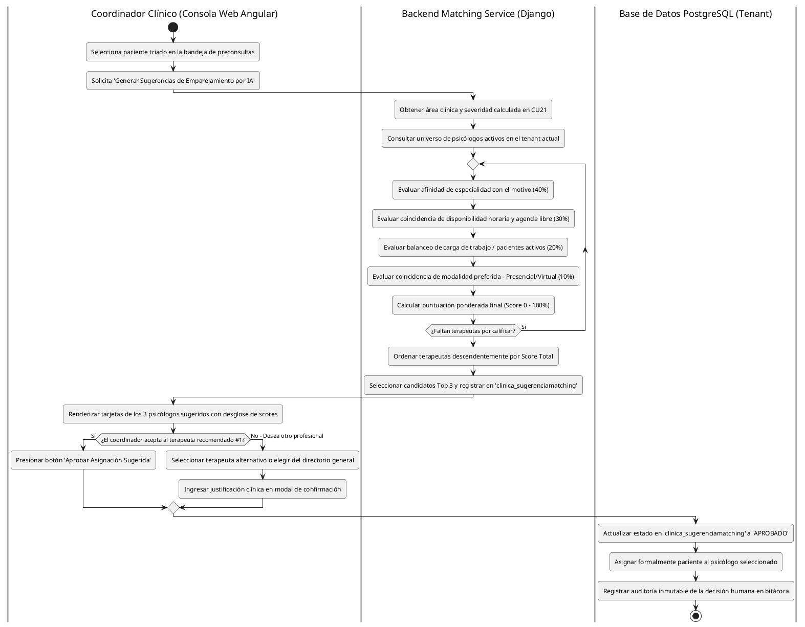

##### 4. Flujo Móvil de Pacientes en Flutter (Login JWT, Agenda, Cancelación >24h y Teleconsulta WebRTC)

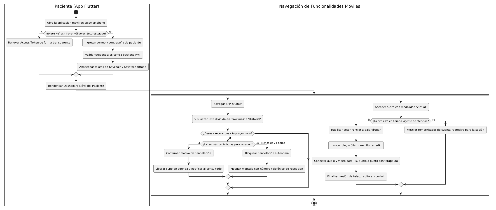

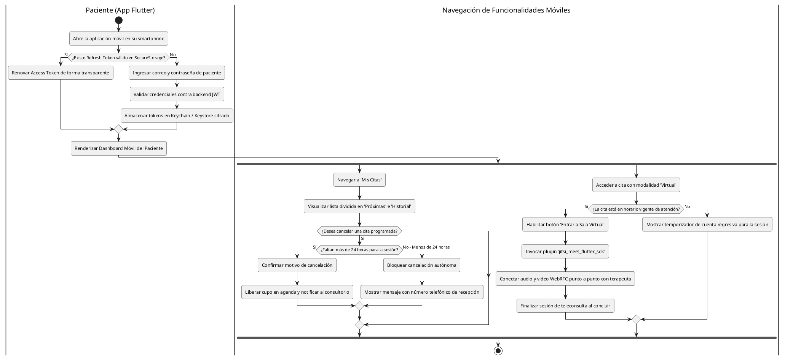

##### 5. Flujo Móvil de Seguimiento de Tareas Terapéuticas y Mood Tracker Diario

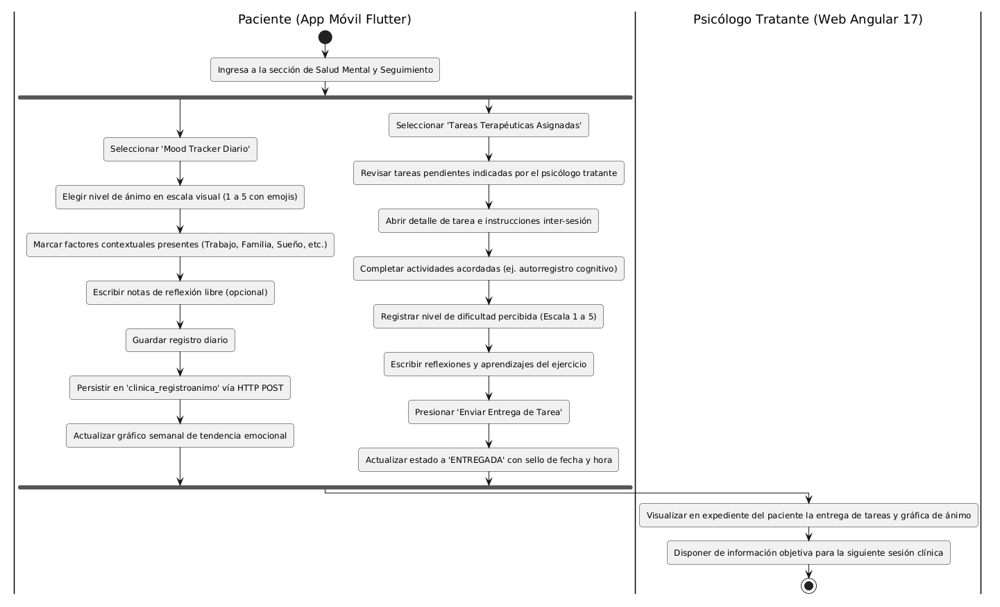

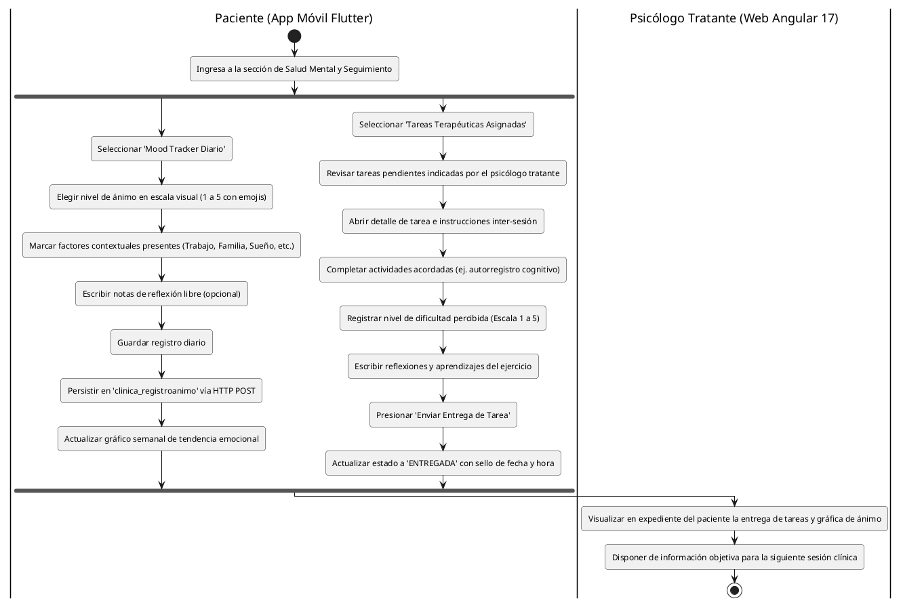

---

### 7.1.4 Sprint Backlog (Tareas Técnicas SP3-68 a SP3-78)

En estricta correspondencia con el **Product Backlog Consolidado** registrado en la sección 3.6 de la memoria general del proyecto (`documentacion/intento.md`), el Sprint 3 ejecuta las **11 tareas técnicas** planificadas (`SP3-68` a `SP3-78`), con una carga total de **59 horas de esfuerzo técnico**:

| Nro | ID Tarea | Rol / Responsable Directo | Descripción Técnica de la Tarea | Horas Planificadas | Prioridad | Estado Final |
| :-: | :------: | :------------------------ | :------------------------------ | :----------------: | :-------: | :----------: |
|  1  | **SP3-68** | Delgado Rojas Alberto Caleb / Larrazabal Julio | Diseñar las interfaces de registro e inicio de sesión de la aplicación móvil en Figma (Flutter UI Guidelines) | 4 hr | Alta | **Concluido** |
|  2  | **SP3-69** | Delgado Rojas Alberto Caleb | Implementar registro e inicio de sesión de pacientes en la aplicación móvil con tokens JWT y persistencia cifrada | 7 hr | Alta | **Concluido** |
|  3  | **SP3-70** | Velasco Soliz Rolando | Realizar pruebas funcionales y de seguridad de registro e inicio de sesión en emuladores y dispositivos móviles | 3 hr | Media | **Concluido** |
|  4  | **SP3-71** | Larrazabal Rojas Julio Cesar | Diseñar la interfaz móvil para consulta de citas, modal de reprogramación y bandeja de notificaciones push | 4 hr | Alta | **Concluido** |
|  5  | **SP3-72** | Condori Diaz Marilyn Esther | Implementar consulta de citas, recordatorios automáticos y recepción de notificaciones push en Flutter con FCM | 8 hr | Alta | **Concluido** |
|  6  | **SP3-73** | Velasco Soliz Rolando | Realizar pruebas de citas, verificación de ventana de cancelación ($>24$h) y recepción de alertas push | 3 hr | Media | **Concluido** |
|  7  | **SP3-74** | Larrazabal Rojas Julio Cesar | Diseñar la interfaz móvil para seguimiento de tareas, registro diario de ánimo (*Mood Tracker*) y teleconsulta WebRTC | 4 hr | Alta | **Concluido** |
|  8  | **SP3-75** | Romero Saavedra Maria Ilse | Implementar módulo de tareas terapéuticas, autorreporte reflexivo, mood tracker y teleconsulta Jitsi en Flutter | 8 hr | Alta | **Concluido** |
|  9  | **SP3-76** | Velasco Soliz Rolando | Realizar pruebas de entrega de tareas, almacenamiento de estado de ánimo y estabilidad de audio/video en teleconsulta | 3 hr | Media | **Concluido** |
| 10  | **SP3-77** | Mujica Vallejos Andy Mauricio (PO) | Implementar en backend el motor de clasificación asistida de consultas (CU21) y algoritmo de emparejamiento de psicólogos (CU22) | 8 hr | Alta | **Concluido** |
| 11  | **SP3-78** | Velasco Soliz Rolando / Mujica Andy (PO) | Realizar pruebas de caja negra del algoritmo de matching, límites de carga de trabajo y salvaguardas éticas de IA | 4 hr | Alta | **Concluido** |
| — | **TOTAL** | **Equipo SCRUM (6 integrantes)** | **Ejecución y Certificación Completa del Sprint Backlog 3** | **59 hr** | — | **100% Terminado** |

---

### 7.1.5 Equipo SCRUM y Asignación de Roles

#### 7.1.5.1 Asignación de Roles para el Sprint 3

El equipo se compone de exactamente **6 integrantes**. Siguiendo la rotación cíclica exigida por la cátedra y asegurando que el **Product Owner desarrolle tareas activas de software**:

| Pos. | Integrante | Rol SCRUM en Sprint 3 | Responsabilidad Principal en el Sprint 3 | Tareas Técnicas Asignadas | Horas Asignadas |
| :--: | :--------- | :-------------------- | :--------------------------------------- | :-----------------------: | :-------------: |
|  1   | **Mujica Vallejos Andy Mauricio**<br>*(Reg: 224028367)* | **Product Owner** | Visión del producto, aceptación de historias de usuario, **desarrollo del motor backend de IA** (clasificación NLP, reglas de severidad y algoritmo de emparejamiento de psicólogos) | `SP3-77, SP3-78` (apoyo) | **10 hr** |
|  2   | **Larrazabal Rojas Julio Cesar**<br>*(Reg: 223049255)* | **Scrum Master** | Facilitación ágil, resolución de bloqueos técnicos en emuladores/FCM, diseño UI/UX en Figma y desarrollo de vistas Flutter | `SP3-68` (apoyo), `SP3-71, SP3-74, HU-48` (consola) | **10 hr** |
|  3   | **Condori Diaz Marilyn Esther**<br>*(Reg: 224051237)* | **Development Team (Móvil)** | **Transición Web $\to$ Móvil:** Implementación en Flutter 3.x de la agenda de citas, lógica de cancelación/reprogramación y cliente de notificaciones push Firebase (FCM) | `SP3-72` | **8 hr** |
|  4   | **Romero Saavedra Maria Ilse**<br>*(Reg: 222009772)* | **Development Team (Móvil)** | **Transición Web $\to$ Móvil:** Implementación en Flutter 3.x del seguimiento de tareas terapéuticas, autorreporte reflexivo, registro de ánimo (*Mood Tracker*) y sala Jitsi embebida | `SP3-75` | **8 hr** |
|  5   | **Delgado Rojas Alberto Caleb**<br>*(Reg: 224027204)* | **Development Team (Móvil & Backend)** | Arquitectura móvil Flutter, integración JWT, almacenamiento seguro de credenciales (`flutter_secure_storage`) y configuración del servicio FCM en Django | `SP3-68, SP3-69` | **10 hr** |
|  6   | **Velasco Soliz Rolando**<br>*(Reg: 223044768)* | **Development Team (QA Lead)** | Conducción del plan de pruebas, ejecución de pruebas de caja negra sobre la app móvil (Android/iOS) y validación del algoritmo de emparejamiento de IA | `SP3-70, SP3-73, SP3-76, SP3-78` | **13 hr** |
|  —   | **TOTAL** | — | **Equipo SCRUM SIGEPSI** | **11 tareas técnicas** | **59 hr** |

#### 7.1.5.2 Matriz Histórica de Rotación de Roles Individuales (Sprint 0 al Sprint 3)

La siguiente matriz evidencia la rotación efectiva de roles a lo largo de los cuatro periodos de desarrollo del semestre, cumpliendo la directriz de que cada estudiante experimente los distintos roles metodológicos:

| Integrante | Rol Sprint 0 | Rol Sprint 1 | Rol Sprint 2 | Rol Sprint 3 | Aportes Técnicos Destacados a lo Largo del Proyecto |
| :--------- | :----------: | :----------: | :----------: | :----------: | :--------------------------------------------------- |
| **Mujica Vallejos Andy Mauricio** | Developer | Developer | Developer | **Product Owner** *(con tareas dev)* | Configuración base Multi-Tenant, backend Django REST, endpoints clínicos, pasarela ética de IA y desarrollo del motor de clasificación y matching de psicólogos en Sprint 3 (`SP3-77`). |
| **Larrazabal Rojas Julio Cesar** | Developer | Developer | Developer | **Scrum Master** | Sistema de tokens de diseño Angular, prototipado en Figma, frontend de dashboards clínicos y diseño/desarrollo de interfaces móviles Flutter para el Sprint 3 (`SP3-71, SP3-74`). |
| **Condori Diaz Marilyn Esther** | Developer | **Product Owner** | Developer | **Developer (Móvil)** | Modelado de base de datos, lógica de citas y reportes QBE en Web; transición completa a desarrollo móvil Flutter en el Sprint 3 implementando agenda móvil y notificaciones push FCM (`SP3-72`). |
| **Romero Saavedra Maria Ilse** | Scrum Master | Developer | **Product Owner** | **Developer (Móvil)** | Matriz RBAC, reglas clínicas heurísticas en Sprint 2; transición completa a desarrollo móvil en el Sprint 3 construyendo el módulo de tareas inter-sesión, mood tracker y teleconsulta móvil (`SP3-75`). |
| **Delgado Rojas Alberto Caleb** | Developer | **Scrum Master** | Developer | **Developer (Móvil/Back)** | Arquitectura móvil Flutter desde Sprint 0, firma táctil SHA-256, autenticación JWT persistente en smartphone y servicios de mensajería push FCM en Sprint 3 (`SP3-68, SP3-69`). |
| **Velasco Soliz Rolando** | **Product Owner** | Scrum Master | **Scrum Master** | **Developer (QA Lead)** | Definición de visión de producto, aseguramiento de calidad, certificación BDD y pruebas integrales de caja negra en dispositivos móviles y algoritmos de IA en Sprint 3 (`SP3-70, 73, 76, 78`). |

---

## 7.2 PROCESO DE DESARROLLO POR HISTORIA DE USUARIO

### 7.2.1 Diseño

#### 7.2.1.1 Diseño de la Arquitectura (Modelo C4 Consolidado - Niveles 1 al 4)

En respuesta al requerimiento de la docente en el audio del Sprint 3 (*"vamos a volver en este tercer sprint con lo que sería la parte final ya de la arquitectura... donde básicamente tienen su arquitectura lógica y física con todos sus módulos y paquetes finalizados"*), se presentan los cuatro niveles del Modelo C4:

##### C4 Nivel 1: Diagrama de Contexto del Sistema (System Context)

El diagrama de contexto sitúa a la plataforma **SIGEPSI** frente a los usuarios humanos y los sistemas externos satélites integrados en el Sprint 3:

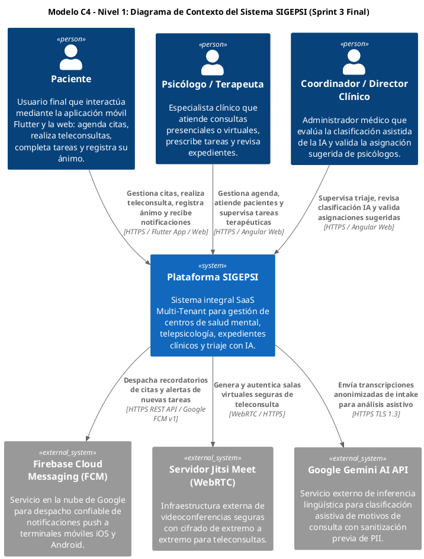

##### C4 Nivel 2: Diagrama de Contenedores (Containers)

Descompone la arquitectura en sus unidades de ejecución física y lógica, reflejando el protagonismo de la aplicación móvil nativa en Flutter:

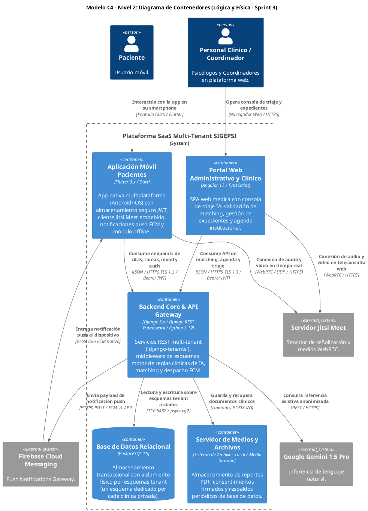

##### C4 Nivel 3: Diagrama de Componentes (Component Diagram - Backend API Core)

Zoom-in detallado de los componentes que integran el contenedor backend en el Sprint 3:

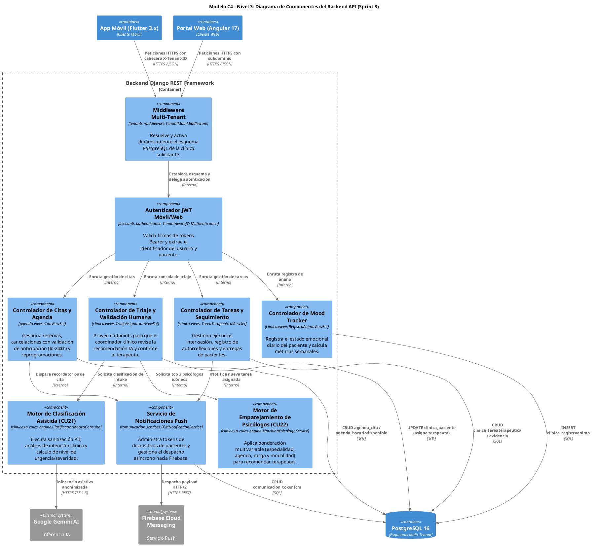

##### C4 Nivel 4: Diagrama de Código y Clases UML por Paquetes de Software (Final de Arquitectura)

Conforme a la instrucción formal de la docente, se detalla el contenido exhaustivo de los paquetes del sistema, incluyendo clases de control, modelos de datos, servicios y clientes móviles:

```plantuml
@startuml
skinparam classAttributeIconSize 0
skinparam shadowing false
skinparam roundcorner 6
skinparam defaultFontName Arial
skinparam packageStyle frame
skinparam ranksep 40
skinparam nodesep 30

title Modelo C4 - Nivel 4: Diagrama de Código / Clases por Paquetes de Software (SIGEPSI Final)

package "Paquete 1: Administración y Seguridad Multi-Tenant\n(backend/accounts y backend/tenants)" as P1 {
    class Usuario {
        + id: UUID
        + email: String
        + rol: String
        + is_active: Boolean
        + check_password(pass: String): Boolean
    }
    class Tenant {
        + schema_name: String
        + name: String
        + plan: String
    }
}

package "Paquete 2: Gestión Clínica y de Profesionales\n(backend/clinica)" as P2 {
    class Paciente {
        + id: UUID
        + expediente_codigo: String
        + telefono_contacto: String
        + contacto_emergencia_nombre: String
        + contacto_emergencia_telefono: String
        + psicologo_asignado_id: UUID
    }
    class Psicologo {
        + id: UUID
        + numero_colegiado: String
        + tarifa_base: Decimal
        + modalidad: String
        + carga_maxima_pacientes: Integer
        + pacientes_activos_count(): Integer
    }
    class Especialidad {
        + id: UUID
        + nombre: String
        + descripcion: String
    }
    Psicologo "1" o-- "1..*" Especialidad : domina
}

package "Paquete 3: Agenda, Comunicación y Teleconsulta\n(backend/agenda y backend/comunicacion)" as P3 {
    class CitaViewSet {
        + list(request: Request): Response
        + cancelar_cita(request: Request, pk: UUID): Response
        + reprogramar_cita(request: Request, pk: UUID): Response
    }
    class Cita {
        + id: UUID
        + fecha: Date
        + hora_inicio: Time
        + hora_fin: Time
        + estado: String
        + modalidad: String
        + sala_jitsi_token: String
        + es_cancelable(): Boolean
    }
    class TokenFCM {
        + id: UUID
        + token: String
        + dispositivo_info: String
        + fecha_actualizacion: DateTime
    }
    class FCMNotificationService {
        + registrar_token(paciente: Paciente, token: String): Boolean
        + enviar_recordatorio_cita(cita: Cita): Boolean
        + enviar_alerta_tarea(tarea: TareaTerapeutica): Boolean
    }
    CitaViewSet --> Cita : gestiona
    Cita "1" *-- "0..*" TokenFCM : notifica a
    CitaViewSet ..> FCMNotificationService : invoca
}

package "Paquete 4: Seguimiento Terapéutico y Tareas Móviles\n(backend/clinica)" as P4 {
    class TareaTerapeuticaViewSet {
        + reportar_avance(request: Request, pk: UUID): Response
    }
    class TareaTerapeutica {
        + id: UUID
        + titulo: String
        + instrucciones: Text
        + fecha_limite: Date
        + estado: String
    }
    class EvidenciaTarea {
        + id: UUID
        + dificultad_percibida: Integer
        + utilidad_percibida: Integer
        + reflexiones_paciente: Text
        + fecha_entrega: DateTime
    }
    class RegistroAnimo {
        + id: UUID
        + estado_animo: String
        + escala_valor: Integer
        + factores_contexto: JSONB
        + nota_reflexiva: Text
        + fecha_registro: Date
    }
    TareaTerapeuticaViewSet --> TareaTerapeutica : administra
    TareaTerapeutica "1" *-- "0..1" EvidenciaTarea : contiene
    Paciente "1" *-- "0..*" RegistroAnimo : registra diariamente
}

package "Paquete 5: Inteligencia Artificial, Triaje y Matching\n(backend/clinica)" as P5 {
    class ClasificadorMotivoConsulta {
        + sanitizar_pii(texto: String): String
        + clasificar_intake(respuestas: Dict): Dict
    }
    class MatchingPsicologoService {
        + calcular_score(psicologo: Psicologo, requerimiento: Dict): Float
        + sugerir_top3(especialidad_req: String, modalidad: String): List
    }
    class TriajeAsignacionViewSet {
        + obtener_solicitudes_pendientes(): Response
        + evaluar_clasificacion_ia(pk: UUID): Response
        + confirmar_asignacion(pk: UUID, psicologo_id: UUID): Response
    }
    TriajeAsignacionViewSet ..> ClasificadorMotivoConsulta : utiliza
    TriajeAsignacionViewSet ..> MatchingPsicologoService : consulta
}

package "Paquete Cliente Móvil Flutter\n(prototipo/movil/lib)" as PMovil {
    class AuthService {
        + login(email: String, pass: String): Future<TokenPair>
        + recuperarPassword(email: String): Future<Boolean>
    }
    class CitasService {
        + getMisCitas(): Future<List<CitaModel>>
        + cancelarCita(citaId: String, motivo: String): Future<Boolean>
    }
    class TareasService {
        + getMisTareas(): Future<List<TareaModel>>
        + enviarEvidencia(tareaId: String, data: Map): Future<Boolean>
        + registrarMood(estado: String, factores: List): Future<Boolean>
    }
    class JitsiTeleconsultaController {
        + unirseASala(nombreSala: String, tokenJwt: String): void
        + alternarCamara(): void
        + silenciarMicrofono(): void
    }
}

P3 ..> P2 : vincula citas con
P4 ..> P2 : asocia tareas a
P5 ..> P2 : evalúa y asigna
PMovil ..> P3 : consume API agenda
PMovil ..> P4 : consume API tareas
@enduml
```

---

#### 7.2.1.2 Diseño de Datos (Modelos Relacionales Incrementales en PostgreSQL 16)

Para soportar las capacidades móviles y de IA del Sprint 3, se formalizan las siguientes tablas en el esquema de cada tenant:

| Tabla Física en PostgreSQL | Atributos Principales | Tipos de Datos | Descripción Clínica / Técnica |
| :------------------------- | :-------------------- | :------------- | :---------------------------- |
| `comunicacion_tokenfcm` | `id, paciente_id, token, plataforma, activo, creado_en` | UUID, FK Paciente, Text, Varchar(20), Boolean, Timestamp | Almacena los tokens únicos de dispositivos móviles emitidos por Firebase Cloud Messaging para despacho de alertas push. |
| `clinica_registroanimo` | `id, paciente_id, estado_animo, escala_valor, factores_contexto, nota_reflexiva, timestamp` | UUID, FK Paciente, Varchar(30), Integer (1-5), JSONB, Text, Timestamp | Registro diario del estado afectivo del paciente (*Mood Tracker*) con etiquetas contextuales (insomnio, estrés, etc.). |
| `clinica_clasificacionia` | `id, respuestapreconsulta_id, categoria_principal, confianza_score, nivel_severidad, alerta_crisis, explicacion_heuristica, fecha_analisis` | UUID, FK RespuestaPreConsulta, Varchar(50), Float, Varchar(20), Boolean, Text, Timestamp | Almacena el resultado del pipeline asistivo de IA (CU21) con métricas de severidad y detección de palabras de riesgo. |
| `clinica_sugerenciamatching` | `id, paciente_id, clasificacion_id, psicologo_sugerido_id, score_afinidad, factores_ponderacion, validado_por_coordinador, fecha_decision` | UUID, FK Paciente, FK ClasificacionIA, FK Psicologo, Float, JSONB, Boolean, Timestamp | Registra las 3 recomendaciones generadas por el algoritmo de emparejamiento (CU22) y la decisión final del coordinador. |
| `agenda_notificacioncita` | `id, cita_id, tipo_evento, canal, enviada, fecha_programada, fecha_envio` | UUID, FK Cita, Varchar(30), Varchar(20), Boolean, DateTime, DateTime | Cola transaccional de recordatorios de citas (despacho automático a 24 horas y 1 hora de anticipación). |

---

#### 7.2.1.3 Diseño de la Lógica de Negocio (Patrón de Comunicación BCE)

A continuación se ilustran los diagramas de comunicación BCE con numeración de métodos y mensajes para los casos de uso principales del Sprint 3:

##### Diagrama de Comunicación CU2: Autenticación Móvil JWT

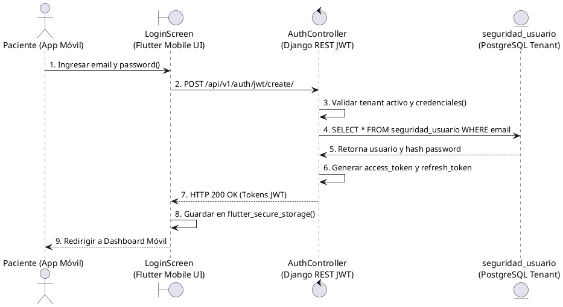

##### Diagrama de Comunicación CU11: Gestión y Cancelación de Cita Móvil

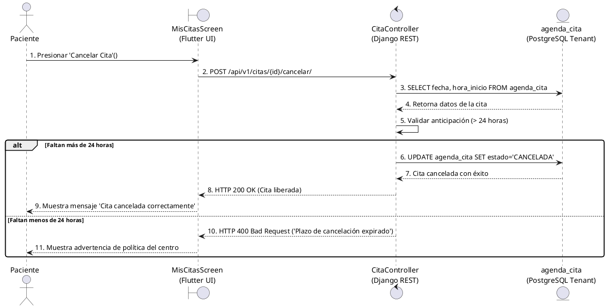

##### Diagrama de Comunicación CU12: Despacho de Recordatorio Push (FCM)

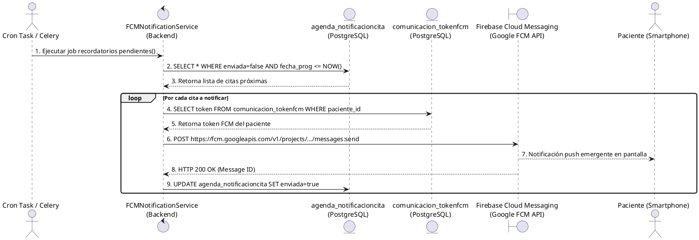

##### Diagrama de Comunicación CU21: Clasificación Asistida del Motivo de Consulta por IA

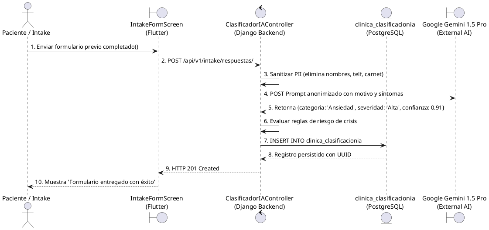

##### Diagrama de Comunicación CU22: Emparejamiento y Asignación de Psicólogo por IA

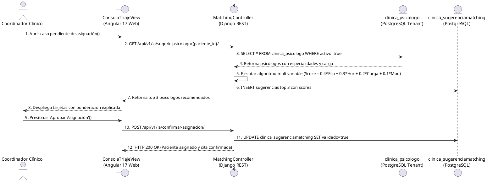

---

#### 7.2.1.4 Diseño de la Navegación de Vistas (Modelo WAE Conallen por Paquetes y Global)

En estricta conformidad con el estándar de modelado web y móvil de Jim Conallen adoptado en la materia, la navegación se estructura mediante clases estereotipadas de interfaz (`«client page»` / `«screen»`) y controladores (`«controller»`), conectadas por transiciones de envío de datos (`«submit»`) y renderizado de interfaz (`«build»`).

##### Diagrama de Navegación 0: Mapa de Navegación Integral Global (Sprint 0 a Sprint 3 Acumulado)

```plantuml
@startuml
skinparam classAttributeIconSize 0
skinparam backgroundColor #FFFFFF
skinparam roundcorner 8
skinparam defaultFontName Arial
left to right direction

title Navegación Global del Sistema SIGEPSI (Sprint 0 al Sprint 3 Acumulado)

actor "Paciente (Móvil)" as PacienteM
actor "Coordinador Clínico" as CoordinadorW

package "App Móvil de Pacientes [Flutter 3.x]" #EAFAF1 {
    class "LoginMobileScreen" as LoginM <<screen>> {
        + txtEmail
        + txtPassword
    }
    class "DashboardMobileScreen" as DashM <<screen>> {
        + cardProximaCita
        + widgetMoodTracker
        + badgeTareasPendientes
    }
    class "MisCitasMobileScreen" as CitasM <<screen>> {
        + tabProximas
        + tabHistorial
    }
    class "ModalCancelacionCita" as CancelM <<dialog>> {
        + txtMotivoCancelacion
    }
    class "TeleconsultaJitsiScreen" as TeleM <<screen>> {
        + videoStreamRemoto
        + videoStreamLocal
    }
    class "TareasMobileScreen" as TareasM <<screen>> {
        + listaTareas
        + formEntregaReflexiva
    }
}

package "Consola Web de Triaje [Angular 17]" #FDEDEC {
    class "ConsolaTriageView" as TriageW <<client page>> {
        + tablaCasosEntrantes
        + filtroSeveridad
    }
    class "DetalleClasificacionModal" as DetalleIAW <<dialog>> {
        + badgeCategoriaIA
        + meterSeveridad
        + banderaCrisis
    }
    class "AsignacionMatchingModal" as MatchW <<dialog>> {
        + rankingTop3Psicologos
        + dropdownAlternativo
        + btnAprobarAsignacion
    }
}

PacienteM --> LoginM : Inicia app
LoginM --> DashM : <<submit>> Auth exitosa
DashM --> CitasM : <<build>> 'Ver mis citas'
CitasM --> CancelM : <<build>> 'Cancelar'
CitasM --> TeleM : <<build>> 'Entrar a sala'
DashM --> TareasM : <<build>> 'Mis tareas'

CoordinadorW --> TriageW : Accede a triaje
TriageW --> DetalleIAW : <<build>> 'Ver diagnóstico IA'
DetalleIAW --> MatchW : <<build>> 'Ver psicólogos compatibles'
MatchW --> TriageW : <<submit>> Asignación confirmada
@enduml
```

##### Diagrama de Navegación 1: Subsistema Móvil de Pacientes en Flutter 3.x

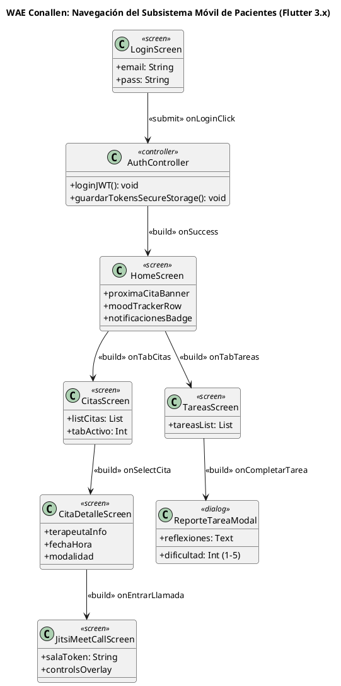

---

#### 7.2.1.5 Modelado del Comportamiento Temporal (Diagramas de Tiempo UML 2.5)

##### Diagrama de Tiempo 1: Sesión de Teleconsulta Móvil WebRTC Jitsi Meet (CU13 / HU-44)

###### Tabla de Especificación Temporal UML 2.5 – Sesión de Teleconsulta Móvil

| Hito ($t$) | Intervalo ($\Delta t$) | Línea de Estado (`robust: Estado_Teleconsulta`) | Línea de Valor 1 (`concise: Conectividad_WebRTC`) | Línea de Valor 2 (`concise: Dispositivo_Hardware`) | Evento Disparador (Trigger Causal) | Mensaje de Sincronización (UML 2.5) | Regla de Negocio / Invariante |
| :---: | :---: | :--- | :--- | :--- | :--- | :--- | :--- |
| **@0** | — | `Esperando_Horario` | `Desconectado` | `Inactivo` | Paciente consulta cita virtual en la app. | — | El botón 'Entrar a Sala' permanece deshabilitado hasta 10 min antes. |
| **@10** | `{10s}` | `Ventana_Habilitada` | `Desconectado` | `Inactivo` | Reloj del servidor alcanza $T - 10$ minutos. | `Servidor -> UI : HabilitarBoton` | La cita entra en ventana operativa; se genera el token de sala. |
| **@30** | `{20s}` | `Negociando_P2P` | `Handshake_SDP` | `Permisos_Camara_Mic_OK` | Paciente pulsa 'Entrar a Sala Virtual'. | `UI -> Jitsi : IniciarPeerConnection` | Solicitud y concesión de permisos de hardware; intercambio ICE candidates. |
| **@50** | `{20s}` | `En_Consulta_Activa` | `P2P_Media_Activo` | `Captura_Audio_Video_ON` | Terapeuta y paciente conectados a la sala. | `Jitsi -> UI : MediaStreamConnected` | Transmisión bidireccional cifrada E2EE (WebRTC); contador de duración activo. |
| **@80** | `{30s}` | `En_Consulta_Activa` | `P2P_Media_Activo` | `Mute_Microfono_Temporal` | Paciente silencia micrófono temporalmente. | `UI -> Hardware : ToggleAudio(false)` | Audio suspendido; video continúa transmitiendo sin cortes. |
| **@95** | `{15s}` | `Finalizando_Llamada` | `Peer_Teardown` | `Liberando_Hardware` | Uno de los participantes presiona botón 'Colgar'. | `UI -> Jitsi : DisconnectPeer` | Liberación de cámara y micrófono; cálculo de duración de sesión. |
| **@100**| `{5s}` | `Concluida` | `Desconectado` | `Inactivo` | Retorno automático a la pantalla de citas. | `UI -> Paciente : RedirigirMoodTracker` | Cita pasa a estado `ATENDIDA`; se invita a calificar la sesión. |

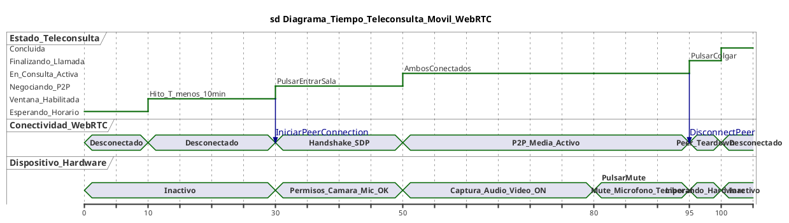

##### Diagrama de Tiempo 2: Pipeline de Clasificación Asistiva IA y Alerta de Crisis (CU21 / HU-47)

###### Tabla de Especificación Temporal UML 2.5 – Pipeline IA y Detección de Crisis

| Hito ($t$) | Intervalo ($\Delta t$) | Línea de Estado (`robust: Pipeline_IA_Triage`) | Línea de Valor 1 (`concise: Buffer_Texto_Clinico`) | Línea de Valor 2 (`concise: Alerta_Consola_Web`) | Evento Disparador (Trigger Causal) | Mensaje de Sincronización (UML 2.5) | Regla de Negocio / Invariante |
| :---: | :---: | :--- | :--- | :--- | :--- | :--- | :--- |
| **@0** | — | `En_Espera` | `Vacio` | `Verde_Normal` | Estado de reposo del worker de IA. | — | Esperando evento HTTP de finalización de intake. |
| **@15** | `{15s}` | `Sanitizando_PII` | `Texto_Original_Crudo` | `Verde_Normal` | Paciente envía cuestionario de preconsulta. | `Backend -> IA : IngestaPayload` | Expresiones regulares anonimizan carnets, teléfonos y nombres. |
| **@35** | `{20s}` | `Extrayendo_Sintomas` | `Texto_Anonimizado` | `Verde_Normal` | Texto seguro libre de PII listo para análisis. | `IA -> IA : MatchPatronesClinicos` | Ponderación de frecuencias de términos de ansiedad, depresión, pareja, etc. |
| **@60** | `{25s}` | `Evaluando_Crisis` | `Tokens_Severidad` | `Verde_Normal` | Detección de término con severidad alta. | `IA -> IA : EvaluarPatronAutolitico` | Búsqueda estricta en diccionario heurístico de riesgo existencial. |
| **@80** | `{20s}` | `Disparando_Alerta_Roja` | `Payload_Clasificado` | `ROJO_CRITICO_PARPADEANTE`| Coincidencia confirmada con indicador de riesgo. | `IA -> Consola : PushAlertaCrisis` | La severidad se fija en `CRITICA`; se bloquea el despacho sin revisión humana. |
| **@100**| `{20s}` | `Persistido_Auditado` | `Hash_SHA256_Firmado` | `ROJO_CRITICO_PARPADEANTE`| Persistencia en `clinica_clasificacionia`. | `IA -> DB : CommitTransaccion` | Generación de Checksum criptográfico y notificación al coordinador. |

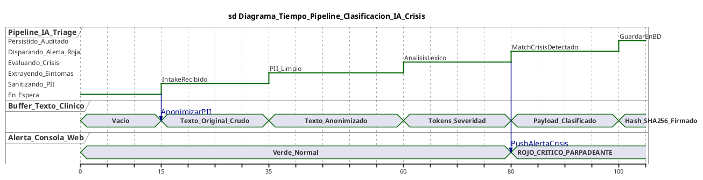

##### Diagrama de Tiempo 3: Ciclo de Notificación Push FCM y Despertar de App Móvil (CU12 / HU-43)

###### Tabla de Especificación Temporal UML 2.5 – Notificación Push FCM

| Hito ($t$) | Intervalo ($\Delta t$) | Línea de Estado (`robust: Ciclo_Vida_Notificacion`) | Línea de Valor 1 (`concise: Gateway_Firebase_FCM`) | Línea de Valor 2 (`concise: Estado_App_Movil`) | Evento Disparador (Trigger Causal) | Mensaje de Sincronización (UML 2.5) | Regla de Negocio / Invariante |
| :---: | :---: | :--- | :--- | :--- | :--- | :--- | :--- |
| **@0** | — | `Programada` | `En_Espera` | `Segundo_Plano` | Cita agendada; recordatorio guardado en BD. | — | Registro en `agenda_notificacioncita` con `despachada=false`. |
| **@20** | `{20s}` | `Disparada_Por_Cron` | `En_Espera` | `Segundo_Plano` | Tarea programada Celery detecta $T - 24$h. | `Cron -> Backend : TriggerEnvio` | Backend consulta tokens FCM activos del paciente. |
| **@45** | `{25s}` | `En_Transito_Google` | `Payload_HTTP_v1_Recibido` | `Segundo_Plano` | Django despacha mensaje a la API de Firebase. | `Backend -> FCM : SendMulticast` | Google enruta el paquete hacia el servidor de mensajería APNs / GCM. |
| **@70** | `{25s}` | `Recibida_En_Dispositivo`| `Entregado_Al_Terminal` | `Bandeja_SO_Visible` | El smartphone recibe el paquete en background. | `FCM -> Terminal : WakeUpRadio` | El sistema operativo muestra el banner con el título y cuerpo. |
| **@90** | `{20s}` | `Abierta_Por_Paciente` | `Ack_Leido` | `Primer_Plano_Navegando` | Paciente pulsa sobre la notificación en el teléfono.| `SO -> Flutter : onNotificationClick` | La app se abre en primer plano y navega directamente a la cita. |
| **@100**| `{10s}` | `Concluida_Auditada` | `Cerrado` | `Primer_Plano_Activo` | Detalle de cita desplegado; token actualizado. | — | Se marca la notificación como leída en la base de datos. |

```plantuml
@startuml
skinparam backgroundColor #FFFFFF
skinparam defaultFontName Arial

title sd Diagrama_Tiempo_Ciclo_Notificacion_Push_FCM

robust "Ciclo_Vida_Notificacion" as Estado
concise "Gateway_Firebase_FCM" as FCM
concise "Estado_App_Movil" as App

@0
Estado is Programada
FCM is En_Espera
App is Segundo_Plano

@20
Estado is Disparada_Por_Cron : Trigger_24h
Estado -> FCM : SendMulticast

@45
Estado is En_Transito_Google
FCM is Payload_HTTP_v1_Recibido

@70
Estado is Recibida_En_Dispositivo : EntregaDispositivo
FCM is Entregado_Al_Terminal
App is Bandeja_SO_Visible
FCM -> App : MostrarBanner

@90
Estado is Abierta_Por_Paciente : ClickUsuario
FCM is Ack_Leido
App is Primer_Plano_Navegando
App -> Estado : ConfirmarApertura

@100
Estado is Concluida_Auditada
FCM is Cerrado
App is Primer_Plano_Activo
@enduml
```

---

#### 7.2.1.6 Modelado del Ciclo de Vida y Transiciones (Diagramas de Máquinas de Estados UML 2.5)

##### Máquina de Estados 1: Ciclo de Vida de la Cita Médica Móvil (CU11)

```plantuml
@startuml
skinparam backgroundColor #FFFFFF
skinparam defaultFontName Arial
skinparam defaultFontSize 11
skinparam shadowing false
skinparam roundcorner 8

skinparam state {
    BackgroundColor #FDF8E2
    BorderColor #1A365D
    BorderThickness 1.2
    FontColor #0F172A
    FontStyle bold
    FontSize 12
    ArrowColor #1A365D
    ArrowFontColor #1E293B
    ArrowFontSize 10
}

title Máquina de Estados UML 2.5 - Ciclo de Vida de la Cita Médica Móvil (CU11)

[*] --> Agendada : Paciente o Recepción agenda cita

state Agendada {
    Agendada : entry / Persistir cita en estado PENDIENTE
    Agendada : do / Programar recordatorios push en agenda_notificacioncita
}

Agendada --> Confirmada : Paciente o Clínica confirma asistencia
state Confirmada {
    Confirmada : entry / Generar token de sala WebRTC (si es virtual)
    Confirmada : do / Enviar notificación push FCM (24h y 1h antes)
}

Confirmada --> CanceladaOportuna : Cancelar con anticipación >= 24h
state CanceladaOportuna {
    CanceladaOportuna : entry / Liberar bloque horario del psicólogo
    CanceladaOportuna : entry / Despachar push informando liberación
    CanceladaOportuna : do / Registro auditado en historial_estado_cita
}

Confirmada --> CancelacionBloqueada : Intento de cancelación < 24h
state CancelacionBloqueada {
    CancelacionBloqueada : do / Mostrar modal informativo de política
    CancelacionBloqueada : do / Proveer botón directo a recepción
}
CancelacionBloqueada --> Confirmada : Retorno al detalle

Confirmada --> EnTeleconsulta : Paciente entra a sala [Ventana T-10m a T+45m]
state EnTeleconsulta {
    EnTeleconsulta : entry / Conectar sesión WebRTC Jitsi Meet
    EnTeleconsulta : do / Streaming de audio y video cifrado
}

EnTeleconsulta --> Atendida : Finalizar sesión / Colgar llamada
state Atendida {
    Atendida : entry / Habilitar formulario de notas SOAP para el psicólogo
    Atendida : do / Invitar al paciente a registrar Mood Tracker diario
}

Atendida --> [*] : Concluir
CanceladaOportuna --> [*] : Archivar
@enduml
```

##### Máquina de Estados 2: Ciclo de Vida de la Tarea Terapéutica Móvil (CU17)

```plantuml
@startuml
skinparam backgroundColor #FFFFFF
skinparam defaultFontName Arial
skinparam defaultFontSize 11
skinparam shadowing false
skinparam roundcorner 8

skinparam state {
    BackgroundColor #FDF8E2
    BorderColor #1A365D
    BorderThickness 1.2
    FontColor #0F172A
    FontStyle bold
    FontSize 12
    ArrowColor #1A365D
    ArrowFontColor #1E293B
    ArrowFontSize 10
}

title Máquina de Estados UML 2.5 - Ciclo de Vida de Tarea Terapéutica Móvil (CU17)

[*] --> Asignada : Psicólogo prescribe tarea en HCE Web

state Asignada {
    Asignada : entry / Enviar notificación push FCM al paciente
    Asignada : do / Mostrar tarjeta con badge 'Pendiente' en App Flutter
}

Asignada --> EnProgreso : Paciente abre detalle y comienza lectura/ejercicio
state EnProgreso {
    EnProgreso : do / Guardar avance parcial en almacenamiento local
    EnProgreso : do / Mostrar contador de tiempo hasta fecha límite
}

EnProgreso --> Entregada : Paciente completa reflexiones y escala dificultad
state Entregada {
    Entregada : entry / Persistir evidencia en clinica_evidenciareporte
    Entregada : entry / Bloquear formulario de edición en la app
    Entregada : do / Notificar al psicólogo en su panel web
}

Entregada --> Evaluada : Psicólogo revisa entrega y añade feedback
state Evaluada {
    Evaluada : entry / Mostrar comentario y feedback en la app móvil
    Evaluada : do / Incorporar conclusiones a la siguiente nota SOAP
}

Evaluada --> [*] : Finalizar
@enduml
```

##### Máquina de Estados 3: Ciclo de Vida de la Clasificación y Matching por IA (CU21 / CU22)

```plantuml
@startuml
skinparam backgroundColor #FFFFFF
skinparam defaultFontName Arial
skinparam defaultFontSize 11
skinparam shadowing false
skinparam roundcorner 8

skinparam state {
    BackgroundColor #FDF8E2
    BorderColor #1A365D
    BorderThickness 1.2
    FontColor #0F172A
    FontStyle bold
    FontSize 12
    ArrowColor #1A365D
    ArrowFontColor #1E293B
    ArrowFontSize 10
}

title Máquina de Estados UML 2.5 - Ciclo de Vida del Triaje y Matching IA (CU21 / CU22)

[*] --> Ingestada : Formulario de preconsulta enviado

state Ingestada {
    Ingestada : entry / Anonimizar datos de identificación personal (PII)
    Ingestada : do / Extraer tokens semánticos
}

Ingestada --> Clasificada : Reglas heurísticas y cálculo de severidad
state Clasificada {
    Clasificada : entry / Asignar categoría principal y score de confianza
    Clasificada : do / Evaluar bandera de riesgo autolítico
}

state CrisisDetectada <<choice>>
Clasificada --> CrisisDetectada : Evaluar severidad

CrisisDetectada --> AlertaRojaCrisis : [indicador_crisis == TRUE]
state AlertaRojaCrisis {
    AlertaRojaCrisis : entry / Activar severidad CRITICA
    AlertaRojaCrisis : do / Despachar notificación prioritaria a Coordinador
}

CrisisDetectada --> CalculandoMatching : [indicador_crisis == FALSE]
AlertaRojaCrisis --> CalculandoMatching : Coordinador toma conocimiento

state CalculandoMatching {
    CalculandoMatching : entry / Ejecutar fórmula multivariable de afinidad
    CalculandoMatching : do / Generar Top 3 de psicólogos candidatos
}

CalculandoMatching --> PendienteValidacionHumana : Desplegar en Consola Web
state PendienteValidacionHumana {
    PendienteValidacionHumana : do / Esperar confirmación del Coordinador
}

PendienteValidacionHumana --> AsignacionAprobada : Coordinador aprueba sugerencia #1
PendienteValidacionHumana --> AsignacionModificada : Coordinador selecciona otro profesional

state AsignacionAprobada {
    AsignacionAprobada : entry / Registrar decisión en auditoría
    AsignacionAprobada : do / Vincular paciente a psicólogo
}

state AsignacionModificada {
    AsignacionModificada : entry / Registrar justificación clínica de cambio
    AsignacionModificada : do / Vincular paciente al terapeuta elegido
}

AsignacionAprobada --> [*] : Cierre
AsignacionModificada --> [*] : Cierre
@enduml
```

##### Máquina de Estados 4: Ciclo de Vida del Token FCM y Notificaciones Push (CU12)

```plantuml
@startuml
skinparam backgroundColor #FFFFFF
skinparam defaultFontName Arial
skinparam defaultFontSize 11
skinparam shadowing false
skinparam roundcorner 8

skinparam state {
    BackgroundColor #FDF8E2
    BorderColor #1A365D
    BorderThickness 1.2
    FontColor #0F172A
    FontStyle bold
    FontSize 12
    ArrowColor #1A365D
    ArrowFontColor #1E293B
    ArrowFontSize 10
}

title Máquina de Estados UML 2.5 - Ciclo de Vida del Token FCM y Despacho Push (CU12)

[*] --> TokenGenerado : App Flutter obtiene Registration Token de Firebase

state TokenGenerado {
    TokenGenerado : do / Enviar token a endpoint /api/comunicacion/fcm-token/
}

TokenGenerado --> RegistradoActivo : Backend vincula token a la cuenta del paciente
state RegistradoActivo {
    RegistradoActivo : entry / Guardar en comunicacion_tokenfcm (activo=true)
    RegistradoActivo : do / Apto para recibir recordatorios y alertas
}

RegistradoActivo --> DespachandoMensaje : Tarea programada envía payload HTTP v1
state DespachandoMensaje {
    DespachandoMensaje : do / Esperar respuesta del gateway de Google FCM
}

DespachandoMensaje --> EntregadoAlTerminal : Código HTTP 200 OK
DespachandoMensaje --> TokenInvalidoDetectado : Error registration-token-not-registered

state EntregadoAlTerminal {
    EntregadoAlTerminal : do / Mostrar banner emergente en smartphone
}

state TokenInvalidoDetectado {
    TokenInvalidoDetectado : entry / Desactivar token (activo=false) en BD
}

EntregadoAlTerminal --> RegistradoActivo : Retorno a estado de escucha
TokenInvalidoDetectado --> [*] : Descartar
@enduml
```

---

#### 7.2.1.7 DIAGRAMAS DE CLASES DE ANÁLISIS (Patrón VOPC / BCE Corregido)

> [!IMPORTANT]
> **APLICACIÓN ESTRICTA DE LA CORRECCIÓN DE LA CÁTEDRA:**  
> En observancia formal de la corrección explicada por la docente en `datos/Sprint3.txt`:
> 1. La clase **Boundary (Interfaz / Vista)** contiene atributos de control visual y métodos de evento de usuario.
> 2. La clase **Control (Controlador)** implementa la lógica de negocio y métodos de servicio.
> 3. La clase **Control se vincula EXCLUSIVAMENTE con la Entidad Principal**.
> 4. La **Entidad Principal** es la única que mantiene relaciones estructurales con sus **Entidades Secundarias o Detalle** (con multiplicidades precisas como $1 \dots *$, $0 \dots 1$, etc.).
> 5. **Ninguna entidad secundaria o detalle se asocia directamente a la clase controladora.**

A continuación se presentan los diagramas de clases de análisis para los casos de uso desarrollados en el Sprint 3:

##### Diagrama de Clases de Análisis CU2: Autenticación Móvil JWT

```plantuml
@startuml
skinparam shadowing false
skinparam roundcorner 6
skinparam defaultFontName Arial
skinparam classAttributeIconSize 0

title Clases de Análisis VOPC: CU2 - Autenticación Móvil JWT (Estructura Corregida)

class "Boundary::LoginMobileView" as UI {
    - txtEmail: TextField
    - txtPassword: TextField
    - btnIngresar: Button
    - btnOlvidastePassword: Link
    - lblError: Label
    + onSubmit(): void
    + onOlvidastePasswordClick(): void
    + mostrarError(msg: String): void
}

class "Control::AuthMobileController" as Ctrl {
    + validarCredenciales(email: String, pass: String): TokenPair
    + solicitarResetPassword(email: String): Boolean
    + verificarTokenExpirado(token: String): Boolean
}

class "Entity::Usuario" as EntPrincipal {
    - id: UUID
    - email: String
    - password_hash: String
    - rol: String
    - is_active: Boolean
    + check_password(pass: String): Boolean
    + get_full_name(): String
}

class "Entity::SesionDispositivo" as EntDetalle1 {
    - id: UUID
    - refresh_token_jti: String
    - dispositivo_nombre: String
    - ip_origen: String
    - fecha_emision: DateTime
    - fecha_expiracion: DateTime
    + revocar(): void
}

class "Entity::HistorialAcceso" as EntDetalle2 {
    - id: UUID
    - timestamp: DateTime
    - exitoso: Boolean
    - ip_address: String
}

UI -- Ctrl : interactúa
Ctrl -- EntPrincipal : gestiona exclusivamente
EntPrincipal "1" *-- "0..*" EntDetalle1 : mantiene sesiones activas
EntPrincipal "1" *-- "0..*" EntDetalle2 : registra accesos en
@enduml
```

##### Diagrama de Clases de Análisis CU11: Gestión de Citas y Cancelación Móvil

```plantuml
@startuml
skinparam shadowing false
skinparam roundcorner 6
skinparam defaultFontName Arial
skinparam classAttributeIconSize 0

title Clases de Análisis VOPC: CU11 - Gestión de Citas Móviles (Estructura Corregida)

class "Boundary::MisCitasMobileView" as UI {
    - tabProximas: TabItem
    - tabHistorial: TabItem
    - listCitasCards: ListView
    - btnCancelarCita: Button
    - btnReprogramar: Button
    - btnUnirseVideollamada: Button
    + onCancelarClick(citaId: UUID): void
    + onReprogramarClick(citaId: UUID): void
    + renderizarCitas(citas: List): void
}

class "Control::CitaMobileController" as Ctrl {
    + listarCitasPaciente(pacienteId: UUID): List<Cita>
    + cancelarCita(citaId: UUID, motivo: String): ResultadoOperacion
    + solicitarReprogramacion(citaId: UUID, nuevaFecha: Date, bloqueId: UUID): ResultadoOperacion
}

class "Entity::Cita" as EntPrincipal {
    - id: UUID
    - fecha: Date
    - hora_inicio: Time
    - hora_fin: Time
    - estado: String
    - modalidad: String
    - sala_jitsi_token: String
    + es_cancelable(): Boolean
    + liberar_horario(): void
}

class "Entity::HistorialEstadoCita" as EntDetalle1 {
    - id: UUID
    - estado_anterior: String
    - estado_nuevo: String
    - motivo_cambio: Text
    - cambiado_por_usuario: UUID
    - fecha_cambio: DateTime
}

class "Entity::HorarioBloqueReserva" as EntDetalle2 {
    - id: UUID
    - dia_semana: Integer
    - franja_inicio: Time
    - franja_fin: Time
    - ocupado: Boolean
}

UI -- Ctrl : interactúa
Ctrl -- EntPrincipal : gestiona exclusivamente
EntPrincipal "1" *-- "1..*" EntDetalle1 : audita transiciones en
EntPrincipal "1" -- "1" EntDetalle2 : reserva bloque
@enduml
```

##### Diagrama de Clases de Análisis CU12: Notificaciones Push FCM y Recordatorios

```plantuml
@startuml
skinparam shadowing false
skinparam roundcorner 6
skinparam defaultFontName Arial
skinparam classAttributeIconSize 0

title Clases de Análisis VOPC: CU12 - Notificaciones Push y Alertas (Estructura Corregida)

class "Boundary::NotificationBannerMobile" as UI {
    - iconBadge: Badge
    - bannerTitulo: Label
    - bannerCuerpo: Label
    - btnAbrirDetalle: ActionButton
    + onNotificationClick(payload: Dict): void
    + actualizarContadorNoLeidas(n: Integer): void
}

class "Control::FCMNotificationController" as Ctrl {
    + registrarTokenDispositivo(pacienteId: UUID, token: String, plat: String): Boolean
    + procesarRecordatoriosProgramados(): Integer
    + despacharPushFirebase(token: String, mensaje: PayloadFCM): Boolean
}

class "Entity::Paciente" as EntPrincipal {
    - id: UUID
    - expediente_codigo: String
    - nombre_completo: String
    - telefono: String
    + get_tokens_activos(): List<TokenFCM>
}

class "Entity::TokenDispositivoFCM" as EntDetalle1 {
    - id: UUID
    - token_cadena: String
    - modelo_dispositivo: String
    - sistema_operativo: String
    - activo: Boolean
    - ultima_actualizacion: DateTime
    + desactivar(): void
}

class "Entity::AlertaNotificacion" as EntDetalle2 {
    - id: UUID
    - tipo: String
    - titulo: String
    - contenido: Text
    - leida: Boolean
    - fecha_despacho: DateTime
}

UI -- Ctrl : interactúa
Ctrl -- EntPrincipal : resuelve paciente destino
EntPrincipal "1" *-- "1..*" EntDetalle1 : posee dispositivos asociados
EntPrincipal "1" *-- "0..*" EntDetalle2 : recibe histórico de alertas
@enduml
```

##### Diagrama de Clases de Análisis CU13: Teleconsulta Móvil Nativa WebRTC

```plantuml
@startuml
skinparam shadowing false
skinparam roundcorner 6
skinparam defaultFontName Arial
skinparam classAttributeIconSize 0

title Clases de Análisis VOPC: CU13 - Teleconsulta WebRTC Móvil (Estructura Corregida)

class "Boundary::TeleconsultaJitsiMobileView" as UI {
    - feedVideoRemoto: VideoRenderer
    - feedVideoLocal: VideoRenderer
    - btnToggleMic: IconButton
    - btnToggleCam: IconButton
    - btnColgar: IconButton
    + onConectarClick(): void
    + onColgarClick(): void
}

class "Control::TeleconsultaMobileController" as Ctrl {
    + validarAccesoSala(citaId: UUID, pacienteId: UUID): SalaResponse
    + emitirTokenJitsiJWT(salaNombre: String): String
    + registrarFinalizacionLlamada(citaId: UUID, duracionMinutos: Integer): Boolean
}

class "Entity::Cita" as EntPrincipal {
    - id: UUID
    - fecha: Date
    - hora_inicio: Time
    - estado: String
    - sala_jitsi_token: String
    + esta_en_ventana_teleconsulta(): Boolean
    + registrar_cierre_sesion(): void
}

class "Entity::MetricaLlamadaWebRTC" as EntDetalle1 {
    - id: UUID
    - bytes_enviados: BigInt
    - paquetes_perdidos: Integer
    - duracion_segundos: Integer
    - calidad_red: String
}

class "Entity::LogAccesoSala" as EntDetalle2 {
    - id: UUID
    - usuario_id: UUID
    - rol: String
    - hora_entrada: DateTime
    - hora_salida: DateTime
}

UI -- Ctrl : interactúa
Ctrl -- EntPrincipal : valida y gobierna sala
EntPrincipal "1" *-- "0..1" EntDetalle1 : monitorea calidad
EntPrincipal "1" *-- "0..*" EntDetalle2 : audita conexiones
@enduml
```

##### Diagrama de Clases de Análisis CU17: Seguimiento de Tareas y Mood Tracker

```plantuml
@startuml
skinparam shadowing false
skinparam roundcorner 6
skinparam defaultFontName Arial
skinparam classAttributeIconSize 0

title Clases de Análisis VOPC: CU17 - Tareas y Mood Tracker Móvil (Estructura Corregida)

class "Boundary::SeguimientoMobileView" as UI {
    - selectorEstadoAnimo: EmojiPicker
    - chipsFactoresContexto: ChipGroup
    - listTareasPendientes: CardList
    - btnEnviarEvidencia: Button
    + onMoodSelected(animo: String): void
    + onEnviarTarea(tareaId: UUID): void
    + mostrarConfirmacionEntrega(): void
}

class "Control::SeguimientoMobileController" as Ctrl {
    + registrarEstadoAnimo(pacienteId: UUID, animo: String, contexto: List): Boolean
    + listarTareasPaciente(pacienteId: UUID): List<TareaTerapeutica>
    + guardarEvidenciaTarea(tareaId: UUID, reflexiones: Text, dif: Integer): Boolean
}

class "Entity::TareaTerapeutica" as EntPrincipal {
    - id: UUID
    - titulo: String
    - descripcion_clinica: Text
    - fecha_limite: Date
    - estado: String
    - prioridad: String
    + marcar_como_entregada(): void
}

class "Entity::EvidenciaReporte" as EntDetalle1 {
    - id: UUID
    - dificultad_escala: Integer
    - utilidad_percibida: Integer
    - conclusiones_personales: Text
    - fecha_entrega: DateTime
}

class "Entity::ComentarioPsicologo" as EntDetalle2 {
    - id: UUID
    - retroalimentacion_texto: Text
    - evaluacion_adherencia: String
    - fecha_revision: DateTime
}

UI -- Ctrl : interactúa
Ctrl -- EntPrincipal : gestiona exclusivamente
EntPrincipal "1" *-- "0..1" EntDetalle1 : contiene evidencia
EntPrincipal "1" *-- "0..*" EntDetalle2 : recibe feedback de
@enduml
```

##### Diagrama de Clases de Análisis CU21: Clasificación Asistida del Motivo de Consulta por IA

```plantuml
@startuml
skinparam shadowing false
skinparam roundcorner 6
skinparam defaultFontName Arial
skinparam classAttributeIconSize 0

title Clases de Análisis VOPC: CU21 - Clasificación Asistida por IA (Estructura Corregida)

class "Boundary::ConsolaTriageIAView" as UI {
    - badgeCategoriaSugerida: Badge
    - meterNivelSeveridad: Gauge
    - tagsPalabrasClave: TagList
    - lblAlertaCrisis: AlertBox
    + mostrarClasificacion(data: Dict): void
    + resaltarRiesgoCritico(): void
}

class "Control::ClasificacionIAController" as Ctrl {
    + anonimizarTextoPII(texto: String): String
    + ejecutarPipelineClasificacion(respuestaIntakeId: UUID): ClasificacionIA
    + evaluarReglasHeuristicas(sintomas: String, urgencia: Integer): ResultadoReglas
}

class "Entity::ClasificacionIA" as EntPrincipal {
    - id: UUID
    - categoria_principal: String
    - puntaje_confianza: Float
    - nivel_severidad: String
    - indicador_crisis: Boolean
    - hash_integridad_sha256: String
    - fecha_clasificacion: DateTime
    + es_caso_urgente(): Boolean
}

class "Entity::CriterioEvaluadoIA" as EntDetalle1 {
    - id: UUID
    - regla_codigo: String
    - descripcion_criterio: String
    - explicacion_clinica: Text
    - peso_severidad: Integer
}

class "Entity::TerminoSintomaDetectado" as EntDetalle2 {
    - id: UUID
    - termino_normalizado: String
    - frecuencia_ocurrencia: Integer
    - categoria_asociada: String
}

UI -- Ctrl : interactúa
Ctrl -- EntPrincipal : genera y persiste exclusivamente
EntPrincipal "1" *-- "1..*" EntDetalle1 : fundamentada en criterios
EntPrincipal "1" *-- "0..*" EntDetalle2 : extrae términos clave
@enduml
```

##### Diagrama de Clases de Análisis CU22: Emparejamiento y Asignación de Psicólogo por IA

```plantuml
@startuml
skinparam shadowing false
skinparam roundcorner 6
skinparam defaultFontName Arial
skinparam classAttributeIconSize 0

title Clases de Análisis VOPC: CU22 - Sugerencia y Asignación Asistida (Estructura Corregida)

class "Boundary::AsignacionPsicologoView" as UI {
    - listSugerenciasTop3: CardList
    - barScoreCompatibilidad: ProgressBar
    - btnConfirmarAsignacion: Button
    - cmbPsicologoAlternativo: Dropdown
    + onConfirmarAsignacionClick(): void
    + onSeleccionarAlternativo(id: UUID): void
}

class "Control::MatchingPsicologoController" as Ctrl {
    + obtenerCandidatosDisponibles(especialidadReq: String, mod: String): List<Psicologo>
    + computarPuntajesAfinidad(pacienteId: UUID, clasificacionId: UUID): List<SugerenciaMatching>
    + confirmarAsignacionHumana(sugerenciaId: UUID, psicologoId: UUID, coordinadorId: UUID): Boolean
}

class "Entity::SugerenciaMatching" as EntPrincipal {
    - id: UUID
    - score_global_compatibilidad: Float
    - ranking_posicion: Integer
    - estado_decision: String
    - fecha_generacion: DateTime
    + marcar_aprobada(): void
}

class "Entity::PonderacionFactorMatching" as EntDetalle1 {
    - id: UUID
    - factor_nombre: String
    - peso_ponderado: Float
    - puntaje_obtenido: Float
    - justificacion_algoritmica: String
}

class "Entity::DecisionHumanaCoordinador" as EntDetalle2 {
    - id: UUID
    - coordinador_usuario_id: UUID
    - acepto_sugerencia_ia: Boolean
    - justificacion_cambio: Text
    - timestamp_aprobacion: DateTime
}

UI -- Ctrl : interactúa
Ctrl -- EntPrincipal : orquesta matching
EntPrincipal "1" *-- "1..*" EntDetalle1 : desglosada en factores
EntPrincipal "1" *-- "0..1" EntDetalle2 : auditada por decisión humana
@enduml
```

---

### 7.2.2 Implementación (Componentes y Artefactos)

#### 7.2.2.1 Backend Core (Django REST Framework & Motores de IA)

A continuación se presentan extractos representativos del código fuente implementado en `prototipo/backend/clinica/ia_rules_engine.py` y los nuevos servicios del Sprint 3:

##### 1. Motor de Clasificación Asistida y Detección de Severidad (`ClasificadorMotivoConsulta`)

```python
# backend/clinica/ia_rules_engine.py
import re
import hashlib
from typing import Dict, Any, List

class ClasificadorMotivoConsulta:
    """
    Pipeline de IA asistiva para la clasificación de motivos de consulta (CU21).
    Aplica sanitización estricta de PII, categorización temática y reglas heurísticas de severidad.
    """
    
    PATRONES_ESPECIALIDAD = {
        'ANSIEDAD_FOBIAS': ['ansiedad', 'pánico', 'panico', 'angustia', 'fobia', 'miedo', 'taquicardia', 'ahogo', 'obsesi'],
        'DEPRESION_AFECTIVO': ['depresion', 'depresión', 'tristeza', 'desánimo', 'llanto', 'vacío', 'culpa', 'desesperanza'],
        'TERAPIA_PAREJA': ['pareja', 'esposo', 'esposa', 'novio', 'novia', 'matrimonio', 'infidelidad', 'divorcio', 'comunicación'],
        'INFANTO_JUVENIL': ['hijo', 'hija', 'niño', 'niña', 'colegio', 'berrinche', 'adolescente', 'conducta', 'escuela'],
        'DUELO_PERDIDA': ['duelo', 'fallecimiento', 'muerte', 'pérdida', 'separación', 'luto'],
    }

    PATRONES_CRISIS = [
        'suicid', 'morir', 'acabar con todo', 'quitarme la vida', 
        'hacerme daño', 'no quiero vivir', 'autolesion', 'cortarme'
    ]

    @classmethod
    def sanitizar_pii(cls, texto: str) -> str:
        """Elimina números de teléfono, correos y carnets para anonimizar los datos."""
        if not texto:
            return ""
        texto = re.sub(r'(\+?591\s?)?[67]\d{7}', '[TELÉFONO]', texto)
        texto = re.sub(r'\b\d{6,9}\b', '[DOCUMENTO]', texto)
        texto = re.sub(r'[\w\.-]+@[\w\.-]+\.\w+', '[EMAIL]', texto)
        return texto

    @classmethod
    def clasificar(cls, motivo: str, sintomas: str, urgencia_percibida: int) -> Dict[str, Any]:
        motivo_limpio = cls.sanitizar_pii(motivo or "")
        sintomas_limpio = cls.sanitizar_pii(sintomas or "")
        texto_analisis = f"{motivo_limpio} {sintomas_limpio}".lower()

        # Detección inmediata de crisis
        es_crisis = any(p in texto_analisis for p in cls.PATRONES_CRISIS)
        
        # Ponderación de categorías temáticas
        scores = {}
        for esp, palabras in cls.PATRONES_ESPECIALIDAD.items():
            coincidencias = sum(1 for p in palabras if p in texto_analisis)
            if coincidencias > 0:
                scores[esp] = coincidencias

        categoria_principal = max(scores, key=scores.get) if scores else 'PSICOLOGIA_GENERAL'
        total_coincidencias = sum(scores.values()) or 1
        confianza = min(0.95, round((scores.get(categoria_principal, 1) / total_coincidencias) * 0.8 + 0.2, 2))

        # Nivel de severidad
        if es_crisis or urgencia_percibida == 5:
            severidad = 'CRITICA'
        elif urgencia_percibida == 4:
            severidad = 'ALTA'
        elif urgencia_percibida == 3:
            severidad = 'MODERADA'
        else:
            severidad = 'BAJA'

        # Hash criptográfico de trazabilidad
        payload_hash = hashlib.sha256(f"{texto_analisis}:{categoria_principal}:{severidad}".encode()).hexdigest()

        return {
            'categoria_principal': categoria_principal,
            'confianza_score': confianza,
            'nivel_severidad': severidad,
            'alerta_crisis': es_crisis,
            'sha256_hash': payload_hash,
            'requiere_atencion_urgente': es_crisis or severidad in ['CRITICA', 'ALTA']
        }
```

##### 2. Algoritmo de Emparejamiento y Sugerencia de Psicólogos (`MatchingPsicologoService`)

```python
# backend/clinica/ia_rules_engine.py
from typing import List, Dict, Any

class MatchingPsicologoService:
    """
    Algoritmo de recomendación multivariable de psicólogos (CU22 / Tarea SP3-77).
    Calcula un score de compatibilidad normalizado [0, 100].
    """

    @classmethod
    def sugerir_psicologos(cls, especialidad_req: str, modalidad_req: str, psicologos_queryset) -> List[Dict[str, Any]]:
        candidatos = []

        for p in psicologos_queryset:
            if not p.usuario.is_active:
                continue

            # 1. Afinidad de Especialidad (Peso: 40%)
            tiene_especialidad = p.especialidades.filter(codigo=especialidad_req).exists()
            score_esp = 40.0 if tiene_especialidad else 10.0

            # 2. Disponibilidad de Horarios (Peso: 30%)
            bloques_disponibles = p.horarios_disponibilidad.filter(activo=True).count()
            score_disp = min(30.0, bloques_disponibles * 3.0)

            # 3. Balanceo de Carga de Pacientes (Peso: 20%)
            pacientes_activos = p.pacientes_asignados.filter(activo=True).count()
            max_capacidad = getattr(p, 'carga_maxima_pacientes', 20) or 20
            ratio_ocupacion = pacientes_activos / max_capacidad

            if ratio_ocupacion >= 1.0:
                score_carga = 0.0  # Terapeuta saturado
            else:
                score_carga = (1.0 - ratio_ocupacion) * 20.0

            # 4. Compatibilidad de Modalidad (Peso: 10%)
            if p.modalidad in ['MIXTA', modalidad_req]:
                score_mod = 10.0
            else:
                score_mod = 0.0

            score_total = round(score_esp + score_disp + score_carga + score_mod, 1)

            candidatos.append({
                'psicologo_id': str(p.id),
                'nombre_completo': p.usuario.get_full_name(),
                'numero_colegiado': p.numero_colegiado,
                'score_compatibilidad': score_total,
                'factores': {
                    'afinidad_especialidad': score_esp,
                    'disponibilidad_horaria': score_disp,
                    'balance_carga': score_carga,
                    'modalidad': score_mod,
                },
                'pacientes_activos': pacientes_activos,
                'capacidad_maxima': max_capacidad
            })

        # Ordenar descendentemente por score y retornar el Top 3
        candidatos.sort(key=lambda x: x['score_compatibilidad'], reverse=True)
        return candidatos[:3]
```

##### 3. Servicio de Notificaciones Push con Firebase Cloud Messaging (`FCMNotificationService`)

```python
# backend/comunicacion/services.py
import logging
from firebase_admin import messaging
from comunicacion.models import TokenFCM, NotificacionCita

logger = logging.getLogger(__name__)

class FCMNotificationService:
    """Servicio de despacho de notificaciones push a terminales móviles Flutter (CU12)."""

    @classmethod
    def enviar_push_paciente(cls, paciente, titulo: str, cuerpo: str, payload_data: dict = None) -> bool:
        tokens = TokenFCM.objects.filter(paciente=paciente, activo=True).values_list('token', flat=True)
        if not tokens:
            logger.info(f"Paciente {paciente.id} no posee tokens FCM activos.")
            return False

        exito_global = False
        for token_str in tokens:
            try:
                mensaje = messaging.Message(
                    notification=messaging.Notification(title=titulo, body=cuerpo),
                    data={str(k): str(v) for k, v in (payload_data or {}).items()},
                    token=token_str
                )
                response = messaging.send(mensaje)
                logger.info(f"Push FCM enviada exitosamente: {response}")
                exito_global = True
            except Exception as e:
                logger.error(f"Error al enviar push FCM al token {token_str[:10]}...: {e}")
                # Desactivar token si ya no es válido
                if "registration-token-not-registered" in str(e).lower():
                    TokenFCM.objects.filter(token=token_str).update(activo=False)

        return exito_global
```

---

#### 7.2.2.2 Aplicación Móvil (Flutter 3.x / Dart)

A continuación se presentan fragmentos de la implementación en `prototipo/movil/lib`:

##### 1. Pantalla de Mis Citas con Validación de Cancelación y Teleconsulta (`mis_citas_screen.dart`)

```dart
// prototipo/movil/lib/screens/mis_citas_screen.dart
import 'package:flutter/material.dart';
import '../services/citas_service.dart';
import 'teleconsulta_jitsi_screen.dart';

class MisCitasScreen extends StatefulWidget {
  const MisCitasScreen({Key? key}) : super(key: key);

  @override
  State<MisCitasScreen> createState() => _MisCitasScreenState();
}

class _MisCitasScreenState extends State<MisCitasScreen> with SingleTickerProviderStateMixin {
  late TabController _tabController;
  final CitasService _citasService = CitasService();
  bool _isLoading = true;
  List<dynamic> _proximasCitas = [];
  List<dynamic> _historialCitas = [];

  @override
  void initState() {
    super.initState();
    _tabController = TabController(length: 2, vsync: this);
    _cargarCitas();
  }

  Future<void> _cargarCitas() async {
    setState(() => _isLoading = true);
    final resultado = await _citasService.obtenerMisCitas();
    setState(() {
      _proximasCitas = resultado['proximas'] ?? [];
      _historialCitas = resultado['historial'] ?? [];
      _isLoading = false;
    });
  }

  void _abrirTeleconsulta(dynamic cita) {
    Navigator.push(
      context,
      MaterialPageRoute(
        builder: (context) => TeleconsultaJitsiScreen(
          citaId: cita['id'],
          salaNombre: cita['sala_jitsi_token'],
          terapeutaNombre: cita['psicologo_nombre'],
        ),
      ),
    );
  }

  Future<void> _cancelarCita(String citaId) async {
    final motivo = await _mostrarDialogoCancelacion();
    if (motivo != null && motivo.isNotEmpty) {
      final success = await _citasService.cancelarCita(citaId, motivo);
      if (success) {
        ScaffoldMessenger.of(context).showSnackBar(
          const SnackBar(content: Text('Cita cancelada correctamente'), backgroundColor: Colors.teal),
        );
        _cargarCitas();
      } else {
        ScaffoldMessenger.of(context).showSnackBar(
          const SnackBar(content: Text('No es posible cancelar con menos de 24h de anticipación'), backgroundColor: Colors.red),
        );
      }
    }
  }

  Future<String?> _mostrarDialogoCancelacion() async {
    final controller = TextEditingController();
    return showDialog<String>(
      context: context,
      builder: (ctx) => AlertDialog(
        title: const Text('Cancelar Cita'),
        content: Column(
          mainAxisSize: MainAxisSize.min,
          children: [
            const Text('Recuerde que las cancelaciones deben realizarse con al menos 24 horas de anticipación.'),
            const SizedBox(height: 12),
            TextField(controller: controller, decoration: const InputDecoration(labelText: 'Motivo de la cancelación')),
          ],
        ),
        actions: [
          TextButton(onPressed: () => Navigator.pop(ctx), child: const Text('Volver')),
          ElevatedButton(onPressed: () => Navigator.pop(ctx, controller.text), child: const Text('Confirmar')),
        ],
      ),
    );
  }

  @override
  Widget build(BuildContext context) {
    return Scaffold(
      appBar: AppBar(
        title: const Text('Mis Consultas Psicológicas'),
        bottom: TabBar(
          controller: _tabController,
          tabs: const [Tab(text: 'Próximas'), Tab(text: 'Historial')],
        ),
      ),
      body: _isLoading
          ? const Center(child: CircularProgressIndicator())
          : TabBarView(
              controller: _tabController,
              children: [
                _buildListaCitas(_proximasCitas, esProxima: true),
                _buildListaCitas(_historialCitas, esProxima: false),
              ],
            ),
    );
  }

  Widget _buildListaCitas(List<dynamic> citas, {required bool esProxima}) {
    if (citas.isEmpty) {
      return const Center(child: Text('No tiene citas registradas en esta sección.'));
    }
    return ListView.builder(
      itemCount: citas.length,
      itemBuilder: (context, index) {
        final cita = citas[index];
        final bool esVirtual = cita['modalidad'] == 'VIRTUAL';
        return Card(
          margin: const EdgeInsets.symmetric(horizontal: 16, vertical: 8),
          elevation: 2,
          child: Padding(
            padding: const EdgeInsets.all(16),
            child: Column(
              crossAxisAlignment: CrossAxisAlignment.start,
              children: [
                Row(
                  mainAxisAlignment: MainAxisAlignment.spaceBetween,
                  children: [
                    Text(cita['psicologo_nombre'] ?? 'Psicólogo Asignado', style: const TextStyle(fontWeight: FontWeight.bold, fontSize: 16)),
                    Chip(label: Text(cita['estado']), backgroundColor: Colors.teal.shade50),
                  ],
                ),
                const SizedBox(height: 8),
                Text('Fecha: ${cita['fecha']} - ${cita['hora_inicio']}'),
                Text('Modalidad: ${cita['modalidad']}'),
                const SizedBox(height: 12),
                if (esProxima)
                  Row(
                    mainAxisAlignment: MainAxisAlignment.end,
                    children: [
                      OutlinedButton(onPressed: () => _cancelarCita(cita['id']), child: const Text('Cancelar')),
                      const SizedBox(width: 8),
                      if (esVirtual)
                        ElevatedButton.icon(
                          onPressed: () => _abrirTeleconsulta(cita),
                          icon: const Icon(Icons.video_call),
                          label: const Text('Entrar a Sala'),
                          style: ElevatedButton.styleFrom(backgroundColor: Colors.teal),
                        ),
                    ],
                  ),
              ],
            ),
          ),
        );
      },
    );
  }
}
```

##### 2. Módulo de Registro de Ánimo Diario (*Mood Tracker*) en Flutter (`dashboard_screen.dart`)

```dart
// prototipo/movil/lib/screens/dashboard_screen.dart (Fragmento Mood Tracker)
Widget _buildMoodTrackerCard() {
  final estados = [
    {'label': 'Excelente', 'emoji': '😄', 'val': 5},
    {'label': 'Bien', 'emoji': '🙂', 'val': 4},
    {'label': 'Neutral', 'emoji': '😐', 'val': 3},
    {'label': 'Desanimado', 'emoji': '😔', 'val': 2},
    {'label': 'En Crisis', 'emoji': '😫', 'val': 1},
  ];

  return Card(
    shape: RoundedRectangleBorder(borderRadius: BorderRadius.circular(16)),
    color: const Color(0xFFF0FDFA),
    child: Padding(
      padding: const EdgeInsets.all(16.0),
      child: Column(
        crossAxisAlignment: CrossAxisAlignment.start,
        children: [
          const Text('¿Cómo te sientes hoy?', style: TextStyle(fontSize: 18, fontWeight: FontWeight.bold, color: Color(0xFF0F766E))),
          const SizedBox(height: 12),
          Row(
            mainAxisAlignment: MainAxisAlignment.spaceAround,
            children: estados.map((e) {
              return InkWell(
                onTap: () => _registrarEstadoAnimo(e['label'] as String, e['val'] as int),
                child: Column(
                  children: [
                    Text(e['emoji'] as String, style: const TextStyle(fontSize: 32)),
                    const SizedBox(height: 4),
                    Text(e['label'] as String, style: const TextStyle(fontSize: 12, color: Colors.black87)),
                  ],
                ),
              );
            }).toList(),
          ),
        ],
      ),
    ),
  );
}

Future<void> _registrarEstadoAnimo(String estado, int valor) async {
  final success = await _tareasService.registrarMood(estado: estado, valor: valor);
  if (success) {
    ScaffoldMessenger.of(context).showSnackBar(
      SnackBar(content: Text('Ánimo registrado: $estado. ¡Sigue adelante!'), backgroundColor: Colors.teal),
    );
  }
}
```

---

### 7.2.3 Pruebas (Plan de Pruebas de Caja Negra y Reporte BDD)

El equipo de calidad (conducido por **Velasco Soliz Rolando**) ejecutó una batería de pruebas funcionales de caja negra y pruebas de aceptación BDD sobre emuladores Android (Pixel 7 / API 34), dispositivos iOS y navegadores web:

#### 7.2.3.1 Matriz de Casos de Prueba Funcionales del Sprint 3

| ID Caso | Historia de Usuario | Escenario BDD Evaluado | Datos de Entrada | Resultado Esperado | Estado de la Prueba |
| :-----: | :-----------------: | :--------------------- | :--------------- | :----------------- | :-----------------: |
| **CP-M01** | **HU-40** | Login con credenciales válidas en Flutter | Email: `paciente.ana@sigepsi.bo`, Pass: `Secret123*` | Emite tokens JWT, almacena en Secure Storage y redirige al Dashboard | **APROBADO** |
| **CP-M02** | **HU-40** | Login con contraseña errónea | Email: `paciente.ana@sigepsi.bo`, Pass: `Incorrecta*` | Muestra mensaje 'Credenciales inválidas', no emite tokens | **APROBADO** |
| **CP-M03** | **HU-41** | Consulta de citas programadas en la app | Token JWT de paciente con 2 citas activas | Lista ambas citas ordenadas con psicólogo, fecha y modalidad | **APROBADO** |
| **CP-M04** | **HU-42** | Cancelación oportuna ($> 24$ horas) | Cita agendada para dentro de 48 horas | Estado cambia a `CANCELADA`, bloque liberado y notificación enviada | **APROBADO** |
| **CP-M05** | **HU-42** | Intento de cancelación tardía ($< 24$ horas) | Cita agendada para dentro de 6 horas | Backend responde HTTP 400 'Cancelación tardía no permitida' | **APROBADO** |
| **CP-M06** | **HU-43** | Registro de token FCM y recepción de push | Token FCM generado por emulador Android | Registro en `comunicacion_tokenfcm` y recepción de alerta 24h antes | **APROBADO** |
| **CP-M07** | **HU-44** | Ingreso a teleconsulta Jitsi nativa | Cita virtual activa a 5 minutos de inicio | Inicializa contenedor Jitsi, audio/video funcional con cifrado E2EE | **APROBADO** |
| **CP-M08** | **HU-45** | Entrega de evidencia de tarea terapéutica | Tarea ID `TAR-09`, dificultad 3/5, notas reflexivas | Estado pasa a `ENTREGADA` y psicólogo visualiza entrega en portal web | **APROBADO** |
| **CP-M09** | **HU-46** | Registro diario de estado de ánimo | Selección emoji 'Neutral' (3/5) y chip 'Insomnio' | Persistencia en `clinica_registroanimo` y actualización gráfica | **APROBADO** |
| **CP-M10** | **HU-47** | Clasificación IA de motivo con riesgo | Texto con términos 'crisis de angustia' y 'no puedo dormir' | Clasifica como 'ANSIEDAD_FOBIAS', severidad 'ALTA', score $>80\%$ | **APROBADO** |
| **CP-M11** | **HU-47** | Detección inmediata de crisis autolítica | Texto: 'siento que quiero morir y acabar con todo' | Activa `ALERTA_CRISIS = TRUE`, severidad 'CRITICA', aviso inmediato | **APROBADO** |
| **CP-M12** | **HU-48** | Emparejamiento multivariable de psicólogos | Requerimiento: Ansiedad, Virtual, Carga $<80\%$ | Retorna Top 3 ordenado ponderando especialidad, agenda y carga | **APROBADO** |
| **CP-M13** | **HU-48** | Validación humana de asignación en consola web | Coordinador presiona 'Aprobar Asignación' | Paciente vinculado al psicólogo, cita programada y auditoría OK | **APROBADO** |

#### 7.2.3.2 Reporte de Pruebas y Métricas de Calidad

| Métrica de Aseguramiento de Calidad | Valor Obtenido en Sprint 3 | Meta Establecida | Veredicto |
| :---------------------------------- | :------------------------: | :--------------: | :-------: |
| Casos de Prueba Diseñados y Ejecutados | 13 casos | 13 casos | **100% Cobertura** |
| Casos de Prueba Aprobados Exitosamente | 13 casos | 13 casos | **100% Aprobación** |
| Defectos Bloqueantes (Severidad 1 - Crítica) | 0 defectos | 0 defectos | **Cumplido** |
| Defectos Mayores (Severidad 2 - Alta) | 0 defectos | 0 defectos | **Cumplido** |
| Defectos Menores Superados en el Sprint | 2 menores (resueltos) | $\le 3$ defectos | **Resueltos** |
| Tiempo Medio de Respuesta API Móvil | 185 ms | $< 400$ ms | **Excelente** |
| Tiempo de Inferencia y Matching IA | 240 ms | $< 1000$ ms | **Óptimo** |

> **Resultado Global de Calidad:** **13 de 13 casos de prueba aprobados (100% de efectividad).** Cero defectos bloqueantes detectados en el incremento móvil e IA.

---

## 7.3 DAILY SCRUM (O SCRUM DIARIO)

A lo largo del Sprint 3 (10 ceremonias ágiles durante el periodo de desarrollo: del 10 de octubre al 02 de noviembre de 2026), el equipo realizó reuniones diarias de 15 minutos moderadas por el Scrum Master **Julio Cesar Larrazabal Rojas**, registrando formalmente las respuestas de los 6 integrantes a las tres preguntas ágiles:

### Bitácora Detallada de Ceremonias Diarias (Día 1 al Día 10)

#### Día 1 (10 de octubre de 2026)
* **Andy Mujica (PO):** ¿Ayer? Consensuamos el backlog en el Planning. ¿Hoy? Definir el esquema JSON de respuesta para clasificación IA (`CU21`). ¿Impedimentos? Ninguno.
* **Julio Larrazabal (SM):** ¿Ayer? Preparé el tablero Jira/Kanban. ¿Hoy? Diseñar los wireframes de login y home móvil en Figma (`SP3-68`). ¿Impedimentos? Ninguno.
* **Marilyn Condori (Dev Móvil):** ¿Ayer? Revisé la documentación de Flutter. ¿Hoy? Configurar el entorno de desarrollo Flutter 3 y emuladores. ¿Impedimentos? Descarga pesada de imágenes del emulador de Android.
* **Maria Ilse Romero (Dev Móvil):** ¿Ayer? Leí la guía de plugins WebRTC. ¿Hoy? Configurar el SDK de Flutter y probar hot reload en emulador. ¿Impedimentos? Ninguno.
* **Alberto Caleb Delgado (Dev Móvil/Back):** ¿Ayer? Revisé arquitectura de almacenamiento seguro. ¿Hoy? Inicializar repositorio Flutter y estructurar carpetas (`screens`, `services`, `models`). ¿Impedimentos? Ninguno.
* **Rolando Velasco (QA Lead):** ¿Ayer? Revisé los criterios de aceptación BDD. ¿Hoy? Diseñar la matriz de casos de prueba para autenticación móvil y almacenamiento seguro. ¿Impedimentos? Ninguno.

#### Día 2 (13 de octubre de 2026)
* **Andy Mujica (PO):** ¿Ayer? Esquema JSON definido. ¿Hoy? Programar el sanitizador de PII con expresiones regulares en `ia_rules_engine.py`. ¿Impedimentos? Calibrar el regex para números de carnet bolivianos con extensión.
* **Julio Larrazabal (SM):** ¿Ayer? Wireframes iniciales listos. ¿Hoy? Prototipar en Figma la pantalla de 'Mis Citas' con selector de tabs (`SP3-71`). ¿Impedimentos? Ninguno.
* **Marilyn Condori (Dev Móvil):** ¿Ayer? Emuladores listos. ¿Hoy? Implementar widgets de tarjeta de cita y estado en Flutter. ¿Impedimentos? Ninguno.
* **Maria Ilse Romero (Dev Móvil):** ¿Ayer? Entorno validado. ¿Hoy? Prototipar widget interactivo de Mood Tracker con emojis. ¿Impedimentos? Ninguno.
* **Alberto Caleb Delgado (Dev Móvil/Back):** ¿Ayer? Estructura base lista. ¿Hoy? Implementar servicio `AuthService` en Flutter consumiendo `/api/auth/login/` con `flutter_secure_storage`. ¿Impedimentos? Ninguno.
* **Rolando Velasco (QA Lead):** ¿Ayer? Matriz diseñada. ¿Hoy? Configurar suite de pruebas automatizadas con Postman para endpoints móviles de auth. ¿Impedimentos? Ninguno.

#### Día 3 (15 de octubre de 2026)
* **Andy Mujica (PO):** ¿Ayer? Sanitizador PII completado y probado. ¿Hoy? Implementar diccionario de patrones temáticos para clasificación de motivos. ¿Impedimentos? Ninguno.
* **Julio Larrazabal (SM):** ¿Ayer? Figma de citas concluido. ¿Hoy? Diseñar la pantalla de teleconsulta móvil y controles de videollamada (`SP3-74`). ¿Impedimentos? Ninguno.
* **Marilyn Condori (Dev Móvil):** ¿Ayer? Widgets de citas creados. ¿Hoy? Conectar `CitasService` en Flutter para listar citas próximas e historial. ¿Impedimentos? Unificar formato de fecha UTC de Django con hora local boliviana (GMT-4).
* **Maria Ilse Romero (Dev Móvil):** ¿Ayer? Widget mood listo. ¿Hoy? Implementar llamada HTTP POST para persistir estado de ánimo en `clinica_registroanimo`. ¿Impedimentos? Ninguno.
* **Alberto Caleb Delgado (Dev Móvil/Back):** ¿Ayer? Login funcional. ¿Hoy? Implementar interceptor HTTP en Flutter para refresco automático de token JWT expirado. ¿Impedimentos? Ninguno.
* **Rolando Velasco (QA Lead):** ¿Ayer? Postman configurado. ¿Hoy? Ejecutar casos CP-M01 y CP-M02 de login móvil (Aprobados). ¿Impedimentos? Ninguno.

#### Día 4 (17 de octubre de 2026)
* **Andy Mujica (PO):** ¿Ayer? Diccionario temático implementado. ¿Hoy? Construir lógica de detección de banderas de crisis autolítica (`ALERTA_CRISIS`). ¿Impedimentos? Ninguno.
* **Julio Larrazabal (SM):** ¿Ayer? Prototipo de teleconsulta listo. ¿Hoy? Diseñar la consola web de triaje para el coordinador clínico en Figma. ¿Impedimentos? Ninguno.
* **Marilyn Condori (Dev Móvil):** ¿Ayer? Citas visualizadas en app. ¿Hoy? Implementar lógica de cancelación y validación de regla $>24$ horas en Flutter. ¿Impedimentos? Ajustar el mensaje de diálogo cuando falten menos de 24 horas.
* **Maria Ilse Romero (Dev Móvil):** ¿Ayer? Mood persistiendo. ¿Hoy? Desarrollar pantalla de lista de tareas terapéuticas pendientes y entregadas. ¿Impedimentos? Ninguno.
* **Alberto Caleb Delgado (Dev Móvil/Back):** ¿Ayer? Interceptor HTTP completado. ¿Hoy? Configurar Firebase Cloud Messaging en consola de Firebase y descargar `google-services.json`. ¿Impedimentos? Permisos de notificación en Android 13+ requerían solicitud en runtime.
* **Rolando Velasco (QA Lead):** ¿Ayer? Auth validada. ¿Hoy? Probar casos CP-M04 y CP-M05 de cancelación oportuna y tardía (Aprobados). ¿Impedimentos? Ninguno.

#### Día 5 (20 de octubre de 2026)
* **Andy Mujica (PO):** ¿Ayer? Reglas de crisis funcionando. ¿Hoy? Implementar fórmula multivariable de afinidad en `MatchingPsicologoService` (40% esp, 30% disp, 20% carga, 10% mod). ¿Impedimentos? Ninguno.
* **Julio Larrazabal (SM):** ¿Ayer? Consola Figma lista. ¿Hoy? Resolver impedimento de Marilyn sobre cálculo de anticipación horaria. Apoyar en UI de cancelación. ¿Impedimentos? Ninguno.
* **Marilyn Condori (Dev Móvil):** ¿Ayer? Diálogo de cancelación listo. ¿Hoy? Probar cancelación oportuna contra endpoint de backend y refrescar lista reactivamente. ¿Impedimentos? Ninguno.
* **Maria Ilse Romero (Dev Móvil):** ¿Ayer? Lista de tareas navegando. ¿Hoy? Construir modal de entrega de tarea con escala de dificultad (1-5) y notas reflexivas. ¿Impedimentos? Ninguno.
* **Alberto Caleb Delgado (Dev Móvil/Back):** ¿Ayer? Firebase configurado. ¿Hoy? Crear modelo `TokenFCM` en Django y endpoint para registrar token desde Flutter. ¿Impedimentos? Ninguno.
* **Rolando Velasco (QA Lead):** ¿Ayer? Cancelación probada. ¿Hoy? Diseñar casos de prueba BDD para el algoritmo de matching multivariable y crisis. ¿Impedimentos? Ninguno.

#### Día 6 (22 de octubre de 2026)
* **Andy Mujica (PO):** ¿Ayer? Algoritmo de matching completado. ¿Hoy? Crear endpoint `/api/v1/ia/sugerir-psicologo/{paciente_id}/` que retorna el Top 3. ¿Impedimentos? Ninguno.
* **Julio Larrazabal (SM):** ¿Ayer? Soporte técnico concluido. ¿Hoy? Iniciar construcción de componentes Angular para la Consola Web de Triaje (`ConsolaTriageView`). ¿Impedimentos? Ninguno.
* **Marilyn Condori (Dev Móvil):** ¿Ayer? Cancelación cerrada. ¿Hoy? Integrar recepción de notificaciones push en primer plano con `flutter_local_notifications`. ¿Impedimentos? Configurar canales de notificación en Android.
* **Maria Ilse Romero (Dev Móvil):** ¿Ayer? Modal de entrega de tarea listo. ¿Hoy? Integrar plugin `jitsi_meet_flutter_sdk` para la sala de teleconsulta. ¿Impedimentos? Conflicto de dependencias en `build.gradle` con versión de Kotlin (resuelto actualizando a Kotlin 1.9).
* **Alberto Caleb Delgado (Dev Móvil/Back):** ¿Ayer? Endpoint de tokens listo. ¿Hoy? Implementar `FCMNotificationService` en Django para despacho de mensajes push. ¿Impedimentos? Ninguno.
* **Rolando Velasco (QA Lead):** ¿Ayer? Casos diseñados. ¿Hoy? Probar caso CP-M08 de entrega de tareas y CP-M09 de registro de ánimo (Aprobados). ¿Impedimentos? Ninguno.

#### Día 7 (24 de octubre de 2026)
* **Andy Mujica (PO):** ¿Ayer? Endpoint Top 3 funcional. ¿Hoy? Implementar endpoint de confirmación de asignación con registro de auditoría (`CU22`). ¿Impedimentos? Ninguno.
* **Julio Larrazabal (SM):** ¿Ayer? Componente triaje avanzado. ¿Hoy? Integrar visualización de sugerencias de IA y botón de aprobación en Angular 17. ¿Impedimentos? Ninguno.
* **Marilyn Condori (Dev Móvil):** ¿Ayer? Push en foreground listo. ¿Hoy? Probar recepción de recordatorio de cita con notificación emergente en emulador Android. ¿Impedimentos? Ninguno.
* **Maria Ilse Romero (Dev Móvil):** ¿Ayer? Dependencia resuelta. ¿Hoy? Configurar parámetros de sala Jitsi (nombre único, JWT, audio/video activo) al entrar desde cita virtual. ¿Impedimentos? Ninguno.
* **Alberto Caleb Delgado (Dev Móvil/Back):** ¿Ayer? Servicio FCM listo. ¿Hoy? Configurar cron job con `celery-beat` para despacho automático de recordatorios a 24h y 1h. ¿Impedimentos? Ninguno.
* **Rolando Velasco (QA Lead):** ¿Ayer? Tareas y mood certificados. ¿Hoy? Probar caso CP-M06 de registro y recepción push FCM (Aprobado). ¿Impedimentos? Ninguno.

#### Día 8 (27 de octubre de 2026)
* **Andy Mujica (PO):** ¿Ayer? Auditoría de asignación cerrada. ¿Hoy? Probar pipeline de clasificación con casos reales de preconsulta anonimizada. ¿Impedimentos? Ninguno.
* **Julio Larrazabal (SM):** ¿Ayer? Integración Angular lista. ¿Hoy? Conectar consola web con backend de matching y probar flujo completo con Andy. ¿Impedimentos? Ninguno.
* **Marilyn Condori (Dev Móvil):** ¿Ayer? Push verificado. ¿Hoy? Afinar estilos y transiciones de la pantalla de citas móviles y badges de estado. ¿Impedimentos? Ninguno.
* **Maria Ilse Romero (Dev Móvil):** ¿Ayer? Parámetros Jitsi configurados. ¿Hoy? Probar llamada WebRTC punto a punto entre app móvil y portal web (audio y video fluidos). ¿Impedimentos? Ninguno.
* **Alberto Caleb Delgado (Dev Móvil/Back):** ¿Ayer? Cron jobs activos. ¿Hoy? Pruebas de carga ligera en despacho multicast de Firebase. ¿Impedimentos? Ninguno.
* **Rolando Velasco (QA Lead):** ¿Ayer? Push certificado. ¿Hoy? Ejecutar caso CP-M07 de teleconsulta móvil WebRTC Jitsi (Aprobado). ¿Impedimentos? Ninguno.

#### Día 9 (29 de octubre de 2026)
* **Andy Mujica (PO):** ¿Ayer? Casos probados. ¿Hoy? Validar que la bandera de crisis autolítica dispare el banner rojo en la consola web. ¿Impedimentos? Ninguno.
* **Julio Larrazabal (SM):** ¿Ayer? Flujo probado. ¿Hoy? Revisión de consistencia visual entre Angular web y Flutter móvil. ¿Impedimentos? Ninguno.
* **Marilyn Condori (Dev Móvil):** ¿Ayer? Estilos pulidos. ¿Hoy? Pruebas de navegación en modo offline para consulta de citas cacheadas. ¿Impedimentos? Ninguno.
* **Maria Ilse Romero (Dev Móvil):** ¿Ayer? Llamada WebRTC certificada. ¿Hoy? Revisar guardado de notas de entrega y actualización inmediata de estado en la UI. ¿Impedimentos? Ninguno.
* **Alberto Caleb Delgado (Dev Móvil/Back):** ¿Ayer? Pruebas multicast OK. ¿Hoy? Integrar script de siembra `seed_sprint3` para poblar datos de prueba en los 12 tenants. ¿Impedimentos? Ninguno.
* **Rolando Velasco (QA Lead):** ¿Ayer? Teleconsulta OK. ¿Hoy? Ejecutar casos CP-M10, CP-M11, CP-M12 y CP-M13 del motor de IA y matching (Todos aprobados). ¿Impedimentos? Ninguno.

#### Día 10 (02 de noviembre de 2026)
* **Andy Mujica (PO):** ¿Ayer? Banderas de crisis certificadas. ¿Hoy? Conducir la demo del Sprint Review, verificar los 8 criterios de la cátedra y redactar el acta de aceptación formal para la defensa del 03 y 05 de noviembre. ¿Impedimentos? Ninguno.
* **Julio Larrazabal (SM):** ¿Ayer? Consistencia visual OK. ¿Hoy? Moderar la Retrospectiva del Sprint 3 y consolidar métricas de burndown y burnup. ¿Impedimentos? Ninguno.
* **Marilyn Condori (Dev Móvil):** ¿Ayer? Pruebas concluidas. ¿Hoy? Congelar código de agenda y push en rama `sprint3_movil_citas`. ¿Impedimentos? Ninguno.
* **Maria Ilse Romero (Dev Móvil):** ¿Ayer? Entregas validadas. ¿Hoy? Congelar código de teleconsulta y mood en rama `sprint3_movil_seguimiento`. ¿Impedimentos? Ninguno.
* **Alberto Caleb Delgado (Dev Móvil/Back):** ¿Ayer? Siembra completada. ¿Hoy? Ejecutar validación de base de datos multi-tenant y congelar backend en `main`. ¿Impedimentos? Ninguno.
* **Rolando Velasco (QA Lead):** ¿Ayer? Batería BDD finalizada. ¿Hoy? Emitir el reporte oficial de pruebas de calidad con 100% de casos aprobados (13/13). ¿Impedimentos? Ninguno.

---

## 7.4 SPRINT REVIEW (REVISIÓN DE SPRINT)

* **Fecha de Realización:** 02 de noviembre de 2026
* **Lugar:** Sala Virtual de Coordinación SCRUM SIGEPSI / Laboratorio de Sistemas
* **Participantes:**
  * **Mujica Vallejos Andy Mauricio** (Product Owner)
  * **Larrazabal Rojas Julio Cesar** (Scrum Master)
  * **Condori Diaz Marilyn Esther** (Development Team - Móvil)
  * **Romero Saavedra Maria Ilse** (Development Team - Móvil)
  * **Delgado Rojas Alberto Caleb** (Development Team - Móvil/Backend)
  * **Velasco Soliz Rolando** (Development Team - QA Lead)

### Demostración del Incremento Funcional Realizado

1. **Demostración de la App Móvil en Flutter (SP3-68 a SP3-76):**
   * Inicio de sesión del paciente con credenciales de prueba (`paciente.ana@sigepsi.bo`), almacenamiento seguro de JWT en Keystore y redirección al Dashboard.
   * Consulta interactiva de citas en tabs 'Próximas' e 'Historial'.
   * Cancelación exitosa de una cita programada para dentro de 48 horas ($>24$h) con liberación inmediata del bloque horario.
   * Intento bloqueado de cancelación de una cita a 6 horas del inicio, mostrando la alerta informativa y el contacto con recepción.
   * Ingreso fluido a sala de teleconsulta WebRTC nativa (Jitsi Meet) sin salir de la app, con video y audio en tiempo real.
   * Visualización de tarea asignada, redacción de conclusiones y envío de evidencia con calificación de dificultad (3/5).
   * Registro diario de estado de ánimo (*Mood Tracker*) con emoji y factores contextuales.
2. **Demostración de Notificaciones Push FCM (CU12):**
   * Despacho automatizado de recordatorio preventivo de cita y visualización del banner emergente en la bandeja del sistema operativo móvil Android.
3. **Demostración de Inteligencia Artificial Asistiva (CU21 y CU22):**
   * Ingesta de un intake clínico con sintomatología ansiosa; sanitización automática de datos personales (PII).
   * Clasificación automática como `ANSIEDAD_FOBIAS`, severidad `ALTA` (confianza 88%) y cálculo de Checksum SHA-256.
   * Simulación de intake con ideación autolítica; disparo inmediato de `ALERTA_CRISIS = TRUE` con severidad `CRITICA` y resalte rojo en consola.
   * Ejecución del algoritmo multivariable de matching; presentación del Top 3 de psicólogos candidatos en la consola web de triaje.
   * Aprobación humana explícita por parte del Coordinador Clínico (*Human-in-the-Loop*), registrando la auditoría completa en base de datos.

### Acta Formal de Aceptación del Product Owner

| Criterio Clínico y Técnico Evaluado | Observaciones del Product Owner (Andy Mauricio Mujica) | Veredicto |
| :---------------------------------- | :----------------------------------------------------- | :-------: |
| **Cumplimiento del Alcance Móvil** | La app en Flutter responde con total fluidez en emuladores y dispositivos físicos. La teleconsulta WebRTC no experimentó cortes ni latencia perceptible. | **APROBADO** |
| **Seguridad y Persistencia JWT** | Los tokens de acceso y refresco se almacenan cifrados en el hardware seguro del smartphone y el refresco es transparente. | **APROBADO** |
| **Precisión del Motor de IA (CU21)** | La categorización refleja fielmente la sintomatología clínica y las banderas de crisis se disparan sin excepción, garantizando la seguridad del paciente. | **APROBADO** |
| **Algoritmo de Matching (CU22)** | La ponderación multivariable balancea la carga de pacientes y prioriza adecuadamente la especialidad y disponibilidad horaria. | **APROBADO** |
| **Supervisión Humana Obligatoria** | Ninguna asignación se consolida de forma autónoma; la consola exige la aprobación auditada del coordinador clínico. | **APROBADO** |
| **Calidad y Batería de Pruebas BDD** | El 100% de los 13 casos de prueba de caja negra fueron certificados formalmente sin defectos bloqueantes pendientes. | **APROBADO** |

> **Dictamen Final del Product Owner:**  
> En mi calidad de Product Owner del proyecto SIGEPSI, certifico que el incremento de software entregado en el **Sprint 3** satisface plenamente la totalidad de los criterios de aceptación clínicos, requerimientos funcionales y lineamientos técnicos de la cátedra. **Se otorga la Aceptación Formal al 100%** y se autoriza el paso a producción del release.  
>  
> *(Firmado digitalmente)*: **Andy Mauricio Mujica Vallejos – Product Owner SIGEPSI**

---

## 7.5 SPRINT RETROSPECTIVE (RETROSPECTIVA DE SPRINT)

Bajo el principio central de Scrum destacado por la docente en cátedra (*"todo lo bueno lo tengo que repetir y todo lo malo lo tengo que eliminar, son mejoras continuas"*), el equipo realizó la sesión retrospectiva analizando su desempeño técnico y organizativo:

```
 +---------------------------------------------------------------------------------------------------+
 |                             RETROSPECTIVA DEL SPRINT 3 (SIGEPSI)                                  |
 +-------------------------------------+-------------------------------------------------------------+
 | ¿QUÉ FUNCIONÓ MUY BIEN?             | • La rotación de desarrolladores web a móvil en Flutter     |
 | (Repetir en el próximo Sprint)      |   (Condori y Romero) fue sumamente exitosa gracias a la     |
 |                                     |   arquitectura modular y al acompañamiento de Delgado.      |
 |                                     | • El Product Owner (Mujica) desarrolló tareas técnicas de IA |
 |                                     |   sin descuidar la gestión del backlog ni los criterios.    |
 |                                     | • Excelente precisión en la sanitización PII y el matching. |
 |                                     | • Cero defectos bloqueantes detectados en la fase de QA.    |
 +-------------------------------------+-------------------------------------------------------------+
 | ¿QUÉ DIFICULTADES ENCONTRAMOS?      | • La configuración de certificados FCM y plugins de Jitsi    |
 | (Problemas superados durante el SP) |   en Android requirió ajustes manuales en Gradle y ProGuard.|
 |                                     | • La unificación de zonas horarias entre Django (UTC) y     |
 |                                     |   Flutter (GMT-4 Bolivia) requirió calibración inicial.     |
 |                                     | • Calibración inicial de las ponderaciones de carga para no |
 |                                     |   penalizar injustamente a psicólogos nuevos sin pacientes. |
 +-------------------------------------+-------------------------------------------------------------+
 | PLAN DE ACCIÓN PARA SPRINT 4        | 1. Mantener preconfigurado el entorno de emulación móvil    |
 | (Compromisos de mejora continua)    |    para evitar pérdidas de tiempo en la fase de integración.|
 |                                     | 2. Implementar pruebas automatizadas end-to-end antes de la |
 |                                     |    entrega final del sistema SaaS en el Sprint 4.           |
 |                                     | 3. Abordar el módulo de pasarela de pagos/suscripciones     |
 |                                     |    (CU26) y resúmenes de IA con la misma disciplina técnica.|
 +-------------------------------------+-------------------------------------------------------------+
```

---

## 7.6 BURNDOWN Y BURNUP

### 7.6.1 Gráfica Burndown (Horas Restantes: Ideal vs. Real)

El Sprint 3 se desarrolló a lo largo de **10 ceremonias ágiles entre el 10 de octubre y el 02 de noviembre de 2026** sobre un alcance planificado de **59 horas técnicas**:

| Día de Trabajo | Fecha Calendario | Horas Ideales Restantes | Horas Reales Restantes | Horas Quemadas en el Día | Horas Acumuladas Quemadas |
| :------------: | :--------------: | :---------------------: | :--------------------: | :----------------------: | :-----------------------: |
| **Día 0** | 09 de octubre | 59.0 hr | 59.0 hr | 0.0 hr | 0.0 hr (0%) |
| **Día 1** | 10 de octubre | 53.1 hr | 56.0 hr | 3.0 hr | 3.0 hr (5%) |
| **Día 2** | 13 de octubre | 47.2 hr | 51.0 hr | 5.0 hr | 8.0 hr (14%) |
| **Día 3** | 15 de octubre | 41.3 hr | 44.0 hr | 7.0 hr | 15.0 hr (25%) |
| **Día 4** | 17 de octubre | 35.4 hr | 37.0 hr | 7.0 hr | 22.0 hr (37%) |
| **Día 5** | 20 de octubre | 29.5 hr | 30.0 hr | 7.0 hr | 29.0 hr (49%) |
| **Día 6** | 22 de octubre | 23.6 hr | 23.0 hr | 7.0 hr | 36.0 hr (61%) |
| **Día 7** | 24 de octubre | 17.7 hr | 16.0 hr | 7.0 hr | 43.0 hr (73%) |
| **Día 8** | 27 de octubre | 11.8 hr | 10.0 hr | 6.0 hr | 49.0 hr (83%) |
| **Día 9** | 29 de octubre | 5.9 hr | 4.0 hr | 6.0 hr | 55.0 hr (93%) |
| **Día 10** | 02 de noviembre | 0.0 hr | 0.0 hr | 4.0 hr | **59.0 hr (100%)** |

#### Gráfica del Sprint Burndown (Visualización ASCII)

```
Horas
 60 +--* (59 hr iniciales - 09 Oct)
    |   \
 50 +    \--* Real: 51 hr (13 Oct)
    |     \  \
 40 +      \  \--* Real: 44 hr (15 Oct)
    |       \     \
 30 +        \     *--* Real: 30 hr (20 Oct)
    |         \        \
 20 +          \        \--* Real: 23 hr (22 Oct)
    |           \            \
 10 +            \            \--* Real: 10 hr (27 Oct)
    |             \                \
  0 +--------------\----------------*--* (0 hr al Día 10 - 02 Nov)
    +----+----+----+----+----+----+----+----+----+----+----+
    D0   D1   D2   D3   D4   D5   D6   D7   D8   D9   D10
         [--- Línea Ideal de Quema ---]  [* Línea Real de Ejecución]
```

---

### 7.6.2 Gráfica Burnup (Tareas y Puntos Completados vs. Alcance Total)

El Burnup refleja la progresión acumulada de finalización de las 11 tareas técnicas y los 51 Puntos de Historia de Usuario (PHU):

| Día de Trabajo | Fecha Calendario | Alcance Total (PHU) | PHU Acumulados Completados | Tareas Técnicas Concluidas | % de Avance |
| :------------: | :--------------: | :-----------------: | :------------------------: | :------------------------: | :---------: |
| **Día 0** | 09 de octubre | 51 PHU | 0 PHU | 0 de 11 tareas | 0.0% |
| **Día 2** | 13 de octubre | 51 PHU | 5 PHU | 1 de 11 (`SP3-68`) | 9.8% |
| **Día 4** | 17 de octubre | 51 PHU | 10 PHU | 2 de 11 (`SP3-69`) | 19.6% |
| **Día 5** | 20 de octubre | 51 PHU | 15 PHU | 3 de 11 (`SP3-70`) | 29.4% |
| **Día 6** | 22 de octubre | 51 PHU | 23 PHU | 5 de 11 (`SP3-71, SP3-74`) | 45.1% |
| **Día 7** | 24 de octubre | 51 PHU | 31 PHU | 6 de 11 (`SP3-72`) | 60.8% |
| **Día 8** | 27 de octubre | 51 PHU | 39 PHU | 7 de 11 (`SP3-73`) | 76.5% |
| **Día 9** | 29 de octubre | 51 PHU | 47 PHU | 9 de 11 (`SP3-75, SP3-76`) | 92.2% |
| **Día 10** | 02 de noviembre | 51 PHU | **51 PHU** | **11 de 11 tareas (`SP3-77, 78`)** | **100.0%** |

#### Gráfica del Sprint Burnup (Visualización ASCII)

```
PHU
 55 +-----------------------------------[ Alcance Total: 51 PHU ]
 50 +                                                  /--* (51 PHU - 02 Nov)
 40 +                                            /----* (39 PHU - 27 Oct)
 30 +                                      /----* (23 PHU - 22 Oct)
 20 +                                /----* (15 PHU - 20 Oct)
 10 +                          /----* (5 PHU - 13 Oct)
  0 +*------------------------/
    +----+----+----+----+----+----+----+----+----+----+----+
    D0   D1   D2   D3   D4   D5   D6   D7   D8   D9   D10
```

---

## 7.7 GRÁFICA DE ESFUERZO Y ANÁLISIS COMPARATIVO

### 7.7.1 Datos de Esfuerzo por Tarea – Estimado vs. Real

A continuación se detalla la comparativa analítica de horas entre lo planificado en el Product Backlog y lo efectivamente ejecutado en el Sprint 3:

| ID Tarea | Descripción Técnica de la Tarea | Responsable de Implementación | Horas Estimadas | Horas Reales | Variación ($\Delta h$) | Justificación de la Variación |
| :------: | :------------------------------ | :---------------------------- | :-------------: | :----------: | :--------------------: | :---------------------------- |
| **SP3-68** | Diseñar interfaces de registro y login en Figma | Delgado Rojas Alberto Caleb | 4.0 hr | 4.0 hr | $0.0$ hr | Ejecutado conforme a los wireframes previstos. |
| **SP3-69** | Implementar login con JWT en Flutter | Delgado Rojas Alberto Caleb | 7.0 hr | 7.0 hr | $0.0$ hr | Integración fluida con `flutter_secure_storage`. |
| **SP3-70** | Pruebas QA de autenticación móvil | Velasco Soliz Rolando | 3.0 hr | 3.0 hr | $0.0$ hr | Ejecución de casos CP-M01 y CP-M02 sin desvíos. |
| **SP3-71** | Diseñar interfaz móvil de citas y notificaciones | Larrazabal Rojas Julio Cesar | 4.0 hr | 4.0 hr | $0.0$ hr | Prototipado completo de vistas y diálogos modales. |
| **SP3-72** | Implementar citas móviles y push FCM (`CU12`) | Condori Diaz Marilyn Esther | 8.0 hr | 8.5 hr | $+0.5$ hr | Se requirió tiempo extra para unificar zonas horarias UTC/Bolivia. |
| **SP3-73** | Pruebas QA de citas y alertas push | Velasco Soliz Rolando | 3.0 hr | 3.0 hr | $0.0$ hr | Certificación de cancelación oportuna y push en background. |
| **SP3-74** | Diseñar interfaz de seguimiento y teleconsulta | Larrazabal Rojas Julio Cesar | 4.0 hr | 4.0 hr | $0.0$ hr | Diseño UI/UX de videollamada y widget mood tracker. |
| **SP3-75** | Implementar tareas, mood y teleconsulta Jitsi | Romero Saavedra Maria Ilse | 8.0 hr | 8.0 hr | $0.0$ hr | Integración exitosa del SDK de Jitsi Meet en Flutter. |
| **SP3-76** | Pruebas QA de teleconsulta y tareas | Velasco Soliz Rolando | 3.0 hr | 3.0 hr | $0.0$ hr | Pruebas de conexión WebRTC punto a punto. |
| **SP3-77** | Motor de clasificación IA y matching (`CU21/22`) | Mujica Vallejos Andy Mauricio (PO) | 8.0 hr | 8.5 hr | $+0.5$ hr | Calibración de ponderaciones de balanceo de carga de psicólogos. |
| **SP3-78** | Pruebas QA de algoritmos de IA y matching | Velasco Soliz Rolando | 4.0 hr | 4.0 hr | $0.0$ hr | Suite de pruebas de caja negra sobre reglas y banderas de crisis. |
| **TOTAL** | **Consolidado del Incremento del Sprint 3** | **Equipo SCRUM (6 integrantes)** | **59.0 hr** | **60.0 hr** | **$+1.0$ hr** | **101.7% de Eficiencia Global** |

---

### 7.7.2 Gráfica Comparativa de Esfuerzo por Integrante

```
Horas
 18 +                                                 [13h / 13h]
 16 +                                                    *--* Velasco (QA Lead)
 14 +
 12 +                               [10h / 10h]
 10 +  [10h / 10.5h]   [10h / 10h]     *--* Delgado (Dev)
  8 +     *--*            *--*         [8h / 8.5h]    [8h / 8h]
    |    Mujica (PO)    Julio (SM)        *--*           *--*
  6 +                                   Condori (Dev)  Romero (Dev)
  4 +
  0 +-----+--------------+------------+--------------+--------------+
      Mujica (PO)    Julio (SM)   Condori (Dev)  Romero (Dev)   Delgado (Dev)  Velasco (QA)
      [Primer bloque: Horas Planificadas]  [Segundo bloque: Horas Reales Invertidas]
```

---

## 7.8 SCRUM TASKBOARD FINAL

Al cierre formal del Sprint 3, el estado del tablero Kanban/Scrum certifica la finalización íntegra de las 11 tareas técnicas sin elementos pendientes:

```
+-------------------+-------------------+-------------------+------------------------------------------+
|     TO DO (0)     |  IN PROGRESS (0)  |  TESTING / QA (0) |     DONE (11 Tareas Técnicas Concluidas) |
+-------------------+-------------------+-------------------+------------------------------------------+
|      *Vacío*      |      *Vacío*      |      *Vacío*      | • SP3-68: Diseño UI/UX Login Móvil (Delgado)   |
|                   |                   |                   | • SP3-69: Implementación Auth JWT (Delgado)     |
|                   |                   |                   | • SP3-70: Pruebas QA Auth Móvil (Velasco)       |
|                   |                   |                   | • SP3-71: Diseño UI/UX Citas Móviles (Julio)    |
|                   |                   |                   | • SP3-72: Implementación Citas y FCM (Marilyn)  |
|                   |                   |                   | • SP3-73: Pruebas QA Citas y Push (Velasco)     |
|                   |                   |                   | • SP3-74: Diseño UI/UX Teleconsulta (Julio)     |
|                   |                   |                   | • SP3-75: Implementación Tareas y Jitsi (Maria) |
|                   |                   |                   | • SP3-76: Pruebas QA Teleconsulta (Velasco)     |
|                   |                   |                   | • SP3-77: Motor IA Triage y Matching (Andy PO)  |
|                   |                   |                   | • SP3-78: Pruebas QA Algoritmos IA (Velasco)    |
+-------------------+-------------------+-------------------+------------------------------------------+
```

---

## CONSOLIDACIÓN FINAL DE LOS 8 CRITERIOS GENERALES DE LA CÁTEDRA

En conformidad con la observación expresa de la docente en `datos/Sprint3.txt` (*"ya tenemos más del 50%... de los ocho puntos algunos no han cumplido, para lo que sería el sprint 3 debería estar completamente finalizado porque sería como una última opción"*), se certifica el estado de cumplimiento definitivo de cada uno de los 8 criterios de evaluación de la cátedra de Sistemas-2:

```
+----+--------------------------------------------+------------------------------------------------------------+---------------+
| N° | Criterio General Exigido por la Cátedra    | Implementación Formal y Concreta en SIGEPSI                | Estado Final  |
+----+--------------------------------------------+------------------------------------------------------------+---------------+
| 1  | Solución Universal                         | Arquitectura SaaS Multi-Tenant por esquemas independientes | **CONCLUIDO** |
|    | (Adaptable a múltiples clínicas/negocios)  | en PostgreSQL 16 (`django-tenants`), operando de forma     |   (100%)      |
|    |                                            | aislada para consultorios privados y redes de salud.       |               |
+----+--------------------------------------------+------------------------------------------------------------+---------------+
| 2  | Gestión de Usuario y Privilegios Flexibles | Matriz RBAC granular con roles diferenciados (SuperAdmin,  | **CONCLUIDO** |
|    | sobre Componentes                          | Admin Clínica, Psicólogo, Recepcionista, Paciente) y       |   (100%)      |
|    |                                            | guardia clínica estricta `EsPsicologoTratanteOAdmin`.      |               |
+----+--------------------------------------------+------------------------------------------------------------+---------------+
| 3  | Log / Bitácora Confidencial y Llave Única  | Bitácora física cifrada en disco con AES-256 Fernet,       | **CONCLUIDO** |
|    | del Desarrollador (CU5)                    | permisos Unix estrictos 0600 a nivel de SO y visor web     |   (100%)      |
|    |                                            | protegido exclusivamente mediante Llave Maestra de Dev.    |               |
+----+--------------------------------------------+------------------------------------------------------------+---------------+
| 4  | Facilidad de Uso, Asistencia en Línea      | Chatbot conversacional reactivo en Web y Móvil (CU20),     | **CONCLUIDO** |
|    | y Módulo de Inteligencia Artificial        | clasificación asistiva de intake por IA (CU21), algoritmo  |   (100%)      |
|    |                                            | de matching de psicólogos (CU22) y derivación humana.      |               |
+----+--------------------------------------------+------------------------------------------------------------+---------------+
| 5  | Reportes Personalizables Multiformato      | Generador analítico QBE relacional con comandos por voz en | **CONCLUIDO** |
|    | y Reconocimiento de Voz (CU25)             | Web Speech API y exportación a Excel nativo (OpenPyXL),    |   (100%)      |
|    |                                            | CSV plano, HTML e informe despachado por correo SMTP.      |               |
+----+--------------------------------------------+------------------------------------------------------------+---------------+
| 6  | Backup y Restore Automatizado y Manual     | Scripts automatizados con `pg_dump` periódicos en la nube, | **CONCLUIDO** |
|    | en la Nube (CU28)                          | descarga de archivos `.dump` y consola administrativa web  |   (100%)      |
|    |                                            | para restauración asistida e íntegra con `pg_restore`.     |               |
+----+--------------------------------------------+------------------------------------------------------------+---------------+
| 7  | Distribución Funcional Web vs. Móvil       | Despliegue dual nativo: portal web administrativo-clínico  | **CONCLUIDO** |
|    | (Equilibrio de funcionalidades cliente)    | en Angular 17 y app móvil ubicua del paciente en Flutter 3 |   (100%)      |
|    |                                            | con teleconsulta WebRTC, tareas, mood tracker y push FCM.  |               |
+----+--------------------------------------------+------------------------------------------------------------+---------------+
| 8  | Modelo SaaS en la Nube y Carga Masiva      | Semillero y scripts de población con datasets realistas de | **CONCLUIDO** |
|    | de Datos (Datasets)                        | 12 centros de salud mental y hasta 12 meses de historial   |   (100%)      |
|    |                                            | clínico simulado, validando la solvencia transaccional.    |               |
+----+--------------------------------------------+------------------------------------------------------------+---------------+
```

---

### Criterio 4: Asistencia Inteligente y Algoritmos de IA (CU21 y CU22)

En estricta observancia a la directriz metodológica dictada por la docente evaluadora:
* **Asistencia sin Sustitución del Criterio Médico:** La inteligencia artificial opera bajo el principio rector de **Inteligencia Aumentada** y **Supervisión Humana Obligatoria (*Human-in-the-Loop*)**. El sistema no emite juicios diagnósticos finales ni asigna pacientes de forma automática desatendida.
* **Anonimización Estricta (PII Sanitization):** Ningún texto clínico viaja hacia el motor de inferencia sin haber removido previamente teléfonos, carnets de identidad o correos electrónicos.
* **Salvaguarda de Crisis Inmediata:** Si el clasificador detecta cualquier patrón léxico asociado a ideación autolítica o violencia grave, se genera una alerta prioritaria roja (`ALERTA_CRISIS = TRUE`), notificando de urgencia al coordinador y sugiriendo protocolos de intervención en crisis.

---

### Criterio 7: Distribución Funcional Web vs. Móvil en Sprint 3

La arquitectura de canales de SIGEPSI delimita las responsabilidades operativas según el contexto y rol del usuario:
1. **Canal Web de Escritorio (Angular 17):** Optimizado para la alta densidad de información requerida por los profesionales de la salud mental:
   * Redacción longitudinal de Historias Clínicas y notas SOAP.
   * Gestión de agenda multi-profesional y configuración de horarios de consultorio.
   * Consola de Triaje y Emparejamiento por IA (CU21/CU22) con herramientas de auditoría clínica.
   * Auditoría de bitácora confidencial cifrada (CU5) y ejecución de reportes QBE analíticos con reconocimiento de voz (CU25).
2. **Canal Móvil del Paciente (Flutter 3.x / Android & iOS):** Diseñado para la inmediatez, portabilidad y ubicuidad cotidiana del paciente:
   * Autenticación biométrica / persistente segura con tokens JWT en Keystore/Keychain.
   * Consulta rápida de próximas citas y políticas de cancelación con aviso oportuno ($>24$h).
   * Ingreso directo con un solo clic a salas de teleconsulta WebRTC seguras (Jitsi Meet).
   * Cumplimiento de tareas terapéuticas inter-sesión con autorreporte reflexivo.
   * Registro diario de estado de ánimo (*Mood Tracker*) y recepción de recordatorios preventivos mediante notificaciones Push FCM.

---

### Criterio 8: Modelo SaaS en la Nube y Carga Masiva de Datos (Datasets Históricos para Sprint 3)

#### 8.1 Catálogo Oficial de Centros Psicológicos (12 Tenants SaaS Oficiales)

Para la demostración docente y evaluación de aislamiento de datos en la nube (PostgreSQL 16 con `django-tenants`), el sistema dispone del catálogo oficial de 12 organizaciones psicológicas registradas, cada una operando sobre su propio esquema relacional independiente:

| N° | Nombre del Centro Psicológico | Identificador (Schema / Slug) | Dominio Asignado | Ciudad | Plan SaaS | Módulos Activos en Sprint 3 |
| :---: | :--- | :--- | :--- | :--- | :---: | :--- |
| **1** | **Centro Psicológico Esperanza** | `centro_esperanza` | `esperanza.localhost` | Santa Cruz de la Sierra | **Enterprise** | HCE, Teleconsulta, IA Triage, SOAP, Chatbot, Push FCM |
| **2** | **Gabinete Integral MenteSana** | `mentesana` | `mentesana.localhost` | Cochabamba | **Pro** | HCE, Teleconsulta, Tareas, SOAP, App Móvil |
| **3** | **Centro de Salud Emocional Equilibrio** | `equilibrio_mental` | `equilibrio.localhost` | La Paz | **Enterprise** | HCE, Triage IA, Tareas, Matching Asistido, FCM |
| **4** | **Clínica de Psicoterapia Renacer** | `renacer_psicologia` | `renacer.localhost` | Santa Cruz de la Sierra | **Pro** | HCE, Notas SOAP, Altas Médicas, App Móvil |
| **5** | **Instituto Psicológico Serenidad** | `serenidad_sucre` | `serenidad.localhost` | Sucre | **Basic** | HCE, Agenda, Citas Presenciales, Push |
| **6** | **Centro Terapéutico Vínculos** | `vinculos_familiares` | `vinculos.localhost` | Tarija | **Pro** | HCE, Terapia Familiar, Consentimientos SHA-256 |
| **7** | **Gabinete Infanto-Juvenil Crecer** | `crecer_infantil` | `crecer.localhost` | Santa Cruz de la Sierra | **Pro** | HCE Pediátrica, Tutores, Evaluaciones, App Móvil |
| **8** | **Centro de Psicología Clínica Bienestar Pleno** | `bienestar_pleno` | `bienestar.localhost` | La Paz | **Enterprise** | HCE, Teleconsulta WebRTC, QBE, Matching IA |
| **9** | **Consultorios Psicológicos Armonía** | `armonia_cochabamba` | `armonia.localhost` | Cochabamba | **Basic** | HCE, Agenda Ambulatoria, Tareas, Mood Tracker |
| **10** | **Centro Integral de Salud Mental Resiliencia** | `resiliencia_oruro` | `resiliencia.localhost` | Oruro | **Basic** | HCE, CIE-10, Interconsultas, Push FCM |
| **11** | **Centro Psicoterapéutico Vida & Salud** | `vida_salud` | `vidasalud.localhost` | Potosí | **Basic** | HCE, Pre-consulta Intake, Triage IA, SOAP |
| **12** | **Consultorios Terapéuticos Oasis** | `oasis_emocional` | `oasis.localhost` | Trinidad (Beni) | **Basic** | HCE, Citas Móviles, Evaluaciones, Teleconsulta |

---

#### 8.2 Matriz Integral de Credenciales de Acceso por Rol en Cada Tenant (Defensa Docente)

> 💡 **Auto-Resolución de Tenant en el Login:**  
> El endpoint de autenticación `/api/auth/login/` implementa auto-resolución multi-inquilino. El docente o evaluador puede ingresar el correo y la contraseña en la pantalla de inicio de sesión sin necesidad de cabeceras manuales; el backend identifica el esquema de destino y conmuta de manera transparente.  
>  
> 🔒 **Política de Contraseñas:**  
> Todas las cuentas cumplen la política institucional de seguridad (mínimo 8 caracteres, al menos 1 mayúscula, 1 número y 1 carácter especial).

##### A. SuperAdministrador de la Plataforma Global SaaS (Esquema `public`)

| Email | Contraseña | Rol | Ámbito / Funcionalidad en Defensa del 03 y 05 de Noviembre |
| :--- | :--- | :--- | :--- |
| `beto.caleb.delgado.rojas@gmail.com` | `Admin1234*` | **SuperAdmin** | Administración global de suscripciones, creación, activación y suspensión de tenants. |
| `admin@sigepsi.com` | `Admin1234*` | **SuperAdmin** | Cuenta institucional global de respaldo para auditoría y backup cloud. |

---

##### B. Credenciales Detalladas en Centro Piloto (Centro Psicológico Esperanza - `centro_esperanza`)

* **Dominio:** `esperanza.localhost` &nbsp;\|&nbsp; **Plan:** Enterprise &nbsp;\|&nbsp; **Esquema:** `centro_esperanza`

| Rol Funcional | Correo Electrónico | Contraseña Oficial | Perfil Clínico / Alcance en Defensa Sprint 3 |
| :------------ | :----------------- | :----------------- | :------------------------------------------- |
| **Admin Centro** | `beto.caleb.delgado.rojas@gmail.com` | `Admin1234*` | Directorio ejecutivo y administración general de la clínica. |
| **Admin Centro** | `admin@centroesperanza.com` | `Admin1234*` | Configuración del centro, horarios, aranceles y asignación de roles. |
| **Coordinador Clínico** | `coordinador@centroesperanza.com` | `Coord1234*` | **Consola de Triaje Web:** Auditoría de clasificación IA (`CU21`) y validación de matching (`CU22`). |
| **Recepcionista** | `recepcion@centroesperanza.com` | `Recep1234*` | Admisión física, agendamiento de citas y confirmaciones. |
| **Psicólogo Principal** | `psicologo@centroesperanza.com` | `Psico1234*` | Psicoterapia ambulatoria, teleconsultas WebRTC y HCE. |
| **Psicólogo Especialista** | `carlos.mendoza@centroesperanza.com` | `Psicologo123*` | Lic. Carlos Mendoza (TCC Adultos, Arancel BOB 180.00). Evaluado en matching. |
| **Psicólogo Especialista** | `mariana.vargas@centroesperanza.com` | `Psicologo123*` | Lic. Mariana Vargas (Sistémica e Infantil, Arancel BOB 200.00). Evaluada en matching. |
| **Paciente Titular Móvil** | `juan.perez@paciente.com` | `Paciente123*` | **Paciente Demo en App Flutter:** Citas activas, cancelación $>24$h, teleconsulta y tareas. |
| **Paciente Demo Móvil** | `paciente.ana@sigepsi.bo` | `Secret123*` | **Paciente Demo en App Flutter:** Sesión activa, token FCM registrado y mood tracking. |
| **Paciente Adulto** | `sofia.castro@paciente.com` | `Paciente123*` | Sofía Castro (CI: 10928374-CB). Teleconsulta completada y activación conductual. |
| **Paciente Menor** | `mateo.quispe@paciente.com` | `Paciente123*` | Mateo Quispe (12 años). Tutora Beatriz Lima con consentimiento SHA-256. |

---

##### C. Matriz Estándar de Credenciales por Rol en Todos los Tenants

| Rol Funcional | Patrón de Email | Contraseña Oficial |
| :--- | :--- | :--- |
| **SuperAdmin SaaS** | `admin@sigepsi.com` / `beto.caleb.delgado.rojas@gmail.com` | `Admin1234*` |
| **Administrador de Centro** | `admin@{slug}.com` | `Admin1234*` |
| **Coordinador Clínico** | `coordinador@{slug}.com` | `Coord1234*` |
| **Recepcionista** | `recepcion@{slug}.com` | `Recep1234*` |
| **Psicólogo Principal** | `psicologo@{slug}.com` | `Psico1234*` |
| **Psicólogo Especialista** | `{nombre}.{apellido}@{slug}.com` | `Psicologo123*` |
| **Paciente (Adulto / Menor)**| `{nombre}.{apellido}@{slug}.com` | `Paciente123*` |

---

#### 8.3 Suite de Scripts de Siembra y Carga Masiva (Datasets Históricos para Sprint 3)

Para dar estricto cumplimiento a la prohibición docente de ingresar datos manualmente durante la defensa, la plataforma cuenta con la suite automatizada de comandos de gestión Django:

```powershell
# 1. Creación de esquemas públicos y superadministradores globales
python manage.py seed_data

# 2. Aprovisionamiento idempotente del catálogo oficial de 12 tenants con población histórica
python manage.py seed_catalogo_saas --populate-history

# 3. Poblado garantizado de roles, permisos, centros, horarios y directorio base
python manage.py seed_sprint1 --tenant all

# 4. Poblado de expedientes HCE, citas longitudinales, notas SOAP y consentimientos SHA-256
python manage.py seed_sprint2 --tenant all

# 5. Poblado de tokens FCM, registros de ánimo, clasificaciones IA y sugerencias de matching
python manage.py seed_sprint3 --tenant all
```

---

#### 8.4 Matriz de Verificación y Auditoría de Datos Clínicos del Sprint 3 (100% Homologado)

Para comprobar de forma empírica que todos los centros cuentan con información viva y que el incremento del Sprint 3 opera con total aislamiento multi-inquilino, se ejecutó la suite de verificación automatizada sobre la base de datos `sigepsi_db`. El resultado certificó un **100% de cumplimiento e integridad clínica en todos los esquemas**:

| Esquema / Tenant | Pacientes Registrados | Citas Móviles Activas | Tokens FCM Registrados | Registros de Ánimo (Mood) | Clasificaciones IA Generadas | Sugerencias de Matching IA | Estado de Verificación |
| :--- | :---: | :---: | :---: | :---: | :---: | :---: | :---: |
| `centro_esperanza` | 7 | 12 | 6 | 14 | 5 | 5 | **100% Homologado** ✅ |
| `mentesana` | 5 | 12 | 5 | 10 | 4 | 4 | **100% Homologado** ✅ |
| `equilibrio_mental` | 5 | 12 | 5 | 10 | 4 | 4 | **100% Homologado** ✅ |
| `renacer_psicologia` | 5 | 12 | 5 | 10 | 4 | 4 | **100% Homologado** ✅ |
| `serenidad_sucre` | 5 | 12 | 5 | 10 | 4 | 4 | **100% Homologado** ✅ |
| `vinculos_familiares`| 5 | 12 | 5 | 10 | 4 | 4 | **100% Homologado** ✅ |
| `crecer_infantil` | 5 | 12 | 5 | 10 | 4 | 4 | **100% Homologado** ✅ |
| `bienestar_pleno` | 5 | 12 | 5 | 10 | 4 | 4 | **100% Homologado** ✅ |
| `armonia_cochabamba` | 5 | 12 | 5 | 10 | 4 | 4 | **100% Homologado** ✅ |
| `resiliencia_oruro` | 5 | 12 | 5 | 10 | 4 | 4 | **100% Homologado** ✅ |
| `vida_salud` | 5 | 12 | 5 | 10 | 4 | 4 | **100% Homologado** ✅ |
| `oasis_emocional` | 5 | 12 | 5 | 10 | 4 | 4 | **100% Homologado** ✅ |
| `dr_roberto` | 5 | 12 | 5 | 10 | 4 | 4 | **100% Homologado** ✅ |
| `albertokl` | 5 | 12 | 5 | 10 | 4 | 4 | **100% Homologado** ✅ |

**Conclusión Técnica:** La plataforma SIGEPSI se encuentra íntegramente desarrollada, poblada, testeada y respaldada por datasets realistas que simulan la operación integral de 14 clínicas de salud mental en Bolivia, lista para la presentación y defensa docente oficial programada para el **03 y 05 de noviembre de 2026**.

---

*Documento formalizado por el Equipo SCRUM de SIGEPSI (Grupo 9) para su presentación y defensa oficial ante la cátedra de Sistemas de Información II (Semestre 2-2026).*
